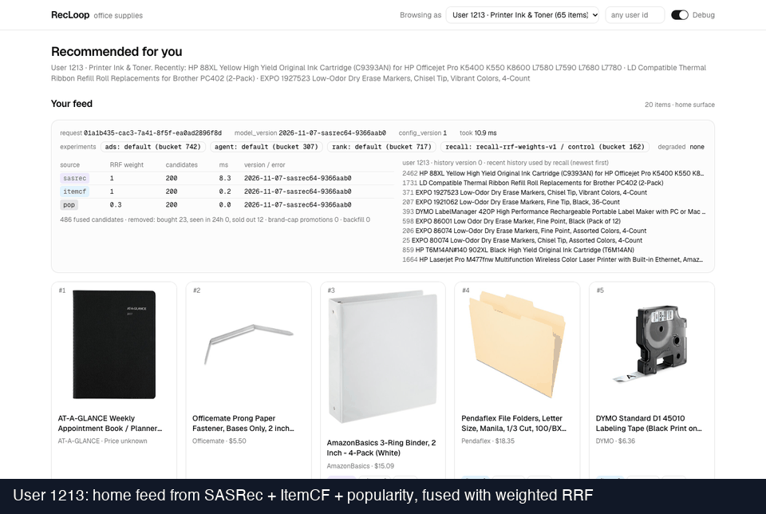
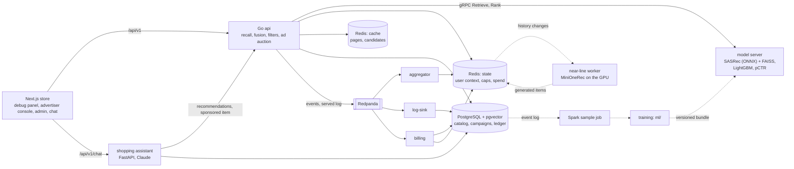

# RecLoop

[](https://github.com/heyemlee/recloop/actions/workflows/ci.yml)

RecLoop is a small office-supplies store with personalized recommendations, sponsored
products in the feed and a shopping assistant. The online layer is written in Go, models and
offline work in Python, and it runs on PostgreSQL + pgvector, Redis and Redpanda. User
behavior, advertisers and budgets are all simulated.



The store with the debug panel on: every request shows its recall sources, fusion scores,
model version and experiment groups. Two dataset users get different feeds; after a click on a
binder, the next feed includes items recalled via that binder (outlined in the GIF).

Key numbers (one laptop, simulated traffic; each links to its report):

- **600 requests/s** within the SLO (P99 ≤ 100 ms, at most 1 % degraded) with the ranker on the
  request path; P99 6.0 ms at that rate ([latency](docs/results/latency.md)).
- **487 of 487** sponsored-click charges equal the simulator's truth after a 30-minute chaos
  drill with 8 × `kill -9` of billing and 3 broker restarts ([billing](docs/results/billing.md)).
- **NDCG@10 0.137** for the LightGBM ranker, against 0.119 for the fusion it reorders and 0.122
  for SASRec alone, on the published test split ([offline](docs/results/offline.md)).
- **1 of 67,482** requests failed during three rolling updates of the model server on
  Kubernetes ([deploy](docs/results/deploy.md)).



The design, its decisions and the experiments: [docs/architecture.md](docs/architecture.md),
[ADRs](docs/adr/) and [results](docs/results/).

**Status: work in progress.** Milestones M0 to M7 are done:

- a reproducible data pipeline, the catalog in PostgreSQL, and offline evaluation of Pop,
  ItemCF and SASRec with bootstrap intervals and a comparison with the published SASRec
  numbers ([results](docs/results/offline.md), [ADRs](docs/adr/));
- the online loop: a Python gRPC model server (SASRec user encoder in ONNX Runtime + FAISS,
  loaded from a versioned bundle), a Go API (concurrent multi-source recall, weighted RRF,
  filters, brand diversity, paging, layered experiment assignment, served-event logging,
  idempotent event ingestion into PostgreSQL and Redis) and a Next.js store with a debug panel.
  A click changes the next page's recommendations.
- latency and events: every recommendation request has a 100 ms budget that each stage draws
  from (the gRPC deadline travels to the model server), a degradation chain that answers with
  what is left instead of failing, a circuit breaker in front of the model server and a
  candidate cache keyed by the user's history version. Events go through a Redpanda log to an
  aggregator (Redis state) and a Redpanda Connect sink (PostgreSQL), each idempotent; a drill
  with duplicate deliveries, `kill -9` of the consumers and a broker restart ends with every
  event applied exactly once. A traffic simulator drives the load tests and an SRM check of the
  experiment split. Prometheus, Grafana and OpenTelemetry traces (Jaeger) show it per stage.
  On a laptop (8-vCPU Docker VM, api and model server limited to 2 CPUs each), with M4's
  ranker called on every candidate-cache miss, every run met the SLO (P99 ≤ 100 ms, at most
  1 % degraded) up to 600 requests/s. From 1,000/s on, a run that starts with an empty cache
  never fills it: the misses' calls queue at the model server past their deadlines, its
  breakers keep reopening, and a degraded list is not cached. With the cache filled first,
  1,000/s met the SLO in 2 of 3 runs. With the model server disconnected the API still answers
  every request (degraded), where the naive version fails all of them
  ([results](docs/results/latency.md),
  [ADR-0003](docs/adr/0003-when-to-add-a-message-queue.md)).
- sponsored products and billing: slots 3 and 9 of the home feed go to a second-price (GSP)
  auction over the eligible campaigns (flight hours, budget left above a safety margin,
  frequency caps counted from impressions), and every slot carries a signed `ad_token` with
  its price. A billing consumer charges each clicked impression once, in one PostgreSQL
  transaction and never above the day's budget, and reconciles the spend counters in Redis
  with the ledger every minute. After a 30-minute drill with duplicate and forged clicks,
  8 × `kill -9` of billing, Redpanda restarts and a slowed-down PostgreSQL, the ledger equals
  the simulator's truth charge by charge. With a safety margin of 5 clicks no click went
  unbilled in the over-delivery study, at the cost of about 10 % of the top campaign's budget
  left unspent ([results](docs/results/billing.md)). Redis keeps user state, dedup markers and
  the ad counters in an instance that never evicts: when it is full it refuses writes, Grafana
  raises an alert and the feed shows no ads; result pages and cached candidates live in a
  second instance that evicts the least recently used.
- ranking and releases: a LightGBM LambdaRank ranker over the online candidates, trained on
  the validation split with features the dataset period has (click rates from the logs would
  leak the simulator's test targets), beats RRF offline: NDCG@10 +0.0186 [+0.0144, +0.0233],
  all of it on targets reviewed the same day as the last history item. Sponsored slots get a
  pCTR from a logistic regression on samples that Spark joins from the event log. The item's
  click rate over the last hour and day, counted once per event from the stream and logged
  with each impression (equal to Spark's recount for all 276,510 impressions of a check run),
  adds AUC +0.005 [+0.001, +0.010] on simulated traffic ([pCTR](docs/results/pctr.md)). A model
  bundle goes live through validation, a 5 % canary with guardrails and a full rollout, and a
  rollback switches a pointer back; under simulated traffic every switch took effect within
  0.07 s. The A/A test passes, and the ranker's CTR change on simulated traffic, +0.0001
  [−0.0005, +0.0006], is not significant: the simulator clicks by text relevance and has no
  same-day effect ([release](docs/results/release.md), [A/B](docs/results/ab.md)).
- a local Kubernetes deployment: one kind node, the infrastructure from official charts
  (CloudNativePG, Redpanda, KEDA, metrics-server, kube-prometheus-stack) and Helm charts for
  RecLoop's services, with images built locally and loaded into the node. Under 150 page
  views/s, three rolling updates of the model server kept at least 2 pods ready and failed 1 of
  67,482 requests; a bundle that fails its golden queries never becomes ready and its rollout
  is undone. The api's autoscaler had a new pod ready 46 s after a step from 100 to 500 page
  views/s, KEDA scaled billing on its consumer lag, and a 30-minute billing drill with
  billing's pod deleted 8 times and Redpanda's 3 times left the ledger equal to the truth
  charge by charge ([results](docs/results/deploy.md)).

Ahead of M4, an ANN benchmark compares exact search with IVF, HNSW and IVF-PQ on synthetic
catalogs of up to 1M items, and studies incremental index updates against full rebuilds. Exact
search is enough until it needs about 1 ms of CPU per query (about 250K items); at 1M items
IVF-Flat reaches recall@100 0.995 at a P99 of 152 µs ([results](docs/results/ann.md)).

M6, the shopping assistant, is done. On the store's chat page
a shopper asks in plain English ("Ink cartridges for my Canon PIXMA MG3620 under $25"); the
language model only turns the request into constraints and writes one sentence per item. Code
checks every constraint (price, stock, category, brand, genuine parts, the last purchase) on
the catalog rows and confirms printer models from quoted text, the reply is personalized
through the recommendation API, and it carries at most one sponsored item from the same
auction, labelled by the rendering code. On 150 generated requests, a rule-based parser in
front of the same pipeline meets the hard constraints for 88.8 % of the items it shows and the
gold constraints reach 100 %, so the misses are parsing errors; a reply takes 15 ms (P50)
without a model. With Claude parsing instead (Opus 5.5 by default, Sonnet 5.5 and Haiku 5.5 to
compare, 3 runs each), every item shown meets the gold constraints and every reply succeeds
(the rules parser: 64.7 %); a Sonnet judge grades their items 1.64 to 1.67 out of 2, the rules
parser's 1.34 (a person's check of the judge is still to come). A reply then takes 4.4 s with
Opus and 2.2 s with Haiku (P50), at $0.010 and $0.0003 ([results](docs/results/agent.md)).

M7: MiniOneRec, a generative recommender (Qwen2.5-1.5B fine-tuned to emit an item's semantic
ID, decoded with beam search constrained to the catalog), was re-run with its published Office
checkpoint on this Mac's GPU. Its result reproduces: its own calc.py gives HR@10 0.1570 and
NDCG@10 0.1237 against the paper's 0.1634 and 0.1242, both inside our 95 % intervals, and every
generated ID is in the catalog. On the same samples it ties SASRec (HR@10 −0.0051 [−0.0134,
+0.0027]) with no significant edge in any user segment, while a 50-beam request takes 3.1 s on
the GPU against 0.15 ms for SASRec on one CPU thread ([results](docs/results/minionerec.md)).
Encoding the prompt once for all 50 beams brings that to 0.64 s, with the same top 10 for 4,864
of the 4,866 samples. It runs near-line: a history change queues the user, a worker generates
once the history has been quiet for 30 s and writes the top 50 items to Redis, and the home feed
fuses them as a fourth recall source. Offline that source adds NDCG@10 +0.0174 [+0.0140,
+0.0209] to the fused list. In a 60-minute simulated A/B a result was written 31 s (P50) after a
change, the feed's P99 was 15.0 ms against 14.7 ms, and home-feed CTR rose from 0.0091 to 0.0100
(p = 0.007); the simulator clicks by relevance to the offline split's targets, so this checks
the path, not real users ([near-line](docs/results/nearline.md)).

## Run

Needs Docker, Go, Node and [uv](https://docs.astral.sh/uv/). Built and measured on one Mac
(Apple M4 Pro, 12 CPUs, 24 GB); CI runs the lint and the tests on Linux (Ubuntu 24.04), the Go
integration tests against PostgreSQL + pgvector and Redis. MiniOneRec's generation needs Apple
Silicon (MPS).

```
make setup        # the stack (PostgreSQL, Redis, Redpanda, consumers, monitoring), data, catalog,
                  # SASRec training, eval, bundle, Redis seed
make serve-model  # gRPC model server   :18081
make serve-api    # Go API              :18080
make serve-web    # web store           http://localhost:13000
make serve-agent  # shopping assistant  :18083 (the store's /chat page)
make test         # Python and Go tests; make e2e runs the browser check
make drill        # duplicates + consumer crashes under simulated traffic, then a consistency check
make load         # latency experiments on CPU-limited containers -> docs/results/latency.md
make billing      # ad over-delivery study + billing chaos drill -> docs/results/billing.md
make release-drill  # canary, full rollout and rollback under traffic -> docs/results/release.md
make ab           # A/A + A/B of the ranker on simulated traffic -> docs/results/ab.md
make kind-up      # a one-node kind cluster with the services (Helm charts; compose stopped)
make deploy-runs  # rolling updates, HPA and KEDA on the cluster -> docs/results/deploy.md
```

Grafana (dashboard "RecLoop") is at http://localhost:13001, Jaeger at http://localhost:16686,
Prometheus at http://localhost:19090.

## Data

[Amazon Review Data (2018)](https://cseweb.ucsd.edu/~jmcauley/datasets/amazon_v2/), Office
Products, with the preprocessing and splits of
[MiniOneRec](https://github.com/AkaliKong/MiniOneRec). The data is for research use and is
not redistributed here; `make data` downloads it and checks every file.

> Jianmo Ni, Jiacheng Li and Julian McAuley. Justifying Recommendations using
> Distantly-Labeled Reviews and Fine-Grained Aspects. EMNLP 2019.

## License

The code is under the [MIT License](LICENSE). Code adapted from other projects keeps its
original license notice: the SASRec model is adapted from
[pmixer/SASRec.pytorch](https://github.com/pmixer/SASRec.pytorch) (Apache-2.0, see
[licenses/](licenses/)). MiniOneRec's code (Apache-2.0, see [licenses/](licenses/)) runs from
an unmodified clone with [a patch for Apple Silicon](minionerec/evaluate.py.patch), and
[minionerec/engine.py](minionerec/engine.py) copies its evaluation's prefix tree and generation
call (changed to encode each prompt once, as its header says); its checkpoint (Apache-2.0, base model Qwen2.5-1.5B-Instruct, Apache-2.0) is downloaded by
`make data-weights` and not redistributed. The text embeddings use
[BAAI/bge-small-en-v1.5](https://huggingface.co/BAAI/bge-small-en-v1.5) (MIT). The dataset is
not part of this repository and has its own terms.
