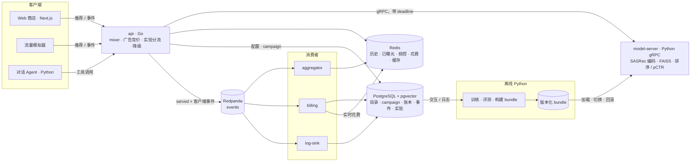

# RecLoop 设计文档

> 推荐 + 赞助商品 + 对话导购 · 2026-11-06 起草
> 先读 §0 和 §16（里程碑），其余按需查。正文是开工前写的设计；实现中的改动和实测结果记在 §19，两处不一致时以 §19 和代码为准。

## 0. 一页总结

**做什么**：一个小型电商站。首页和商品详情页有个性化推荐，信息流里混排赞助商品（Sponsored），另有对话导购。所有功能都挂在同一条数据链路上：

```
浏览 → 记日志 → 更新用户特征 → 召回 → 排序 / 过滤 → 混排广告 → 展示 → 反馈（回到日志）
```

**关键决定**

| 决定 | 选择 | 理由 |
|---|---|---|
| 数据 | Amazon Review Data (2018) · Office Products，沿用 MiniOneRec 的预处理和切分（约 3.5K 商品） | v3 可以直接用 MiniOneRec 公开的 checkpoint；所有方法在同一测试集上比较；能用论文里的数字校验评测代码 |
| 在线层 | Go：api、aggregator、billing（log-sink 用 Redpanda Connect，只写配置） | 热路径是带超时的并发扇出，Go 的 `context` deadline 正好对应深挖 A（§19、ADR-0001） |
| 模型与离线 | Python：PyTorch、FAISS、LightGBM；model-server 走 gRPC | 模型生态在 Python；gRPC 会把 deadline 跨服务传过去 |
| 存储与消息 | PostgreSQL（+ pgvector）、Redis、Redpanda（Kafka API） | 业务数据和账本在 PostgreSQL；派生状态在 Redis；事件日志可以重放 |
| 两个深挖 | A：推荐接口的延迟预算与降级（§5）<br>B：广告计费正确性（§9.3–9.4） | A 是通用的后端能力，能产出实测数字；B 是广告系统里最核心的正确性问题 |
| 运行环境 | 一台 M4 Pro MacBook（12 核 / 24GB），不需要独立 GPU；开发用 docker compose，部署演示用本地 Kubernetes（kind，§23）；容器限 CPU / 内存 | 数字可复现比规模大更重要；MiniOneRec 只做推理，用 Mac 的 GPU（MPS）就能跑（§11） |

**版本**

- **v1**：一个完整闭环 + 两个深挖 + 一组可信实验（离线对比表、延迟曲线、计费不变量、A/B 报告），最后部署到本地 Kubernetes
- **v2**：对话导购 Agent。只依赖 v1 的公开接口，需要时可以提前
- **v3**：MiniOneRec 作为一路生成式召回，回答"对哪类用户有用、代价多少"

每个里程碑结束都是能演示、有结果的状态。

## 1. 目标与非目标

**目标**——每一条都有可验证的结果：

1. **推荐链路**：多路召回 → 融合排序 → 过滤 → 重排与混排。每一步可替换、可单独评测。
2. **在线服务**：有延迟预算、超时降级、熔断和缓存；模型和索引能安全发布、能回滚。
3. **事件与计费正确**：重复投递、乱序、消费者崩溃时，计数和扣费依然正确。
4. **实验可信**：稳定分流；每次曝光和点击都能追溯到实验分组和模型版本；有 A/A 校验。
5. **模型接入**：能把新模型（SASRec、LightGBM、MiniOneRec）接进线上，并量化效果、延迟和成本。

**非目标**

- 不追求 SOTA 效果，追求公平的对比和讲得清的取舍。
- 没有真实广告主和真实流量：用户行为、预算、出价都是模拟的，README 里写明。
- 不上云，不做多机部署；扩展方案只在 §17 讨论。
- 不做完整电商：登录、支付、库存只做最小的桩。

## 2. 数据

### 2.1 数据集

- **来源**：Amazon Review Data (2018) 的 Office Products 类目（评论 + 商品元数据）。MiniOneRec 的 Hugging Face 仓库里也有处理好的版本。
- **预处理**：用 MiniOneRec 仓库的 `data/amazon18_data_process.py` 和它的参数（5-core，用户历史截断到 10 个），按时间切分 train / valid / test（论文为 8:1:1）。
- **规模**（论文表格，以实际跑出来的为准）：约 3,459 个商品；训练 / 验证 / 测试样本约 3.9 万 / 4.9 千 / 4.9 千。
- **元数据**：title、brand、category、price（字符串，部分缺失）、description、feature、imageURL。价格解析成美分，解析不了就记为未知（NULL）。
- **M0 必做的校验**：自己重跑一遍预处理，拿到带 user_id 和时间戳的交互；确认商品集合和 checkpoint 的语义 ID（SID）映射逐个 ASIN 对得上。

**为什么不用更大的数据**

- MiniOneRec 只公开了 Industrial 和 Office 两个 checkpoint（基于 Qwen2.5-1.5B-Instruct），它的 SID 只覆盖这批商品。换数据就得自己训练，README 写的是 4–8 张 A100/H100。没有 GPU，就只能用现成的 checkpoint。
- 同一个测试集上，论文报告的 SASRec 数字可以用来校验我们自己的评测代码（§11）。
- 规模方面的结论来自压测（QPS、P99、事件量），不来自商品数。向量检索的规模问题用单独的 ANN 基准讨论（§4.6）。

### 2.2 模拟世界

| 对象 | 怎么来 |
|---|---|
| 用户 | 数据集里的用户，训练期的行为当作"已经发生"；Web 上可以"以某个用户身份浏览"，也可以新建冷启动用户 |
| 库存 | 每个商品随机库存，会售罄，过滤阶段要处理 |
| 广告主 | 按 brand 生成，每个 1–3 个 campaign；日预算和 CPC 出价按分布采样，固定随机种子。名字用匿名编号（如 Advertiser 017），不显示成真实品牌在投广告；预算和扣费只是数据库里的数字，不涉及真钱 |
| 流量 | `sim/` 模拟器回放测试期的用户 |

**模拟器**：每个会话循环"请求推荐 → 前 N 个位置产生曝光 → 按点击模型点击 → 部分点击变成加购或购买 → 上报事件 → 下一次请求"。

- **点击模型**：`P(click) = 位置偏置(pos) × 相关度(u, i)`。商品正好是该用户真实的下一个商品时，相关度高；否则按它和真实商品的**文本向量**相似度给一个小值。点击模型不用任何被比较模型的打分，以免模拟器偏向某个模型。
- **故障开关**：重复投递比例、乱序、延迟到达、连点、整批重发。
- **结论边界**：模拟器用来验证系统和实验管线；模型效果以离线指标为主要证据。

## 3. 总体架构



| 组件 | 语言 | 职责 | 热路径 |
|---|---|---|---|
| api | Go | `/recommendations`、`/events`、广告竞价、实验分流、降级、广告主和管理接口 | 是 |
| model-server | Python（gRPC） | 用户序列编码、FAISS 检索、排序和 pCTR、bundle 版本管理。**无状态**：输入历史，输出候选 | 是 |
| aggregator | Go | 消费事件 → 用户历史、已曝光、频控、商品计数、热门表 | 否（秒级） |
| billing | Go | 消费赞助点击 → 幂等扣费、预算封顶、实时花费 | 否（秒级） |
| log-sink | Redpanda Connect（只写配置） | 原始事件批量写入 PostgreSQL | 否 |
| agent | Python（FastAPI） | 对话导购，通过公开接口调用推荐和检索 | 对话路径 |
| ml | Python | 预处理、训练、评测、构建版本化 bundle | 离线 |
| 生成 worker（v3） | Python，本机原生进程 | 用 MPS 跑 MiniOneRec，批量生成近线候选写进 Redis | 否（近线） |
| web | Next.js | 商店、广告主后台、内部页（实验、模型版本） | — |
| 基础设施 | — | PostgreSQL、Redis、Redpanda、Redpanda Connect、Prometheus、Grafana、Jaeger、Toxiproxy | — |

哪些用现成的开源项目、哪些自己写，见 §21。

**ADR-0001：在线层用 Go**

- 热路径是 I/O 扇出：并发调多路召回，各自超时，接受部分结果。Go 的 `context` deadline 加 `errgroup` 写这个最直接。
- 模型留在 Python，两边走 gRPC。Go 客户端设置的 deadline 会随请求传到 Python 服务端，服务端用 `context.time_remaining()` 判断还值不值得继续算。
- 退路：M1 第一周写完 mixer 骨架（扇出 + 超时 + 合并）。如果不顺，在线层换成 FastAPI + asyncio，接口和设计都不变。

**运行环境：一台 M4 Pro MacBook（12 核 / 24GB），没有独立 GPU**

| 部分 | 跑在哪里 | 说明 |
|---|---|---|
| v1、v2 的全部服务（开发） | Docker Desktop 上的 docker compose | SASRec、FAISS、LightGBM 都很小，CPU 就够 |
| 部署演示（M5） | Docker Desktop 上的 kind 集群 | 同一套镜像，用 Helm 部署（§23） |
| Spark 样本拼接（M4） | PySpark 本地模式 | 需要装一个 JDK |
| MiniOneRec 推理（v3） | 本机原生 Python，用 MPS | Docker 容器用不了 Mac 的 GPU，所以这部分不进容器 |
| 可选的 SFT 训练 | 租一张 CUDA GPU，按小时付费 | 训练代码依赖 deepspeed 等只支持 CUDA 的包 |

- Docker Desktop 给虚拟机分 8 个 vCPU、8GB 内存，整套 compose 服务用不满；跑 kind 集群时调到 10–12GB。compose 和 kind 不要同时开。
- 24GB 内存够用，但不要同时跑整套服务和 MiniOneRec 评测：评测前先 `docker compose stop`，batch 也调小。
- 用 uv 装 Python 3.12，ml、model_server、agent 各用一个环境。

**前置条件**

- 软件：Docker Desktop、Go、Node、uv + Python 3.12、k6、kind / kubectl / Helm；Spark 作业在容器里跑。
- 开源组件：PostgreSQL + pgvector、Redis、Redpanda、Prometheus、Grafana、Jaeger、Toxiproxy、PyTorch、FAISS、LightGBM、transformers。
- 数据：Amazon Review Data (2018) Office Products，在 UCSD 网站直接下载，只限研究用途，要引用论文；MiniOneRec checkpoint 在 Hugging Face，Apache-2.0。
- 广告不用真的去投：广告主、预算、出价、扣费全是系统里的模拟数据。
- Claude API key 只有 M6 的付费评测需要（§10.4）。
- 原始数据和 checkpoint 不提交到 GitHub，只提交下载脚本：数据只限研究用途，文件也大。

## 4. 推荐链路

### 4.1 一次请求

`GET /v1/recommendations?user_id=42&surface=home&limit=20`

```
服务端总 deadline 100ms
① 读上下文     Redis pipeline：最近历史、hv、已购、已曝光、实验分组              预算 5ms
② 召回（并行） pop      进程内热门表
               itemcf   用最近 10 个商品查进程内邻居表
               sasrec   model-server.Retrieve：编码历史 → FAISS top-200，          预算 35ms
                        顺带给"可投广告商品"打相关度分
               [v3] gen 读 Redis 里 MiniOneRec 的近线结果
③ 合并去重     约 300–400 个候选
④ 过滤         已购、24h 内曝光过、售罄、类目屏蔽
⑤ 排序         v1：进程内加权 RRF                                                 预算 25ms
               M3 起：model-server.Rank 给广告估 pCTR
               M4 起：同一次调用也给自然候选做 LightGBM 排序
⑥ 重排与广告   前 10 个里同一品牌最多 2 个；进程内竞价；第 3、9 位是赞助位
⑦ 返回         served 事件异步发到 Redpanda，不阻塞响应
```

详情页（`surface=item`）以当前商品为种子：ItemCF 邻居 + 文本相似商品，后面的流程相同。

### 4.2 召回

| 路 | 做法 | 作用 |
|---|---|---|
| Pop | 时间衰减热度（全局 + 类目），aggregator 每 5 分钟更新 | 基线、兜底、冷启动 |
| ItemCF | 离线算商品共现相似度，对热门商品和活跃用户降权；每个商品存 top-50 邻居。在线把最近 10 次交互的邻居按时间衰减加权汇总 | 稳定、可解释、进程内毫秒级 |
| SASRec | 2 层 Transformer、64 维起步，输入最近 10 个商品得到用户向量；物品向量建 FAISS `IndexFlatIP`。3.5K 个商品可以直接用全量 softmax 训练，Mac 上就能训 | 主力个性化。用户向量每次请求实时算，刚点过的商品下一次请求就生效 |
| 文本向量 | 开源句向量模型（384 维）编码 title + feature，存 pgvector | 给搜索和 Agent 用；也能召回冷启动商品 |

热路径用 FAISS：在 model-server 进程内、没有网络往返、跟着 bundle 版本一起发布。搜索用 pgvector：要和价格、库存等 SQL 条件一起查，延迟要求也宽松一些。

### 4.3 排序

- **v1：加权 RRF**，`score = Σ w_s / (60 + rank_s)`。不用训练，作为排序基线。
- **M4：LightGBM LambdaRank**
  - 特征：各路召回的分数和名次、命中了几路、商品热度、价格分桶、和用户历史的类目重合度。近 1h / 24h 点击率（来自日志）不进排序器：数据集时期没有曝光日志，模拟日志里的点击率又等于测试标签（模拟器按测试期目标出点击）；它改作 pCTR 的特征（§9.2 第 3 步）（§19，2026-11-08）。
  - 训练数据用**验证期**构造：候选 = 召回结果，正例 = 真实的下一个商品。召回模型用训练期训练，排序模型用验证期，免得排序器学到召回模型在自己训练数据上偏高的分数。
  - pCTR 的训练样本和来自日志的特征（商品近 1h / 24h 点击率），由 Spark 作业从事件日志拼出来（§7.5）。
  - 作为新 bundle 版本走灰度发布（§6），用 A/B 和 RRF 比较。

### 4.4 过滤与重排

- 已购：Redis `u:{uid}:bought`，订单表兜底。
- 已曝光：Redis ZSET 记 24h 内曝光过的商品（score = 时间）。量大时可以换 Bloom filter，讨论即可。
- 售罄、下架、类目屏蔽。
- 多样性：前 10 个里同一品牌最多 2 个。
- 过滤后不够 `limit`：用 Pop 补齐，并打点 `backfill_count`。

### 4.5 缓存

原则：**缓存贵且变得慢的部分；便宜且变得快的部分每次重算。**

| 缓存 | 位置 | Key 和失效 |
|---|---|---|
| 商品目录和特征 | api、model-server 进程内全量（3.5K 很小） | 每 60 秒增量刷新 |
| ItemCF 邻居表、热门表 | 进程内 | 随 bundle 版本整体替换 |
| **候选缓存**（召回 + 排序结果，top-300 带分数） | Redis | `cand:{uid}:{surface}:{variant}:{model_ver}:{hv}`，TTL 5 分钟 |
| 翻页 | Redis | `page:{request_id}`，TTL 10 分钟 |

- 过滤、广告、预算每次都现算：已曝光、库存、预算、频控都变得快。广告结果永远不缓存。
- key 里带 `hv`（历史版本号）：用户有了新行为，key 自然就变了，不需要主动失效。
- key 里带 `model_ver`：换模型以后，旧结果不会混进来。

### 4.6 向量索引的取舍

- 3.5K × 64 维，`IndexFlatIP` 一次查询在微秒级，结果精确，所以线上用 Flat。这个规模上用 ANN 只会损失召回。
- **ANN 基准（必做，M4）**：把向量合成扩到 10 万、100 万，比较 Flat / IVF / HNSW 的 recall@100、P99、内存和建索引时间，回答"多大规模该换 ANN、参数怎么定"。
- **索引增量更新（必做，M4）**：新商品不断加入时，比较"增量加入"和"定期全量重建"的 recall 和耗时。要点：IVF 的聚类中心是用旧数据训练的，一直增量加入会让分桶越来越不均；FAISS 的 HNSW 能增量加入，但不支持删除。所以生产上常见"增量加入 + 定期全量重建"，重建好的索引按 §6 的版本切换上线。产出 `docs/results/ann.md`。

## 5. 延迟与降级（深挖 A）

### 5.1 设计

- **deadline**：每个请求 100ms 总预算，各阶段从剩余时间里拿自己的预算。gRPC 把 deadline 带到 model-server，model-server 每一步之前检查 `time_remaining()`，不够就提前返回——不在调用方已经放弃的请求上浪费 CPU。
- **SLO**：P99 ≤ 100ms，正常负载下降级响应 ≤ 1%。有了 deadline，P99 被预算封住了，要盯的是降级率：延迟问题变成了质量问题。
- **降级链**：每一级都在响应里写 `degraded: [...]`，并打点。

| 故障 | 处理 |
|---|---|
| 排序超时 | 自然结果用 RRF；不出广告 |
| SASRec 召回超时 | ItemCF + Pop；不出广告 |
| model-server 不可用，或熔断已打开 | ItemCF + Pop（都在 api 进程内） |
| Redis 不可用 | 没有历史 → 类目热门；跳过已曝光过滤；不出广告（拿不到预算和频控） |
| 全部失败 | 进程内预先算好的热门列表，不依赖任何外部组件 |

- **原则**：广告永远不拖慢自然结果；拿不准就不出广告——宁可少赚，不能错扣。
- **熔断**：最近 10 秒里至少 20 次调用、其中超时或失败 ≥ 50%，或者连续 10 次失败 → 打开 10 秒 → 半开，放 5 个请求试探，全部成功才关上。目的是故障期间不让每个请求都等满超时。（2026-11-06 由"最近 20 次调用"改来，原因见 §19。）
- **可选**：对 model-server 做 hedged request（超过 P95 还没返回就再发一个）。

### 5.2 怎么测

- **固定硬件**：compose 里给每个容器限 CPU 和内存（例如 api 2 核、model-server 2 核）；k6 在本机跑，给它留出 2–3 个核；压测时插电，关掉低电量模式和其他大应用；报告写明 M4 Pro 12 核 / 24GB；每组跑 3 次取中位数。
- **开环压测**：k6 的 `constant-arrival-rate` 按固定速率发请求，不会因为服务变慢就少发。闭环压测在服务变慢时会自动降速，把 P99 测低（coordinated omission）。
- **可观测**：每个阶段一个 Prometheus 直方图，加 OpenTelemetry trace，P99 能拆到具体阶段。
- **故障注入**：model-server 内置一个调试开关，按概率给单个请求加延迟；Toxiproxy 负责断连和整体加延迟。Toxiproxy 按连接生效，而 gRPC 是长连接，做不了"30% 的请求变慢"。
- **实验矩阵**
  1. QPS 阶梯：找到满足 SLO 的最大 QPS。
  2. 候选缓存开 / 关：同样 QPS 下的 P50 / P95 / P99，附命中率。
  3. 故障：model-server 30% 请求 +200ms、model-server 断开、Redis 断开。比较"朴素实现（无 deadline、无降级）"和本设计的 P99、错误率、降级率。
- **产出**：`docs/results/latency.md`。

## 6. 模型与索引版本

做扎实，但不当深挖。

- **bundle**：离线产出 `artifacts/{version}/`，包括 SASRec 权重、物品向量、FAISS 索引、item_id 映射、ItemCF 邻居表、排序和 pCTR 模型、`manifest.json`（数据快照、离线指标、checksum）。
- **状态**：`model_versions` 表，built → validated → canary → active → retired。
- **加载与切换**：model-server 在后台加载新 bundle，旧版本照常服务；校验 checksum、维度、商品数，以及"黄金查询集"上的 recall 不低于阈值；然后原子切换指针。旧版本在内存里保留 30 分钟，回滚就是把指针切回去。
- **一致性**：用户编码器和物品索引必须是同一个版本，所以打在同一个 bundle 里一起切。每个响应带 `model_ver`，缓存 key 也带。这条防的是"新索引 + 旧用户向量"——不报错，只是悄悄变差。
- **灰度**：通过实验平台把 5% 流量 pin 到新版本（请求里带 `pin_version`），看 CTR、延迟、错误率，再全量或回滚。
- **内存**：切换期间新旧两份同时在内存里，启动时检查是否有 2 倍余量。
- **在 Kubernetes 上**：model-server 的 readiness probe 只在 bundle 加载并校验通过后才返回成功，滚动发布时新 pod 准备好了才接流量（§23）。

## 7. 事件管线

### 7.1 事件

| 类型 | 谁产生 | 关键字段 |
|---|---|---|
| served | 服务端，每次推荐请求一条 | request_id、user_id、surface、items[{item_id, pos, slot, source, score, features, campaign_id?, price?}]、model_ver、实验分组、degraded |
| impression | 客户端，可见时上报 | event_id、impression_id、ad_token（赞助位才有，用于频控） |
| click | 客户端 | event_id、impression_id、ad_token（赞助位才有） |
| add_to_cart / purchase | 客户端 / 订单 | event_id、item_id、order_id |

- `event_id`：客户端生成 UUIDv7（带时间戳、大致递增，对 B-tree 友好）。客户端重试必须复用同一个 `event_id`。
- `impression_id = {request_id}:{position}`：确定性生成。点击带上它，就能关联回 served 记录里的实验分组、模型版本、召回来源和广告价格，不用另外查表。
- 赞助位的 `ad_token = HMAC(request_id, position, campaign_id, item_id, price, user_id, expires_at)`。计费只信 token 里的价格，客户端改不了。
- 前端用 `IntersectionObserver` 判定曝光（≥ 50% 可见且持续 ≥ 1 秒），每 2 秒或页面隐藏时用 `navigator.sendBeacon` 批量上报。

### 7.2 链路

`POST /v1/events`（一批最多 100 条）→ api 校验 → 写入 Redpanda `events`（key = user_id，同一用户内有序）→ 返回 `202`。

| 消费者组 | 做什么 | 写到 |
|---|---|---|
| aggregator | 用户最近历史（50 个）、hv、已购、已曝光、频控计数、商品点击计数、热门表 | Redis |
| billing | 只处理带 `ad_token` 的点击（§9.3） | PostgreSQL 账本，Redis 实时花费 |
| log-sink（Redpanda Connect） | 原始事件批量入库 | PostgreSQL `events_raw` |

- **M1 先不用 Redpanda**：api 直接写 PostgreSQL，同步更新 Redis。到 M2 有了三个独立的消费者，还需要重放，再引入事件日志。这本身是一条 ADR（ADR-0003）。
- **派生状态可重建**：Redis 里的数据丢了，可以从 Redpanda（保留 7 天）重放，或者从 `events_raw` 重算。

### 7.3 去重：技术重复和业务重复是两回事

| | 例子 | 去重键 |
|---|---|---|
| 技术重复 | 客户端重试、生产者重试、消费者重平衡后重复消费 | `event_id` |
| 业务重复 | 用户连点同一个广告两次（两个不同的 `event_id`） | `impression_id`：同一次曝光最多计费一次 |

- 每个消费者把"已处理"标记和副作用放进**同一个**事务或原子操作：PostgreSQL 用 `INSERT … ON CONFLICT DO NOTHING`；Redis 用 Lua 脚本，把 `SET dedup:{group}:{event_id} NX EX 604800` 和计数更新一起执行。
- 副作用提交之后再提交消费位点：at-least-once 投递 + 幂等处理 = 效果上的 exactly-once。
- 为什么不用 Kafka 事务：它只覆盖 Kafka → Kafka，写到 PostgreSQL 时不起作用。
- **坑**：PostgreSQL 分区表上的唯一约束必须包含分区键。如果按服务端接收时间分区，跨零点的重复事件会落进两个分区，唯一约束就失效了。做法是分区键取自 `event_id` 里 UUIDv7 的时间戳——同一个事件永远落在同一个分区。`event_day` 由 api 在校验事件时算好、写进事件，入库时只做字段映射。

### 7.4 乱序和晚到

- 用户历史按事件时间插入（ZSET 的 score = 事件时间），不按到达顺序。
- 点击比曝光先到：计费只依赖 `ad_token`，不依赖曝光事件；CTR 在分析时按 `impression_id` join，和到达顺序无关。
- token 过期（30 分钟）后才到的点击不计费，只记日志。

### 7.5 训练样本拼接（Spark，M4）

把事件日志拼成带标签的训练样本，给 LightGBM 排序和 pCTR 模型用。PySpark 本地模式，按天处理：

1. 把 `events_raw` 某一天的 served、impression、click、purchase 事件导出成按天分区的 Parquet。
2. 按 `impression_id` 把曝光和点击 join 起来：曝光后 30 分钟内有点击，label = 1。
3. 特征只用 served 事件里记下的值，也就是下发那一刻的特征，不用之后才算出来的数，避免数据穿越。线上和线下用的是同一份特征，也就不会有 train-serve skew。
4. 负样本降采样，记下采样率，训练时按权重还原。
5. 输出按天分区的 Parquet，`ml/` 的训练脚本直接读。

要点：

- 标签延迟：点击可能晚到，当天的样本要等归因窗口过去再定稿。
- 去重：先按 `event_id` 去重，再按 `impression_id` 归并。
- 位置偏差：位置作为特征带进样本（§9.2）。

## 8. 实验平台

**分流**

- 分 4 层：`recall`、`rank`、`ads`、`agent`。每层有自己的 salt；同一层的实验互斥，不同层之间正交（Google 2010 年分层实验的做法）。
- `bucket = xxhash64(layer_salt + ":" + unit_id) % 1000`。不要用带随机种子的哈希（Python 的 `hash()`、Go 的 `hash/maphash`），否则不同进程会把同一个用户分到不同组。Go 和 Python 两边用同一个哈希函数，并用同一组测试向量校验。
- 分流单位：登录用户用 user_id，未登录用 device_id。
- 配置存在 PostgreSQL，api 每 10 秒拉一次（带 `config_version`）；每次的分流结果写进 served 事件。
- 实验参数可以指定 bundle 版本或排序器，所以灰度发布就是一个实验（§6）。

**归因**：`click → impression_id → served(request_id) → {实验分组, model_ver, 召回来源, 广告价格}`。一条 SQL 就能算出每个变体的曝光、点击和 CTR。served 日志从 M1 就开始记——事后补归因最麻烦。

**分析**

- 指标：CTR、人均点击、加购率、广告 RPM、P99、降级率。
- 方差：CTR 是比率指标，同一用户的多次曝光彼此相关。按用户聚合后用 delta method 或按用户 bootstrap，不能把每次曝光当独立样本。
- 护栏：SRM 检验（实际分流比例做卡方检验）；A/A 测试（两边配置完全相同；再在日志上换 salt 重新分组 100 次，p 值应接近均匀分布，假阳性率约 5%）。
- 产出：`analysis/ab_report.py` 生成 markdown 报告。

## 9. 广告与计费（深挖 B）

### 9.1 数据与计费方式

- advertisers → campaigns（日预算、CPC 出价、状态、投放时段、频控、定向类目）→ campaign_items（推广哪些商品）。
- 按点击计费（CPC）。金额一律用整数美分，天按 UTC 划分。

### 9.2 投放：在推荐请求里，进程内完成

1. **可投集合**：内存里的活跃 campaign → 推广商品（几百个）。campaign 状态每 5 秒从 PostgreSQL 刷新（可选：outbox + `campaign_updates` topic，做到秒级生效）。
2. **资格过滤**：投放时段；剩余预算 > 安全余量（§9.4）；频控 `fc:{uid}:{cid}:{day}` 没到上限；用户没买过；不和自然结果重复。
   - 频控按曝光事件计数，不按下发计数：更准，但有秒级延迟，偶尔会多出 1 次，可以接受。
3. **打分**：Retrieve 时把可投商品一起发给 model-server，拿到相关度分。M3 起由 Rank 给出 pCTR：logistic regression，特征里有位置和商品近 1h / 24h 的点击率（来自日志，按曝光时刻之前的窗口算，线上线下同一口径）；训练时带位置，预测时把位置固定成参考值（处理位置偏差的常用做法）。训练数据来自 M2 的模拟日志——这是项目里第一次走通"日志 → 训练数据 → 模型"。
4. **质量门槛**：pCTR 低于下限的不出，"出价高但不相关"的广告上不来。
5. **排序与定价**：`eCPM = bid × pCTR`。GSP 二价：第 k 名每次点击的价格 = `eCPM(k+1) / pCTR(k) + 1¢`，不超过自己的出价；没有下一名就用保留价。
6. **插槽**：首页 20 个位置里第 3、9 位是赞助位；没有合格的广告就给自然结果。赞助位明确标注 "Sponsored"。
7. 生成 `ad_token`，写进 served 事件。

### 9.3 计费

**两条不变量，必须 100% 成立**

1. 任何 campaign 的账单总额 ≤ 预算。
2. 同一次曝光最多一笔计费。

billing 处理一次赞助点击：

```text
handleSponsoredClick(evt):
  tok = verify(evt.ad_token)              # HMAC + 过期；失败 → 记 invalid，提交位点，结束
  BEGIN
    INSERT INTO campaign_budget_daily ... ON CONFLICT DO NOTHING   # 当天的预算行不存在就建
    SELECT budget_cents, spent_cents ... FOR UPDATE                # 同一 campaign 的扣费串行化
    billed = min(tok.price, budget - spent)                        # 可能是 0：超投，平台承担
    n = INSERT INTO ad_charges (impression_id, ..., billed)
          ON CONFLICT (impression_id) DO NOTHING                   # 同一次曝光最多一笔
    if n == 0: COMMIT; 记 duplicate; 结束                           # 重复：什么都不改
    UPDATE campaign_budget_daily SET spent_cents = spent_cents + billed
  COMMIT
  Redis INCRBY spend:{cid}:{day} billed   # 提交后再更新；丢了由对账补
  提交消费位点
```

| 场景 | 会发生什么 | 为什么还是对的 |
|---|---|---|
| 客户端重试，同一次点击发了两遍 | 同一个 `event_id` 出现两次 | `impression_id` 主键冲突，第二次什么都不改 |
| 用户连点两下 | 两个 `event_id`，同一个 `impression_id` | 同上（业务去重） |
| COMMIT 之后、提交位点之前崩溃 | 重启后重复消费 | 主键冲突，无操作；Redis 花费可能少记，由对账补上 |
| COMMIT 之前崩溃 | 事务回滚 | 重新消费时正常扣费 |
| 重平衡时两个实例短暂处理同一分区 | 并发重复处理 | 主键 + 预算行锁 |
| 同一 campaign 的点击被并发处理 | 并发扣费 | `FOR UPDATE` 串行化，`CHECK` 约束兜底 |
| 伪造或篡改价格 | token 校验失败 | HMAC；记 invalid，不计费 |
| token 过期后才到 | 不计费 | 30 分钟窗口规则 |

**怎么证明是对的**

- **属性测试**：随机生成点击序列（含重复、乱序、连点、过期 token），每次都断言两条不变量。
- **混沌演练**：模拟器连续跑 30 分钟，期间随机 `kill -9` billing、重启 Redpanda、让 PostgreSQL 慢 200ms；结束后把账本和模拟器记下的"真值"逐笔核对。
- **数据库兜底**：`CHECK (spent_cents <= budget_cents)`，代码有 bug 也写不进超预算的账。

### 9.4 预算：不超扣 vs. 超投

- **超投只能压低，不能消灭**：投放时预算还够，点击回来时已经花完了，这次点击只能少收或不收，差额由平台承担。原因是曝光到点击之间有延迟，在途的点击有多少事先不知道。
- **压低的办法**：投放端读 Redis 实时花费，剩余预算 < `安全余量 × 出价` 就停投；可选 pacing，按"当天已过时间比例 × 日预算"控制投放概率，避免上午就把预算花光。
- **度量**：`超投率 = 没能计费的点击价值 / 预算`。比较安全余量 0 / 5 / 20 次点击（以及加上 pacing）时的超投率和预算花完的时间。
- **对账**：每分钟用 `ad_charges` 重算每个 campaign 的花费，和 `campaign_budget_daily`、Redis 比较；有差异就打点，并以账本为准修正 Redis。
- **产出**：`docs/results/billing.md`。

### 9.5 广告主后台

- Campaign 的增删改查。改预算或出价用乐观锁（`version` + `If-Match`），两个人同时改不会互相覆盖。当天调预算时，在同一个事务里更新当天的预算行；调到比已花费还低，就按已花费封顶。
- 报表：曝光、点击、花费、CTR、平均 CPC。
- 量一下"暂停 campaign 到不再出广告"要多久：v1 的刷新周期是 5 秒；做了 outbox 之后应该在 1 秒以内。

## 10. 对话导购 Agent（v2）

### 10.1 例子

目录是办公用品，所以例子从跑鞋换成墨盒（具体按真实目录调整）：

> "帮我找 40 美元以内、HP OfficeJet Pro 8710 能用的墨盒，上次买的副厂墨盒漏墨。"

解析成：

```json
{
  "category": "ink",
  "budget_max_cents": 4000,
  "compatible_with": "HP OfficeJet Pro 8710",
  "avoid": ["remanufactured", "third-party"],
  "reference_purchase": "latest_ink_in_history"
}
```

### 10.2 工具

| 工具 | 背后 | 说明 |
|---|---|---|
| `search_items(query, filters)` | 全文检索 + pgvector，RRF 融合；SQL 过滤价格和库存 | 召回满足条件的商品 |
| `get_recommendations(user_id, seed_items, limit)` | `/v1/recommendations?surface=chat`（不带广告） | 个性化信号 |
| `get_item_details(ids)` | items 表 | 价格、属性、描述 |
| `get_purchase_history(user_id)` | 订单 | 处理"我上次买的那个" |

赞助商品不是 LLM 的工具：渲染前由 Agent 服务的代码调用内部接口 `/internal/ads/select`，带上已经校验过的硬约束（见 §10.3 第 5 条）。

### 10.3 关键设计：硬约束由代码校验，模型负责理解和解释

1. LLM 只做两件事：把用户的话解析成 JSON（Pydantic 校验，失败重试一次）；根据工具返回的数据写推荐理由。
2. 硬约束（价格、库存、类目）由代码检查。**价格未知 = 不满足**，不能当作满足。
3. 半结构化约束（型号兼容）：代码先在 title 和 description 里匹配，LLM 再判断，并且必须给出证据（字段 + 原文片段）；没有证据就标"未确认"。
4. 最终回复由结构化结果渲染：价格和标题来自数据库，不来自模型生成的文字。
5. 赞助商品由广告模块竞价决定，不由 LLM 挑选；必须满足同样的硬约束；最多 1 个；"Sponsored" 标签由渲染代码加，模型去不掉。
6. 普通推荐请求不经过 Agent，只有 `/v1/chat` 走 Agent，所以两条路径的延迟和成本可以分开测。

### 10.4 评测

- **评测集**约 150 条：用模板加目录属性生成（预算、品牌、兼容型号、对上次购买的不满），人工抽查修正；每条带标准约束。

| 指标 | 怎么算 |
|---|---|
| 硬约束满足率 | 展示出来的商品必须 100% 满足 |
| 解析准确率 | 预算、型号等字段有没有抽对 |
| 工具调用正确率 | 该调的调了、参数对、没有多余的调用 |
| 相关性 | LLM-as-judge 打分，抽 50 条人工复核，报告一致率 |
| 延迟与成本 | P50 / P95、LLM 调用次数、每次对话的 token 成本 |

- **对照组**：不用 LLM 的"关键词搜索 + 过滤"，用来说明 LLM 在哪类请求上真正有用。
- **模型对比**：默认用 Claude Opus 5.5，再拿 Sonnet 5.5 和 Haiku 5.5 对比效果、延迟和成本。
- **费用**：需要一个 Claude API key。按 2026 年 10 月的价格粗算，每次对话约 2 万输入 token、1 千输出 token：Opus 5.5 约 $0.10 一次，Sonnet 5.5 约 $0.05，Haiku 5.5 不到 $0.01。150 条 × 3 个模型 × 跑 3 遍，再加上用 Sonnet 5.5 做的评分，一轮完整评测估约 $80；开了 prompt caching 会更低（实际运行的上限见 §19，2026-11-08）。
- **产出**：`docs/results/agent.md`。

## 11. MiniOneRec（v3）

**要回答的问题**：生成式召回能改善哪类用户的推荐？代价（延迟、GPU、钱）是多少？值不值得进线上、以什么形式进？

**步骤**

1. **复现**：下载 Office checkpoint（`Office_ckpt/`，bf16，约 3.6GB）、SID 和预处理数据，在 Mac 上用 MPS 跑评测。论文报告 Office 上 HR@10 约 0.163。复现不出来就先停下排查，不往下走。仓库的评测是按多卡 CUDA 机器写的，要改几处：
   - `requirements.txt` 钉了 CUDA 版的包（`+cu118`、`nvidia-*`、deepspeed），Mac 上装不了。只装评测要用的 torch、transformers 等，自己建一个精简环境。
   - `evaluate.py` 选设备的逻辑是"有 CUDA 用 cuda，否则用 cpu"，要加上 mps 分支。模型按 bf16 加载；MPS 上个别算子不支持的话，退回 fp16 或 fp32。
   - 文件开头无条件 `import bitsandbytes`：确认评测没用到，就删掉。
   - `evaluate.sh` 把测试集切成 8 份、每张卡一个进程：改成单进程跑。
   - 默认 beam = 50、batch = 8，在 Mac 上会很慢。先拿 200 个用户试跑估时间，全量可能要跑一晚上。
2. **公平对比**：同一测试集、同一份指标代码，跑 Pop / ItemCF / SASRec / RRF / LightGBM / MiniOneRec。论文里 SASRec 的 HR@10 约 0.112，我们的 SASRec 应该接近——这一步顺带校验评测代码。
3. **分群分析**（重点）：按历史长度（1–3 vs 4–10）、目标商品热度（头部 vs 长尾）、是否跨类目分群，每群报 HR@10 和 bootstrap 置信区间。假设：SID 来自文本语义，可能在长尾商品和短历史用户上更有优势。结论可以是否定的，只要方法公平。
4. **成本**：在 M4 Pro（MPS）上测 beam 宽度 10 / 20 / 50 时每个用户的生成延迟、内存占用和吞吐，和 SASRec（CPU、毫秒级）比较。可选：租一张 CUDA GPU 一两个小时测同样的数字做对照，并换算成每 1000 个用户的成本。
5. **接入方式**：逐请求在线生成大概率太慢（以第 4 步的实测为准）。默认做成**近线**：用户历史变化后（去抖 30 秒）进队列，生成 worker（本机原生进程，用 MPS）批量生成 top-50 写进 Redis `gen:{uid}:{ver}`；mixer 把它当作第四路召回，没有就跳过。代价是新鲜度：报告"历史变化 → 结果可用"的延迟分布。
6. **模拟 A/B**：对照组 = 三路召回，实验组 = 三路 + gen；看模拟 CTR、覆盖率和延迟。
7. **可选（要租 GPU；2026-11-08 定为不做，见 §19）**：用 0.5B 骨干自己跑一遍 SID 构建 + SFT（不做 RL），看效果和成本的曲线。训练代码依赖 deepspeed，在 Mac 上跑不现实。

**风险**

- checkpoint 只认识这 3,459 个商品，新商品没有 SID，冷启动仍然靠文本向量和热门。
- Mac 上的速度是最大的未知数。试跑太慢，就减小 beam、只评测抽样用户（报告里写明），或者租 GPU 跑一次全量。
- 只在需要训练、或者想要 GPU 对照数字时才租卡，并设一个花费上限。

**产出**：`docs/results/minionerec.md`。

## 12. 数据模型

### 12.1 PostgreSQL

```sql
-- 商品目录
CREATE TABLE items (
  item_id     INT PRIMARY KEY,              -- 与 MiniOneRec 的商品编号一致
  asin        TEXT UNIQUE NOT NULL,
  title       TEXT NOT NULL,
  brand       TEXT,
  categories  TEXT[],
  price_cents INT,                          -- NULL = 价格未知
  description TEXT,
  features    TEXT[],
  image_url   TEXT,
  stock       INT NOT NULL DEFAULT 100,
  text_emb    vector(384)                   -- 搜索 / Agent 用
);

CREATE TABLE users (
  user_id     BIGINT PRIMARY KEY,
  external_id TEXT UNIQUE,                  -- 数据集里的 reviewerID
  created_at  TIMESTAMPTZ NOT NULL DEFAULT now()
);

CREATE TABLE orders (
  order_id   BIGSERIAL PRIMARY KEY,
  user_id    BIGINT NOT NULL,
  item_id    INT NOT NULL,
  event_id   UUID UNIQUE NOT NULL,          -- 购买也要幂等
  created_at TIMESTAMPTZ NOT NULL DEFAULT now()
);

-- 原始事件：按天分区，分区键取自 UUIDv7 里的时间（§7.3）
CREATE TABLE events_raw (
  event_id      UUID NOT NULL,
  event_day     DATE NOT NULL,
  type          TEXT NOT NULL,              -- served | impression | click | add_to_cart | purchase
  user_id       BIGINT NOT NULL,
  request_id    UUID,
  impression_id TEXT,
  item_id       INT,
  payload       JSONB,                      -- served：整页结果、实验分组、model_ver、degraded
  client_ts     TIMESTAMPTZ,
  server_ts     TIMESTAMPTZ NOT NULL DEFAULT now(),
  PRIMARY KEY (event_id, event_day)
) PARTITION BY RANGE (event_day);

-- 广告
CREATE TABLE advertisers (
  advertiser_id INT PRIMARY KEY,
  name          TEXT NOT NULL,
  brand         TEXT
);

CREATE TABLE campaigns (
  campaign_id        BIGINT PRIMARY KEY,
  advertiser_id      INT NOT NULL REFERENCES advertisers,
  status             TEXT NOT NULL CHECK (status IN ('active', 'paused', 'ended')),
  daily_budget_cents INT NOT NULL CHECK (daily_budget_cents > 0),
  bid_cpc_cents      INT NOT NULL CHECK (bid_cpc_cents > 0),
  freq_cap_per_day   INT NOT NULL DEFAULT 3,
  start_at           TIMESTAMPTZ,
  end_at             TIMESTAMPTZ,
  targeting          JSONB,                 -- 例如 {"categories": [...]}
  version            INT NOT NULL DEFAULT 1, -- 乐观锁
  updated_at         TIMESTAMPTZ NOT NULL DEFAULT now()
);

CREATE TABLE campaign_items (
  campaign_id BIGINT REFERENCES campaigns,
  item_id     INT REFERENCES items,
  PRIMARY KEY (campaign_id, item_id)
);

CREATE TABLE campaign_budget_daily (        -- 按 UTC 天
  campaign_id  BIGINT NOT NULL,
  day          DATE NOT NULL,
  budget_cents INT NOT NULL,                -- 当天的预算
  spent_cents  INT NOT NULL DEFAULT 0,
  PRIMARY KEY (campaign_id, day),
  CHECK (spent_cents <= budget_cents)       -- 代码有 bug 也写不进超预算的账
);

CREATE TABLE ad_charges (                   -- 计费账本，只追加
  impression_id  TEXT PRIMARY KEY,          -- 同一次曝光最多一笔
  click_event_id UUID NOT NULL,
  campaign_id    BIGINT NOT NULL,
  day            DATE NOT NULL,
  price_cents    INT NOT NULL,              -- 竞价价格（来自 ad_token）
  billed_cents   INT NOT NULL,              -- 实际计费 = min(价格, 剩余预算)
  created_at     TIMESTAMPTZ NOT NULL DEFAULT now()
);

-- 实验与模型版本
CREATE TABLE experiments (
  exp_id         TEXT PRIMARY KEY,
  layer          TEXT NOT NULL,             -- recall | rank | ads | agent
  status         TEXT NOT NULL,
  bucket_from    INT NOT NULL,              -- [bucket_from, bucket_to) ⊂ [0, 1000)
  bucket_to      INT NOT NULL,
  variants       JSONB NOT NULL,            -- [{"name": "control", "share": 50, "params": {...}}]
  config_version INT NOT NULL,
  start_at       TIMESTAMPTZ,
  end_at         TIMESTAMPTZ
);

CREATE TABLE model_versions (
  version      TEXT PRIMARY KEY,            -- 例如 2026-11-20-sasrec64
  status       TEXT NOT NULL,               -- built | validated | canary | active | retired
  artifact_uri TEXT NOT NULL,
  manifest     JSONB NOT NULL,              -- 数据快照、离线指标、checksum
  created_at   TIMESTAMPTZ NOT NULL DEFAULT now(),
  activated_at TIMESTAMPTZ
);
```

### 12.2 Redis

| Key | 类型 | 写入方 | 用途 |
|---|---|---|---|
| `u:{uid}:hist` | ZSET（item → 事件时间），保留 50 个 | aggregator | 召回输入 |
| `u:{uid}:hv` | INT | aggregator | 历史版本号，进缓存 key |
| `u:{uid}:bought` | SET | aggregator | 已购过滤 |
| `u:{uid}:seen` | ZSET（item → 曝光时间），24h | aggregator | 已曝光过滤 |
| `fc:{uid}:{cid}:{day}` | INT，TTL 2 天 | aggregator | 频控 |
| `spend:{cid}:{day}` | INT，TTL 2 天 | billing、对账 | 投放端判断预算 |
| `cand:{uid}:{surface}:{variant}:{model_ver}:{hv}` | STRING（压缩），TTL 5 分钟 | api | 候选缓存 |
| `page:{request_id}` | STRING，TTL 10 分钟 | api | 翻页 |
| `dedup:{group}:{event_id}` | STRING，TTL 7 天 | 各消费者 | Redis 侧幂等 |
| `gen:{uid}:{ver}` | LIST | v3 生成 worker | 生成式召回结果 |

### 12.3 Redpanda topics

| Topic | Key | 分区 | 保留 | 生产 → 消费 |
|---|---|---|---|---|
| `events` | user_id | 6 | 7 天 | api → aggregator、billing、log-sink |
| `campaign_updates`（可选，未做） | campaign_id | 3 | compact | outbox 中继 → api |
| `gen_requests`（v3） | user_id | 3 | 1 天 | aggregator → 生成 worker |

## 13. 接口

### 13.1 HTTP

| 方法与路径 | 用途 |
|---|---|
| `GET /v1/recommendations?user_id&surface&item_id&limit&cursor` | 推荐（含赞助位）；surface 取 home、item、chat |
| `POST /v1/events` | 批量上报事件，返回 `202` |
| `GET /v1/items/{id}`、`GET /v1/search?q&max_price&in_stock` | 商品与搜索 |
| `POST /v1/chat` | 对话导购（SSE 流式返回） |
| `POST /v1/campaigns`、`PATCH /v1/campaigns/{id}`（带 `If-Match`）、`GET /v1/campaigns/{id}/report` | 广告主 |
| `GET/POST /v1/admin/experiments`、`POST /v1/admin/models/{version}:activate`、`POST /v1/admin/models:rollback` | 管理 |

推荐接口的响应：

```json
{
  "request_id": "01932c4e-7d1a-7b3e-9f20-5c8e2a1b4d6f",
  "model_version": "2026-11-20-sasrec64",
  "degraded": [],
  "items": [
    {"position": 1, "item_id": 812, "slot": "organic", "source": "sasrec"},
    {"position": 3, "item_id": 45, "slot": "sponsored", "label": "Sponsored", "ad_token": "v1.eyJ..."}
  ],
  "next_cursor": "..."
}
```

### 13.2 gRPC（model-server）

```proto
service ModelServer {
  // 编码用户历史 → 自然候选；同时给可投广告商品打相关度分
  rpc Retrieve(RetrieveRequest) returns (RetrieveResponse);
  // M3：广告 pCTR；M4：自然候选的 LightGBM 排序
  rpc Rank(RankRequest) returns (RankResponse);
}

message RetrieveRequest {
  repeated int32 history = 1;      // 最近 10 个 item_id，按时间先后
  int32 k = 2;                     // 自然候选数，默认 200
  repeated int32 ad_item_ids = 3;  // 已经过资格过滤的广告商品
  string pin_version = 4;          // 灰度时指定 bundle；空 = 当前 active
}

message RetrieveResponse {
  string model_version = 1;
  repeated Scored organic = 2;
  repeated Scored ads = 3;
}

message Scored {
  int32 item_id = 1;
  float score = 2;
}
```

model-server 不读 Redis：输入历史，输出候选。这样好压测、好扩容，结果也好缓存。

## 14. 测试策略

| 层次 | 测什么 | 工具 |
|---|---|---|
| 单元 | GSP 定价、分流哈希（Go / Python 同一组测试向量）、ad_token、RRF、预算封顶 | `go test`、pytest |
| 属性测试 | 计费的两条不变量（§9.3） | Go 的 `rapid` |
| 集成 | api + PostgreSQL + Redis + Redpanda 真实跑 | testcontainers |
| 离线评测 | 固定切分上的 HR / NDCG / Recall 和 bootstrap 置信区间 | `ml/eval` |
| 压测 | QPS–P99、缓存开关 | k6 |
| 故障演练 | 延迟注入、断连、`kill -9` | model-server 调试开关、Toxiproxy、脚本 |
| 部署演练 | 滚动发布、删 pod、自动扩缩容 | kind、Helm、KEDA |

## 15. 仓库结构

```
recloop/
├── docs/
│   ├── design.md              # 本文档
│   ├── adr/                   # 0001-go-online-layer.md、0002-dataset.md …
│   └── results/               # offline / latency / billing / ab / agent / minionerec
├── proto/                     # model_server.proto
├── serving/                   # Go module（在线层）
│   ├── cmd/{api,aggregator,billing}/
│   └── internal/{mixer,recall,ads,billing,experiment,events,cache,resilience,store}/
├── model_server/              # Python gRPC
├── ml/                        # Python
│   ├── data/                  # 下载、预处理、入库
│   ├── models/                # itemcf / sasrec / ranker / ctr
│   ├── eval/                  # 切分、指标、bootstrap
│   ├── samples/               # Spark 样本拼接
│   └── bundle/                # 打包、校验、发布
├── agent/                     # Python FastAPI
├── web/                       # Next.js
├── sim/                       # 流量模拟器 + 故障开关
├── loadtest/                  # k6 脚本
├── analysis/                  # A/B 报告、对账报告
├── deploy/                    # docker-compose.yml、Helm chart、kind 配置、Redpanda Connect、Toxiproxy、Prometheus、Grafana
├── artifacts/                 # bundle（不进 git）
└── Makefile                   # make up / eval / train / bundle / load / drill
```

## 16. 里程碑

| 里程碑 | 时长 | 内容 | 完成标准 |
|---|---|---|---|
| **M0 基础** | 1 周 | compose（PostgreSQL + pgvector、Redis）；数据预处理与入库；SID 映射校验；评测框架；Pop、ItemCF | `make eval` 输出 Pop / ItemCF 的 HR / NDCG@{3,5,10} 和置信区间，写进 `offline.md` |
| **M1 闭环** | 2 周 | SASRec → FAISS；model-server（Retrieve）；Go api：三路召回 + RRF + 过滤 + 翻页；实验分流 + served 日志；事件直写 PostgreSQL 并同步更新 Redis；Next.js 首页、详情页、切换用户和调试面板 | 浏览器里点一个商品，刷新首页推荐随之变化；`offline.md` 加上 SASRec，和论文的 SASRec 数字可比；每条 served 日志都有实验分组和 model_ver |
| **M2 延迟与事件**（深挖 A） | 2 周 | Redpanda + aggregator + log-sink；模拟器；deadline、降级链、熔断、候选缓存；Prometheus / Grafana / OpenTelemetry；k6；故障注入 | `latency.md`：QPS–P99 曲线、缓存开关对比、三种故障下"朴素实现 vs 本设计"；SRM 检验通过 |
| **M3 广告**（深挖 B） | 2 周 | campaign 增删改查（接口 + 简单页面）；资格过滤、频控、pCTR、GSP、插槽、ad_token；billing、对账；属性测试、混沌演练 | `billing.md`：演练后账本与真值逐笔一致；0 笔超预算账单；三种安全余量下的超投率 |
| **M4 模型发布** | 1.5 周 | Spark 样本拼接；LightGBM 排序 → 新 bundle → 5% 灰度 → A/B；回滚演练；A/A；ANN 基准和索引增量更新；内部管理页（实验、模型版本、故障注入开关） | `ab.md`、`ann.md`；一次完整的灰度到全量、一次回滚，都有记录 |
| **M5 部署** | 1.5 周 | kind 集群；自己服务的 Helm chart，基础设施用官方 chart 或 operator；probe、滚动发布、HPA、KEDA；在集群上重跑计费演练（§23） | `deploy.md`：model-server 滚动发布不中断；压测时 api 自动扩容；删掉 billing 的 pod 后，账本仍和真值逐笔一致 |
| **v1 完成** | ≈ 10 周 | 英文 README、演示视频、仓库公开（§22） | |
| **M6 Agent** | 1.5 周 | §10 | `agent.md` |
| **M7 MiniOneRec** | 2 周 | §11 | `minionerec.md` |

**每个里程碑的结果**

- M1：多路召回 + 实时用户向量的完整推荐链路。
- M2：满足 SLO 的最大 QPS；故障时的 P99 和降级率。
- M3：重复投递和崩溃下的计费正确性；超投率的取舍。
- M4：灰度发布和 A/B；ANN 的规模取舍；样本拼接。
- M5：Kubernetes 上的滚动发布、自动扩缩容和故障恢复。
- M6：硬约束满足率、每次对话成本、和无 LLM 基线的对比。
- M7：生成式召回对哪类用户有用、代价多少。

**v1 明确不做**：真实登录、支付和物流；搜索排序优化（搜索只服务 Agent）；多机部署和云上托管的 Kubernetes；pacing、outbox、hedged request、Bloom filter（可选，或只讨论）。

## 17. 扩展性讨论（只讨论，不实现）

- **商品到千万级**：IVF-PQ / HNSW；索引按商品分片，召回扇出到各分片再合并；新商品增量加入，定期全量重建。
- **用户状态**：Redis Cluster 按 user_id 分片；更久的历史放到 KV 存储。
- **热门 campaign 的扣费成为热点行**：billing 的输入按 campaign_id 分区，每个 campaign 只由一个消费者顺序处理，不需要行锁；或者按 campaign 微批扣费。
- **事件量大**：加分区；log-sink 改写列式存储（ClickHouse / Parquet）。
- **多区域**：预算按区域切片下发、定期再平衡，账本全局汇总。

## 18. 风险与取舍

| 风险 | 应对 |
|---|---|
| 范围膨胀 | 每个里程碑有完成标准和"不做"清单；深挖只做两个 |
| 模拟数据说服力不够 | 模型效果以离线指标为主；模拟只用来验证系统；README 写清边界 |
| 商品量小 | 不夸大规模；规模问题用 ANN 基准和 §17 讨论 |
| 没有独立 GPU | v1、v2 用不到 GPU；MiniOneRec 推理在 Mac 上用 MPS 跑；只有可选的训练才租卡，并设花费上限 |
| 笔记本压测噪声大 | 容器限资源，每组跑 3 次取中位数，写明机器型号 |
| Kubernetes 占内存、拖进度 | 开发一直用 compose；kind 只在 M5 和录演示时起 |

## 19. 决策记录

**已定**

| 日期 | 决策 | 理由 |
|---|---|---|
| 2026-11-06 | 在线层用 Go | 热路径是带超时的并发扇出，`context` deadline 加 `errgroup` 写起来最直接，deadline 还能经 gRPC 传到 Python 服务端（ADR-0001）。M1 第一周 mixer 写得不顺，仍可退到 FastAPI |
| 2026-11-06 | 加 Spark 样本拼接（§7.5） | 把日志到训练样本这一段走通：归因、延迟标签、负采样 |
| 2026-11-06 | ANN 基准和索引增量更新改成必做（§4.6） | 回答多大规模该换 ANN、索引怎么增量更新和重建 |
| 2026-11-06 | 部署到本地 Kubernetes（§23） | 展示滚动发布、自动扩缩容和故障恢复；不用云上托管集群 |
| 2026-11-06 | 公网演示暂不做 | 先把 v1 做完，之后再决定要不要上公网（§23.3） |
| 2026-11-06 | 预处理数据从 MiniOneRec 的 GitHub 仓库取，所有输入钉版本 | 仓库自带的 Office 切分、SID 和商品文件与 Hugging Face 上的一致。main 钉 `0cbd94de`；发布数据时用的 `convert_dataset.py` 从 `679f9702` 取（main 上那份后来改过）；Hugging Face 钉 `365a03fc`；每个下载文件记 SHA-256（`ml/data/download.py`） |
| 2026-11-06 | 预处理固定 `TZ=UTC` | `amazon18_data_process.py` 用本机时区把起止月份换成时间戳，而评论时间是 UTC 零点。在非 UTC 的时区跑会丢掉 2016-10-01 的 534 条评论，最后只有 3,446 个商品、48,435 条样本；`TZ=UTC` 下重跑结果和公开数据逐字节一致 |
| 2026-11-06 | 元数据先过滤，再交给上游脚本 | 只留 5-core 评论里出现过的 ASIN 的行：原样复制，保持顺序，保留重复行；流式解压，不落约 5 GB 的解压文件。上游脚本只查这些 ASIN，且每个 ASIN 取最后一行，所以输出不变（已验证逐字节一致） |
| 2026-11-06 | checkpoint 权重推迟到 M7 | M0 只下 tokenizer 和 config 几个小文件，用来校验 SID 词表；3.56 GB 的 `model.safetensors` 用 `make data-weights` 显式下载 |
| 2026-11-06 | 区间价和解析不了的价格都记 NULL | 区间价（如 `$5.99 - $19.99`）不是一个价格；价格未知按"不满足"处理（§10.3）。价格覆盖率 85.8%（2,967 / 3,459） |
| 2026-11-06 | 命中分按商品、按 SID 两种口径 | 15 对商品共用一个 SID（都是同一商品重复上架），生成式模型分不出来。主口径按商品；SID 口径和 MiniOneRec 的 `calc.py` 一致，和生成式方法比较时用；`make eval` 每次都用 `calc.py` 对一遍数 |
| 2026-11-06 | 离线评测协议 | 公开测试集 4,866 条，在全部 3,459 个商品上排序，不过滤历史商品（2.45% 的目标是复购）；Pop、ItemCF 只用训练行拟合，超参在验证集上调，测试集只跑一次；按用户 bootstrap 1,000 次取 95% 区间，固定种子；分数并列时按训练期热度、再按 item_id |
| 2026-11-06 | 每个模型都分"同一天 / 之后"两组报告（M1 起；2026-11-07 定下保留，见那天"点过就算看过"一行） | 测试集 51.5% 的目标和最后一个历史商品同一天评论，日内顺序只是文件顺序。切分不动，`offline.md` 每个模型都报两组和配对差值。M1 的结论：SASRec 和 ItemCF 在"同一天"上打平，SASRec 只在"之后"上显著更好（HR@10 +0.011） |
| 2026-11-06 | SASRec 的训练设置 | 从 pmixer/SASRec.pytorch（`26a8fa88`，Apache-2.0）改；2 层、64 维、1 头、窗口 10、物品向量输入输出共享。全量 softmax 交叉熵（3,459 类），只在窗口最后一个位置算损失，pre-LN，dropout 0.2：valid 上 9 组网格 + 早停选出。只用 CPU、固定种子和线程数，`make train` 重跑得到同样的权重（MPS 快一倍但结果不可复现） |
| 2026-11-06 | 和论文 SASRec 的差距记在 `offline.md` | 测试 HR@10 0.1621 / NDCG@10 0.1218 vs 论文 0.1120 / 0.0858。同一网络只把损失换回上游的 BCE + 1 个随机负样本，NDCG@10 掉 0.029（主要来源）；在此之上改成只在最后位置训练、pre-LN，再加 0.015。MiniOneRec 自带的 `sasrec.py` 原样复跑（`make paper-sasrec`，默认参数）得 0.1231 / 0.0917，和论文差 +0.011 / +0.006（论文调过 lr 和 weight decay、没给种子）：切分和指标复现了论文的基线，差距在模型和训练 |
| 2026-11-06 | 线上用 ONNX Runtime 跑 SASRec 编码器，model-server 不装 PyTorch | 镜像小；一次 Retrieve（编码 + FAISS，含本机 gRPC 往返）实测 1–3ms；bundle 构建时检查 ONNX 与 PyTorch 输出最大差 < 1e-4，黄金查询（256 条验证集历史）走 ONNX + FAISS 必须和 PyTorch 的 top-20 一致 |
| 2026-11-06 | PyTorch 和 FAISS 不放在同一进程 | macOS 上两者各带一份 OpenMP，同时加载时 faiss 段错误；`KMP_DUPLICATE_LIB_OK` 能绕过但官方说不安全。bundle 构建里 FAISS 放子进程，model-server 只有 faiss + onnxruntime |
| 2026-11-06 | bundle 的格式和版本名（§6 的最小版） | `artifacts/bundles/{UTC 日期}-sasrec64-{内容 hash 前 8 位}/`，`manifest.json` 记每个文件的 sha256、数据快照、离线指标；`current` 软链接充当 M1 的"active"，api 启动时登记进 `model_versions`。热加载、灰度、回滚留到 M4 |
| 2026-11-06 | Redis 的初始状态 | `make seed` 先 FLUSHDB，再把数据集用户训练期的交互（最近 50 个）灌进 `u:{uid}:hist`（分数 = 评论时间毫秒 + 序列位置，保住日内顺序）和 `bought`；`demo:users` 给前端选人。从 `events_raw` 重建 Redis 留到 M2 |
| 2026-11-06 | 哪些事件改用户状态 | click、add_to_cart、purchase 进 `hist` 并让 `hv` +1；purchase 另进 `bought`、写 `orders`、扣库存；这三种和 impression 都进 `seen`（点过就算看过，否则 1 秒内点开的商品会被马上推回来） |
| 2026-11-06 | 事件两侧各自幂等 | PostgreSQL：主键 (event_id, event_day)，`ON CONFLICT DO NOTHING`；Redis：Lua 脚本把 `SET dedup:api:{event_id} NX` 和状态更新放一起。先写 PostgreSQL 再更新 Redis；任何一步失败返回 503，客户端用同一个 event_id 重试，重复的那一侧什么都不改 |
| 2026-11-06 | served 日志在 M1 异步直写 `events_raw` | 不阻塞响应（缓冲 + 批量写），M2 换成 Redpanda。表上 CHECK 约束保证每条 served 都有 request_id、`model_ver`、`exp.recall`、`config_version`；约束里用 `COALESCE(..., false)`，否则缺字段时表达式为 NULL 会被放行（测试里发现过） |
| 2026-11-06 | 分流的 salt 和默认实验 | 每层 salt 写在代码里（`recall-v1` 等），Go 和 Python 用 `testdata/bucket_vectors.json` 同一组向量；实验配置在 PostgreSQL，同层实验用排他约束防止桶重叠。M1 默认在 recall 层跑 RRF 权重实验：control 和 sasrec_heavy 各 50%；没有实验的层记 `variant = default` |
| 2026-11-06 | 详情页文本召回走 pgvector | bge-small-en-v1.5（MIT，384 维，钉 revision 和 sha256）编码 title + features，`items.text_emb`；3.5K 行精确 KNN（`<=>`）就够，不建 HNSW。`text_emb` 的存储改成 PLAIN（迁移 00004）：商品行很宽，默认 EXTENDED 会把向量挪进 TOAST，KNN 每次读约 4 万个 buffer、15–35ms；改后约 2 千个、2–4ms，结果仍是精确的 |
| 2026-11-06 | 模拟库存 | 首次入库时按固定种子随机 1–200，约 3% 售罄（§2.2）；购买扣 1，api 进程内库存同步更新、每分钟和数据库对齐 |
| 2026-11-06 | 在线 ItemCF 按位置衰减，不按时间（§4.2 原写"按时间衰减"） | 用离线调出的 gamma = 0.8 按"倒数第几个"加权，和离线评测的打分完全一样（bundle 里带 64 条 Python 算的黄金查询，Go 逐条对上）；数据集的时间只到天，同一天内的商品按时间分不出先后 |
| 2026-11-06 | 端口 | api 18080、model-server 18081、web 13000，可在 `.env` 改 |
| 2026-11-06 | 生成代码进仓库 | buf 管 proto 的 lint / format 和 Go 代码生成；Python 由 grpcio-tools 从 buf 生成的 image 生成；sqlc 生成查询代码。工具版本钉在 `tools/go.mod` |
| 2026-11-06 | 代码用 MIT 许可证 | 改编自其他项目的代码保留原许可证声明；数据集不在仓库里，按它自己的条款 |
| 2026-11-06 | ANN 基准用合成向量（§4.6） | 真实目录只有 3,459 个商品。MiniOneRec 的商品文本向量 PCA 到 64 维（保留 74.6% 方差），拟合 64 个成分的全协方差高斯混合（成分数和正则项用 5 折交叉验证选），按需要的规模采样后 L2 归一化；用户向量是 1–10 个历史商品按 0.8 衰减的加权和，70% 来自主类目。这样保留了簇结构；在 3,459 规模上和真实向量对照，32 组 IVF / HNSW 设置的 recall 最多差 0.03 |
| 2026-11-06 | ANN 的评测口径 | recall@100 以 float64 暴力精确 top-100 为真值，和第 100 名同分的也算命中，同时报 5% 分位（均值会掩盖尾部用户）；延迟是单查询、单线程、从 Python 调用（和 model-server 一样），2,000 条查询，3 次取中位数；建索引用 8 线程；内存取序列化大小；FAISS 1.15.1，和 model-server 同一版本。下面几行的延迟和建索引时间来自 2026-11-07 在空闲机器上重跑的 `make ann`（开始时 1 分钟负载 1.6，没有容器在跑），替换了 M1 训练时测的初步值；recall 不变，结论不变 |
| 2026-11-06 | 线上继续用 Flat；每次查询的 CPU 超过约 1 ms 再换 ANN | 64 维时 Flat 每个商品约 3.7 ns，3,459 个商品 36 µs；1 ms 对应约 25 万个商品。1M 时 P99 4.3 ms 还在 35 ms 的召回预算内，真正的限制是 CPU：按 50% 利用率每核只能撑约 135 QPS |
| 2026-11-06 | 大规模首选 IVF-Flat，不选 HNSW | 1M、k=100：IVF-Flat（nlist 4096，nprobe 32 / 64）recall 0.967 / 0.995，P99 96 / 152 µs，265 MB。HNSW 到 0.95 要 P99 300 µs、528 MB，任何设置都到不了 0.99（约 2% 的"簇间"用户卡在 0.9 以下），而且不能删除。IVF-PQ 不加重排 recall 最高 0.83，只在内存紧张时用。nlist 取 √n～4√n，nprobe 按 recall 目标定 |
| 2026-11-06 | 索引更新：增量加入 + 定期或按触发条件全量重建（§4.6、§6） | 用旧数据训练的 IVF 一直增量加入新类目，不均衡因子从 1.05 涨到 5.52，新类目用户 recall 0.84（重建后 0.95）、P99 330 µs（重建后 97 µs）；只加旧类目的对照组一直是 1.05。1M 全量重建 24 s。触发条件：倒排表不均衡因子、黄金查询 recall。重建好的索引作为新 bundle 版本切换上线，切换前补上快照之后新加的商品 |
| 2026-11-06 | HNSW 的删除 | FAISS 的 HNSW 不支持 `remove_ids`。零散删除先在查询时用 IDSelector 过滤，等下次重建（随机删 50% recall 还有 0.965）；整类下架必须重建（删 10% 就有 5% 的用户 recall 接近 0） |
| 2026-11-06 | 召回取 top-200 时：大规模用 IVF-Flat，nprobe ≥ 64；用 HNSW 时 efSearch 不能小于 k | 1M 上同一个索引在同一段时间里先后测 k=100 和 k=200（补测）。IVF-Flat 在同样的 nprobe 达到同样的目标（32 → 0.95，64 → 0.99，P99 162 µs），同样设置下 recall@200 最多低 0.011，P50 约高 6%。HNSW 在 efSearch 128 时 recall@200 只有 0.941，到 0.95 要 256，到 0.99 要 2048，这时 P99 4.9 ms，比精确的 Flat（4.7 ms）还慢。Flat 的时间都花在扫全部向量上，k=100 和 k=200 一样 |
| 2026-11-06 | CI 用 GitHub Actions（§22.4） | 四个 job：Python（ruff、pytest，`test_ann.py` 单独进程）、Go（PostgreSQL + Redis 作为 service，集成测试真跑）、生成代码（`make generate` 后不能有改动）、前端（tsc、eslint）。需要数据集或 bundle 的测试在 CI 上跳过；action 钉 commit SHA；`make test-web` 先跑 `next typegen`，干净检出里才有 `LayoutProps` 等路由类型 |
| 2026-11-06 | README 的演示 GIF | Playwright 在单独起的一套环境（自己的 PostgreSQL / Redis 容器、换端口的三个服务，代码是 d4b220b）上截 7 帧，Pillow 合成并加英文字幕，约 0.9 MB，放在 `docs/demo.gif`。内容对应 §22.2 的前两步；广告、降级、灰度做完后再重录 |
| 2026-11-06 | M2 事件链路：api 只写 Redpanda（§7.2，ADR-0003） | `POST /v1/events` 校验后写 topic `events`（6 分区、key = user_id、保留 7 天；幂等 producer、acks=all、linger 0），broker 确认后返回 202，api 不再碰 PostgreSQL / Redis。served 走同一 topic：有界缓冲，失败的批次用同样的 event_id 重试 30 秒，缓冲满了才丢并计数（演练时 broker 重启丢过 21 条，改成重试后 0 条）。`EVENTS_MODE=direct` 保留 M1 的同步路径，给测试和不开 Redpanda 时用 |
| 2026-11-06 | 记录格式和给 billing 留的位置 | 每个事件一条 JSON（`serving/internal/events.Record`，字段和 events_raw 一一对应），header `type` 让只关心点击的 billing 不解码就能跳过；带 `impression_id`、`ad_token`（只允许出现在带 impression_id 的点击和曝光上，M2 只透传、不校验；曝光带 token 是 2026-11-08 加的，用于频控）。events_raw 没有 ad_token 列，放进 payload |
| 2026-11-06 | 购买 → 订单改成 events_raw 上的触发器（迁移 00005） | log-sink 只是批量 insert（Redpanda Connect 的 `sql_insert` + `ON CONFLICT DO NOTHING`，和 §21.1 一致）；新插入的 purchase 行由 AFTER INSERT 触发器在同一事务里建订单、扣库存，重复投递插不进行、触发器不触发。api 的库存改成每 5 秒从 PostgreSQL 刷新（原来 1 分钟 + 购买时同步更新） |
| 2026-11-06 | aggregator 和 log-sink 的消费方式 | aggregator：franz-go，消费组 aggregator，一批最多 1000 条，Lua 在一个 pipeline 里逐条执行（去重标记和状态更新仍是一个原子操作），整批成功后同步提交位点；坏记录计数后跳过，Redis 出错就退避重试、不提交。dedup 组名从 api 改成 aggregator，同步路径和重建也用它。两个消费者都用静态成员（instance id）+ 15 秒 session：kill -9 后重启马上接回分区，不用等旧成员超时（第一次演练等了 1 分钟以上）。Redpanda Connect 4.115.1 的 redpanda input / sql_insert 在开源许可下可用（启动日志 license_type=open_source）。log-sink 用 unordered_processing（每个分区最多 4,096 条在途，位点只越过已确认的记录）+ 8 个并发、每批 1,000 行：按分区顺序一批一批写时只有约 1,400 行/秒（它和 PostgreSQL 都基本空闲），压测 1,000/s 以上会落后 90 万条；改后约 16,000 行/秒，给 1 个 CPU |
| 2026-11-06 | Redis 的两条重建路径都跑通 | `make rebuild-redis`：停 aggregator → `make seed` → 等 log-sink 追上 → 回放 events_raw（按天、按 event_id 即 UUIDv7 时间）→ 启 aggregator；`FROM=log` 改成把消费组重置到最早。FROM=db 重建后和重建前完全一致（hv、历史、已购、已曝光）；FROM=log 只有进过 Redpanda 的事件（M1 直写的不在里面，保留期 7 天），这是预期 |
| 2026-11-06 | 请求预算的切法（§4.1、§5.1） | 总 100 ms；用户上下文 5、候选缓存读 3、召回 35、排序预留 25、尾部 10（过滤、翻页存储、渲染）。每个阶段拿 min(自己的预算, 剩余时间 − 后面各阶段的预算)；远程源（SASRec、文本召回）剩余不足 5 ms 就不调（记 skipped），进程内的 ItemCF / Pop 照常算；什么都没回来时用进程内热门（static_popular）。gRPC deadline 随调用传到 model-server，model-server 在注入的延迟之后、搜索之前都检查 `time_remaining()` |
| 2026-11-06 | 降级的写法 | `degraded` 里写 `<依赖>_<状态>`，状态是 timeout / error / circuit_open / skipped（例如 `sasrec_timeout`、`user_state_timeout`、`pages_timeout`），另有 `static_popular`、`model_version_mismatch`；有任意一项就算降级响应，每项都打 `recloop_degraded_total{reason}`。降级时算出的候选不进候选缓存，免得一次故障的结果被缓存 5 分钟 |
| 2026-11-06 | 熔断只放在 model-server 和 PostgreSQL（文本召回）前面，Redis 不加 | Redis 的每次调用已被 3–10 ms 的阶段预算封顶，断开时立刻失败，熔断省不了多少；反而在 dev 冷启动时一阵慢回复就让它打开了 10 秒，所有用户没了历史 |
| 2026-11-06 | 候选缓存的实现（§4.5） | 首页 key 按设计：`cand:{uid}:home:{recall 变体}.{rank 变体}:{model_ver}:{hv}`；详情页的候选不依赖用户（当前商品的 ItemCF + 文本邻居），key 改成 `cand:item:{seed}:{变体}:{model_ver}`，所有用户共用。值是 300 个候选的二进制编码 + S2 压缩（约 7.6 KB，JSON 要 60 KB、编码几百微秒）；翻页条目也改成同样的编码（200 个约 3.7 KB），仍能读 M1 存的 JSON。只在召回完整时写入，和翻页条目同一个 pipeline |
| 2026-11-06 | Redis 加内存上限：maxmemory 384 MB + volatile-ttl（容器 512 MB） | 第一次压测时 256 MB 的 Redis 被翻页条目（10 分钟 TTL）撑满、被 OOM kill。volatile-ttl 先淘汰快过期的候选缓存和翻页条目；用户历史没有 TTL，不会被淘汰。压测每次运行前重新 seed，状态一致、内存不累积 |
| 2026-11-06 | model-server 的故障开关和指标 | 管理端口 18082：`PUT /fault {"delay_ms","probability"}`、`/metrics`、`/healthz`；按概率给单个请求加延迟，等待不超过调用方的 deadline（到点就 abort，不占着线程）。线程池 8 → 32：延迟在工作线程里 sleep，8 个线程时 30% × 200 ms 会把池子占满、拖慢所有请求，那是另一种故障 |
| 2026-11-06 | 朴素实现 = 同一个二进制的 `RECLOOP_RESILIENCE=naive` | 没有请求 deadline、阶段预算、熔断和降级，任何依赖失败都返回 503；Redis 客户端用默认参数（3 s 超时、重试 3 次）。和本设计跑同一份代码、同一套容器，差别只在这几项。故障实验两边都关候选缓存，每个请求都要走 model-server |
| 2026-11-06 | 压测环境（§5.2） | compose 的 bench profile：api（2 CPU / 512 MB）、model-server（2 CPU / 1 GB）做成容器，故障实验经 Toxiproxy 连 model-server 和 Redis，其余直连（见下面 Toxiproxy 那一行）；k6 v2.3.0 从源码构建（`tools/k6`）、在宿主机上跑，和设计一样不占虚拟机的 CPU。每次运行前等两个消费者追上、重新 seed Redis、清掉所有故障；预热 10 秒再测 60 秒，每组 3 次取中位数 |
| 2026-11-06 | 模拟器的参数（§2.2） | 用户 = 有测试期交互的 2,024 个用户，目标 = 他们测试期的商品（4,788 个）。点击 = 位置^−0.7 × 相关度；目标 0.8，其他商品按和目标的文本相似度 s：0.6 × ((s − 0.6) / 0.4)²（上限 0.6，不会超过目标），底 0.015。实测约 6.6% 的页面有点击、每次曝光 CTR 0.94%。会话：每页后 30% 结束，最多 12 页；看 4–10 个位置；不点就 25% 翻下一页；点了 70% 进详情页；点击 15% 加购（目标 50%），加购一半购买。k6 读同一个 world.json |
| 2026-11-06 | SRM 检验的口径（§8） | 单位是用户；每层对配置的变体比例做卡方拟合检验，p < 0.001 报警；另外检查每个用户在每层只出现一个变体、且等于 Python 分桶算出来的变体。数据取 events_raw 里的 served（走过 api → Redpanda → log-sink）。8,000 个模拟会话：recall 层 979 / 1,010，p = 0.49，0 人跨组、0 人和 Python 不一致；从干净状态重做一遍：981 / 1,008，p = 0.55 |
| 2026-11-06 | 事件演练（§7.3） | `make drill`：模拟器开重复投递、整批重发、乱序、晚到、连点，期间 kill -9 aggregator、kill -9 log-sink、重启 Redpanda、两个一起 kill -9。60 秒 83,203 个事件投递 95,028 次：events_raw 每个恰好一次、served 不缺、订单一单一笔、库存一单一件、Redis 的 hv / 历史 / 已购 / 去重标记全对。broker 用优雅重启：dev-container 模式跳过 fsync，kill -9 可能丢已确认的写，那是 broker 的配置，不是链路的性质 |
| 2026-11-06 | 新组件的版本 | Redpanda v26.2.6、Redpanda Connect 4.115.1、Prometheus v3.15.1、Grafana 13.2.4、OTel collector contrib 0.163.2、Jaeger 2.22.0（内存存储，最多 2 万条 trace）、Toxiproxy 2.13.0、k6 v2.3.0、python:3.12.14-slim-bookworm + uv 0.12.6（model-server 镜像）；Go：franz-go v1.22.2、gobreaker v2.4.0、client_golang v1.25.0、OpenTelemetry v1.47.0；Python：opentelemetry 1.45.2、prometheus-client 0.26.0。都选了发布至少一两周的版本 |
| 2026-11-06 | 熔断窗口改成滚动 10 秒（§5.1 已改） | 原来的"最近 20 次调用"在每秒几百次调用时只覆盖几十毫秒：30% 请求变慢时，20 次里凑满 10 次失败的概率约 5%，每次失败都重新判断，熔断很快打开 10 秒，半开的 5 个探测又常常失败。冒烟压测（100/s，30% 调用 +200 ms）：降级 70.8%；改成 10 秒窗口、至少 20 次调用后降级 21.7%（≈ 慢调用的比例），P99 一样（约 37 ms）。另加"连续 10 次失败就打开"：流量小的时候凑不满 20 次也能很快打开。正式压测（200/s，每组 3 次）：model-server 断开后 84 ms（67–92 ms）、10 次失败后打开，每次调用 +50 ms 时 112 ms；恢复后约 5 秒关上；30% 调用 +200 ms 时降级 24%，计数窗口 76%。30% 独立失败时连续 10 次的概率是 0.3¹⁰，但正式压测里一阵集中超时触发过它，见待定表。`BREAKER_WINDOW=time:10s:20:10`（默认）/ `calls:20`（原规则，压测里留一行对照） |
| 2026-11-06 | 压测时 Toxiproxy 只放在故障实验的路径上 | 300/s 时交替对照（容器配置都核对过）：直连 P99 3.5 / 4.5 ms、几乎不降级；经 Toxiproxy P99 27.2 / 5.8 ms、降级 0.97% / 0.35%，Redis 各阶段 P99 从 0.5 ms 到 4.6–10.9 ms——代理自己有不定期的长尾。所以阶梯和缓存实验直连；故障实验所有行（包括"无故障"那行）都经 Toxiproxy，比较在同一条路径上；缓存实验多一行"开缓存 + 经 Toxiproxy"，报告里直接给出代理的开销 |
| 2026-11-06 | 关掉 onnxruntime 的遥测（`ORT_DISABLE_TELEMETRY=1`） | onnxruntime 1.31 在 macOS 上 import 时启动一个上报遥测的后台线程，进程退出时偶尔段错误：`make test` 两次在测试全部通过后崩溃，崩溃报告都在 `Microsoft::Applications::Events`（1DS 遥测）里。Makefile、model-server 镜像、`ml/__init__.py`、`model_server/__init__.py` 都设了；之后十几次运行没再出现 |
| 2026-11-06 | M2 新端口 | Redpanda 19092（管理 19644）、log-sink 14195、aggregator 指标 18090、Prometheus 19090、Grafana 13001、Jaeger 16686、OTLP 14317 / 14318；bench：api 18180、model-server 管理 18182、Toxiproxy 18474。默认端口避开常见的 3000 / 8080 / 9090 / 4318 |
| 2026-11-06 | 计费日 = 广告位下发那天（token 的 iat）的 UTC 日，不是点击日（M3） | 同一曝光的所有点击落在同一个预算行，不管哪次先被处理；账本与处理顺序无关（属性测试依赖这一点）。投放时看的是当天余额，扣的也是当天。某天的账在次日 00:30 后定稿 |
| 2026-11-06 | token 过期按 api 收到点击的时间判断（M3） | 用 api 打在事件上的时间（进 Redpanda 后就是 record timestamp），不按 billing 处理时间，也不按客户端生成的 UUIDv7 时间：billing 停机后重投的点击判定不变；客户端改不了接收时间（UUIDv7 可以往前写 7 天） |
| 2026-11-06 | 技术去重单独一张 `ad_clicks`，业务去重用 `ad_charges` 的 impression_id 主键（M3） | `ad_clicks` 以 event_id 为主键，事务第一步"认领"。§9.3 原文只靠 impression_id 主键也能防重复扣费；加上认领后，重投不再去拿预算行锁（崩溃后成批重投时热门 campaign 不排队），invalid / expired / mismatch 的点击也只记一次，报表能分开"连点"和"重投" |
| 2026-11-06 | 账本主键用 token 里的规范 impression_id，客户端传来的 impression_id 解析后和 token 比（M3） | 否则改 UUID 大小写就能绕过"同一曝光一笔" |
| 2026-11-06 | ad_token = 标准 JWT（HS256，golang-jwt）（M3） | 只收 HS256、exp 必填、严格 base64；kid 在 header，`AD_TOKEN_KEYS=kid:secret,...` 第一个签、全部能验；轮换时旧 key 保留一个 TTL（30 分钟）。§21.2 定了 golang-jwt；严格 base64 是因为签名最后一个字符有 2 位不影响解码，非严格模式下"改一个字符"的 token 仍能验过。§13.1 的 `v1.eyJ...` 示例以此为准（三段式 JWT，版本放 kid） |
| 2026-11-06 | exp 精度到秒（golang-jwt 默认），窗口从下发那一秒的开始算 30 分钟（M3） | 最多少 1 秒，不影响 |
| 2026-11-06 | pCTR 进竞价前量化到 ppm（整数），eCPM 和 GSP 价格都是精确整数运算（M3） | 价格 = floor(eCPM(k+1) / pCTR(k)) + 1¢，夹在 [保留价, 自己出价]。浮点误差会让并列的广告换位、价格差 1 分；"+1¢"取整到分后就是"刚好保住位置的最小整分出价" |
| 2026-11-06 | 保留价 5¢，也是能保存的最低出价；同一广告主在一次竞价里只出一个广告；质量门槛 MinPCTR（M3） | 存得下的 campaign 都能参加竞价；广告主不和自己竞价、不抬高自己的价格（Google 的同类规则） |
| 2026-11-06 | 删除 campaign = 状态改为 ended（终态），行保留（M3） | ended 后任何修改 409；DELETE 幂等、If-Match 可选；PATCH 必须带 If-Match（缺 428、旧 412 并返回当前版本）。账本引用 campaign，不能物理删；412 带当前版本让前端直接重试 |
| 2026-11-06 | 改日预算：campaign 存新值，当天预算行 upsert 为 GREATEST(新值, 已花)；预算没变的 PATCH 不碰预算行（M3） | upsert 而不是 update：billing 同时用旧预算建当天行时，两边在唯一索引上互等，结果都是新值（只 update 会丢这次修改）。锁顺序：PATCH 先 campaigns 行再预算行，billing 只锁预算行（外键检查的 KEY SHARE 不和 NO KEY UPDATE 冲突），不会死锁 |
| 2026-11-06 | 输入上限：出价 5¢–$100，日预算 ≤ $100,000，频控 1–100 次/天，1–50 个商品（M3） | 防误操作；整数运算不溢出 |
| 2026-11-06 | 预算花完后的点击仍写一行 ad_charges（billed = 0）；报表 "not billed" = 价格 − 计费（M3） | 就是 §9.4 超投率的分子，直接从账本算 |
| 2026-11-06 | 测试库按包分开：`recloop_test_<包名>`（M3） | `go test ./...` 并行跑各个包，两个包同时迁移 / 清空同一个库会冲突（加 billing 包后就会发生）。CI 不受影响 |
| 2026-11-06 | Redis 花费 `spend:{cid}:{yyyymmdd}`：Lua `SET dedup:billing:{event_id} NX` + INCRBY + PEXPIRE 48h，只在 COMMIT 后做（M3） | 只会少记不会多记（客户端超时重试也不会重复加）；少记由对账补。日期格式和分区名一致，建议 `fc:{uid}:{cid}:{day}` 用同一格式 |
| 2026-11-06 | token 验证通过但库里没有这个 campaign：返回 `ErrUnknownCampaign`，事务回滚（M3） | 只有物理删除或 key 配错才会发生；消费者应按永久错误处理（记日志、提交位点），不要无限重试 |
| 2026-11-06 | 报表的曝光数从 events_raw 算：served 事件 items 里有 `campaign_id` 和 `pos` 的位置 + 对应的 impression 事件，按下发日（M3） | 和计费日一致；需要 mixer 在 served items 里写 `campaign_id`（§7.1 本来就有） |
| 2026-11-06 | 属性测试的"崩溃"= 断开该事务的数据库连接（M3） | 和 `kill -9` 一样：PostgreSQL 看到会话结束就回滚，代码自己在下一条语句发现。用 `pg_terminate_backend(pid, 超时)` 也行，但它按 100ms 步长等，慢 5 倍 |
| 2026-11-07 | M3 的迁移改号为 00006_ads_billing.sql | M2 和 M3 的纯逻辑部分并行开发，都用了 00005；M2 先合进 main（00005 = purchase → order 触发器），M3 合并时改号。只跑过旧 00005 的测试库要重建 |
| 2026-11-07 | 默认实验保留 recall 层的 RRF 权重 A/B（control / sasrec_heavy 各 50%），不先换成 A/A（M1 留下的问题） | 现在跑 A/A 验证不了什么：还没有分析脚本，现有的护栏 SRM 已经在这个配置上通过（见 SRM 那行）。A/A 两边配置相同，变体参数被悄悄忽略也看不出来；两边不同的 A/B 能看出来，前提是有人检查，所以加了 `TestRecallVariantsFuseWithTheirWeights`：每个变体的 rrf_weights 都进了融合，每个商品的分数按 Σ w / (60 + rank) 逐项对上；故意弄坏参数合并、或让融合改用默认权重，测试都会失败。A/A 按 §8、§16 在 M4 做，而且要在读第一个 A/B 的结果之前：在那个 A/B 所在的层先跑两边配置相同的 A/A，用同一个 `analysis/ab_report.py` 分析；再在日志上换 salt 重新分组 100 次，p 值应接近均匀、假阳性率约 5% |
| 2026-11-07 | "点过就算看过"和"每个模型分同一天 / 之后两组"都保留（M1 留下的问题） | 前者：不这样的话，1 秒内点开的商品还没有曝光事件，刷新后会被推回第 2 位。它只影响 24 小时的已曝光过滤；点击照样进历史，推荐照样跟着变；M2 的 aggregator 用的是同一个 `apply.lua`。后者：测试集 51.5% 的目标和最后一个历史商品同一天，SASRec 比 ItemCF 好的部分全在"之后"那组（HR@10 +0.011，区间不含 0），不分组就看不出来；只多一张表，切分不动 |
| 2026-11-07 | MiniOneRec 用自己的 uv 环境（`minionerec/`），钉它的版本（torch 2.6.0、transformers 4.57.1），只锁 Apple Silicon；上游代码不改，只给 `evaluate.py` 打补丁（mps、去掉 bitsandbytes、`--dtype`、`--attn_implementation`、逐 batch 计时），calc.py / merge.py 原样跑（M7） | 复现要用上游自己的代码和版本；补丁只做在 MPS 上能跑、能计时的最小改动 |
| 2026-11-07 | 全量按 evaluate.sh 的 8 个分片（split.py 的边界）在一张 GPU 上依次跑，再用 merge.py 合并（M7） | 几个小时的任务可以按分片断点续跑；每个 batch 的样本和 evaluate.sh 一样（batch 不跨分片边界）。代价是多 7 次模型加载 |
| 2026-11-07 | MPS 上 attention 用 eager，每个 batch 后调 `torch.mps.empty_cache()`（M7） | torch 2.6.0 的 MPS SDPA 对左填充的 pad 行输出 NaN（任何 dtype 都一样），NaN 传到整条样本，解不出 SID；eager 是同一个计算，实测没有 NaN，`test_mps.py` 钉住这个行为。batch 长度各不相同，MPS 分配器留着每种形状的块，5 个 batch 内进程涨到 21 GB；清缓存只影响内存，不影响结果 |
| 2026-11-07 | 用 bfloat16；evaluate.sh 的设置（batch 8 × 50 beams）实测进程峰值 16.2 GiB，fp32 约 24 GiB，所以全量和成本测量期间这台机器上不能有别的大内存任务（M7） | 替换之前估的 7–9 GiB。dtype 的影响另外看：fp32 batch 4 和同一批用户上的 bf16 batch 4 对照，top-10 重合 88%，HR@10 一样 |
| 2026-11-07 | 生成式模型的商品口径：一个 SID 展开成拥有它的所有商品（按并列顺序：训练热度，再 item_id）；另报 SID 口径，逐 K 和 calc.py 对数（M7） | 和 Pop / ItemCF / SASRec 用同一套指标比较；15 对商品共用一个 SID，展开后各占一个名次 |
| 2026-11-07 | 分群的定义和检验：head = 训练交互数前 20% 的商品（含并列，≥ 15 次）；跨类目 = 目标的二级类目不在历史商品里；历史 1–3 / 4–10 个；同一天 / 之后。"在长尾、短历史上更有优势"用组间对比检验（MiniOneRec − SASRec 在两组之差，联合用户级 bootstrap），区间不含 0 才算成立（M7） | 事先定好分组和判据，避免看了结果再挑。全量结果：哪个分群都不成立 |
| 2026-11-07 | 成本口径和安静机器协议：单请求延迟去掉每个进程的前 2 次调用（Metal 编译），batch 8 去掉第 1 次；内存用 physical footprint；每组开始前要求 1 分钟负载 < 2 且没有容器，最多等 20 分钟，等不到就不测；运行中每 10 s 查 `docker ps`，有容器就重跑一次，再被打扰就保留并标 †；swap-out 记进 manifest，报告里写明（M7） | 延迟只有在安静的机器上才有意义；打扰要在报告里看得见，而不是混进中位数 |
| 2026-11-07 | 复现判据：论文的 HR@10 和 NDCG@10（calc.py 算）落在我们全量结果的 95% 区间里，且 CC = 0；子集只做参考（M7） | 事先定好。全量结果：成立，calc.py 0.1570 / 0.1237，论文 0.1634 / 0.1242，CC = 0 |
| 2026-11-07 | 赞助位 = 首页第一次请求的第 3、9 位（竞价第 1、2 名），自然结果顺延；翻页条目 `page:{request_id}` 在头部记下赞助位和签好的 token，后面的页照原样展示；详情页不出广告；广告不进候选缓存（M3 接入） | 位置、impression_id、token 里的 pos 一一对应，翻页不重复也不丢位；广告每次请求现算（§4.5） |
| 2026-11-07 | 资格过滤的细节：不和自然结果重复按本次请求整个自然列表（翻页用的 200 个）判；品牌多样性只管自然结果，赞助位不计入；同一商品最多占一个赞助位（两个 campaign 推同一商品都赢了位，第二个位置给自然结果，按商品去重放在竞价之后）（M3 接入） | 翻页时同一商品不会既是广告又是自然结果（3,459 个商品里只挡掉约 6%）；赞助位是买的位置，计入多样性会把同品牌的自然结果挤出前 10；去重不改 `ads.Run`，它的属性测试不变 |
| 2026-11-07 | 广告阶段有自己的预算 `BUDGET_ADS_MS` = 10 ms（总预算仍 100 ms，排在排序预留之后、尾部之前）：一次 Redis MGET 读候选 campaign 的 `spend:` 和 `fc:`；超时、出错、预算不够都只出自然结果，`degraded` 写 `ads_<timeout\|error\|skipped>`，pCTR 失败写 `pctr_error`；campaign 快照超过 1 分钟没刷新成功就不出广告（`ads_stale`）。活跃 campaign 在内存里，每 5 秒从 PostgreSQL 整表刷新（M3 接入） | §5.1 广告不拖慢自然结果，拿不准就不出广告；没有活跃 campaign 时不碰 Redis，压测零开销；几百个 campaign 整表读几毫秒，暂停、改出价最多 5 秒生效（outbox 没做） |
| 2026-11-07 | 预算闸门：剩余预算（当天预算行 − 花费）> 安全余量 × 出价才投（严格大于）；投放端的花费 = max(Redis 计数器, 最近一次刷新的预算行 spent)。安全余量、pacing、pCTR 下限是 ads 层实验参数（`safety_margin_clicks`、`pacing`、`min_pctr`），默认值来自环境变量（`ADS_SAFETY_MARGIN_CLICKS`、`ADS_PACING`、`ADS_MIN_PCTR`=0.001、`ADS_FIXED_PCTR`=0.01）（M3 接入） | 第一次超投研究里私有 Redis 到了 384 MB 上限，淘汰了花费计数器，花完的 campaign 看起来一分没花；预算行本来就随 campaign 每 5 秒刷新进内存，两者都只会落后于账本，取大的仍是下界。参数放 ads 层，超投研究切配置不用重启 api，served 也记下是哪组 |
| 2026-11-07 | pacing：目标花费 = 当天预算 × 今天投放时段已过的比例；花费不超前时投放概率 1，超前一个出价时 0，中间线性；没设投放时段就是整个 UTC 日（M3 接入） | §9.4 原文的规则。比较过"剩余预算 / (预算 × 剩余时间比例)"：流量是预算的 k 倍时它开头就放掉约 (1 − 1/k) 的预算。带宽只给一次点击，因为花费本来就落后于下发 |
| 2026-11-07 | 频控的实现：aggregator 验曝光里的 token（过期的也算，曝光确实发生了；伪造或和曝光、用户、商品对不上的不算），在 `apply.lua` 里和去重标记同一个原子操作 `INCR fc:{uid}:{cid}:{下发日}`（TTL 2 天）；`rebuild-from-db` 从 payload 里的 token 重建（M3 接入） | 曝光事件本身没有 campaign_id，token 现成、可验证，客户端改不了别人的频控 |
| 2026-11-07 | billing 是单独的进程 `cmd/billing`：消费组 billing、静态成员、15 s session；一批里最多 8 个点击并发，整批处理完才提交位点；`ErrUnknownCampaign`、坏记录记日志跳过；连 PostgreSQL 经过 compose 里的 `pg-proxy`（Toxiproxy，平时只转发）（M3 接入） | 和 aggregator 一样的消费方式；并发不影响账本（计费日取下发日，行锁串行化同一 campaign-day，属性测试覆盖），PostgreSQL 变慢时吞吐不至于掉到每秒一次；pg-proxy 让演练只给计费加 200 ms |
| 2026-11-07 | 对账在 billing 进程里每分钟一次（今天和昨天）：账本 vs 预算行不等就是 bug，只报警；Redis 落后就按账本逐笔用 billing 自己的去重标记补，再抬到不低于账本（`raise.lua`）；Redis 超前只报警不改（M3 接入） | 直接 SET 成账本值会和在途的 INCRBY 竞争，同一笔会加两次；逐笔用同一个标记补，每笔只计一次；"抬"只给计数器被淘汰、标记还在的情况，也不会超过账本。超前按构造不会发生，自动改掉会掩盖 bug |
| 2026-11-07 | `POST /internal/ads/select`（§10.3 第 5 条）：Agent 传已经校验过硬约束的候选商品（白名单）和要展示的自然商品，同样的资格过滤和竞价，最多 1 个，写一条 surface=chat 的 served；价格上限在这边再查一遍；失败返回 200 + 空 + degraded。web 的代理只转发 `/api/v1/*`（M3 接入） | 类目、型号兼容这些硬约束只有 Agent 的 Python 代码能判，白名单让"满足同样的硬约束"成立；200 + 空让 Agent 照常渲染；`/internal/*` 和 `/metrics` 不该从浏览器够得着 |
| 2026-11-07 | served 里赞助位记 `campaign_id`、`price`、`pctr_ppm`、`ad_token`，整页记 `ads`（结果、策略、各闸门挡掉几个）（M3 接入） | 报表和归因要 campaign_id；pCTR 是下发时刻的特征（§7.5 拼样本只用 served 里的值）；ads 统计给超投研究用 |
| 2026-11-07 | 计费类运行（超投研究、演练）：模拟器经 api 自己建 campaign，跑完结束；有别的活跃 campaign 就拒绝运行；真值只来自模拟器自己的账（收到的 token、发的点击、伪造了哪些）；每组前等消费者追平、重新 seed Redis，api 关候选缓存，记录 Redis 淘汰数，演练有淘汰就算失败。演练用安全余量 0、频控 20 次/天；超投研究每组 4 个新 campaign（出价 50/40/30/20¢，预算各 50 个出价），投放 4 分钟，400 个并发模拟用户，每页停 1–9 秒（M3 接入） | 别的 campaign 会分走点击，真值不能取自被测系统；淘汰会让结果失真（第一次研究和第一次演练因此作废）；余量 0 让最多的点击落在预算花完之后，最考验"不超预算"；在途点击数 ≈ 同时在看的用户数 × CTR，预算按出价的倍数定，余量占预算的比例对每个 campaign 一样 |
| 2026-11-07 | compose 的 Go 镜像名可用 `RECLOOP_GO_IMAGE` 覆盖；Makefile 加 `MODEL_SERVER_ADMIN_PORT`（M3 接入） | 私有 compose 项目不改写共享的 `recloop/go:dev`；两套 model server 能同时跑 |
| 2026-11-08 | 赞助位的曝光事件也带 `ad_token`，用于频控（§7.1 表和上面 M2 记录格式那行已改） | 曝光事件本身没有 campaign_id，token 现成、可验证 |
| 2026-11-08 | 默认安全余量 5 次点击，pacing 关 | 超投研究（billing.md）：这个规模下在途约 1–3 次点击，余量 5 不超投、第一名只剩约 10% 预算；余量 0 + pacing 超投 1.36%；余量 20 剩 36%。固定次数在大流量 campaign 上会不够，以后可做成按"投放速率 × CTR × 点击延迟"自适应 |
| 2026-11-08 | MiniOneRec 不进实时召回。§11 第 5–6 步做近线：先把 prompt 改成只编码一次（prefill 占 86%），再作为第四路 RRF 召回 `gen`，报告"历史变化 → 结果可用"的新鲜度分布，做模拟 A/B；第 7 步（租 GPU）不做 | 一次 50-beam 请求 3.1 s，是 SASRec（0.15 ms）的约 2 万倍，效果和 SASRec 打平（minionerec.md） |
| 2026-11-08 | 熔断规则不改：连续 10 次失败打开 10 秒，半开放 5 个探测（原待定表那行）；压测里看到的误开留在 latency.md 里 | 误开只多降级、不影响 P99（2026-11-07 的压测：1500/s 无故障 3 次里 1 次误开，那次降级 15.6%；30% 调用 +200 ms 时 3 次里 1 次，半开很难连续 5 次成功，那次降级 69%）。"连续 20–30 次 + 半开 1–3 个探测"在下一次压测里用同样的场景（30% 调用 +200 ms、1500/s）各跑 3 次，作为对比数据 |
| 2026-11-08 | M6 的付费评测：默认 Opus 5.5，对比 Sonnet 5.5、Haiku 5.5，effort low，不加 medium 组；先冒烟（上限 $1），再跑全量（总上限 $60）；单次 run 上限 Opus $12、Sonnet $6、Haiku $1；相关性用 Sonnet 评分；key 只从 `.env` 读 | 先用冒烟确认流程，再花全量的钱；上限防止跑飞；三个模型用同一批用例才可比 |
| 2026-11-08 | Redis 加固：去重标记、花费、频控、历史、已曝光这些状态不能被悄悄淘汰；一旦有淘汰要看得见（指标 + Grafana 告警）；单机上的压测仍然能跑。方案：缓存 Redis 用 allkeys-lru、状态 Redis 用 noeviction 分开（7 天的去重标记是给 reset-offsets 重放用的）；改完重跑计费演练和事件演练，碰到请求路径的话重跑 `make load` | M3 的第一次超投研究和第一次演练里，384 MB + volatile-ttl 的 Redis 淘汰了花费计数器和去重标记，M2 的"恰好一次"在 Redis 侧失效、频控被超过（billing.md 里写了作废的两次） |
| 2026-11-06 | 全文检索在进程内做（BM25，字段加权：标题 / 品牌 3、类目 2、features 1.5、描述 1），不用 PostgreSQL 的 `to_tsvector`，也不加 tsvector 列和 GIN 迁移；pgvector KNN 和价格 / 库存 / 类目过滤仍在 SQL 里，每次调用都过滤（M6） | `english` 分析器把 `HL-2240` 切成 'hl' 和 '-2240'，型号对不上；没有存储列时全表现算约 150 ms，进程内约 1 ms；库存和价格每次从库里读，索引旧了也放不进售罄或超预算的商品。目录大到每个副本放不下、或运行中要加商品时再挪回 PostgreSQL |
| 2026-11-06 | 类目约束：62 个类目键映射到目录路径名（include / exclude），没有类目路径的商品不满足任何类目约束；类目也作为 SQL 过滤条件（§10.3 原写 SQL 只过滤价格和库存）（M6） | 和"价格未知 = 不满足"同一原则；SQL 过滤让候选集中在本类目，代码最后再查一遍 |
| 2026-11-06 | 型号兼容：代码先在 title → features → description 里匹配，带证据（字段 + 原文片段）；代码确认少于 3 个时才让模型判前 8 个未确认的，模型的"兼容"要有逐字存在、含型号数字的引文，"不兼容"也要可验证的引文才丢（M6） | Amazon 的兼容列表多在 features；20 个型号人工核对无误判；模型的判断不能凭空升级成"已确认"，也省调用 |
| 2026-11-06 | 模型只解析请求、每个商品写一句理由：理由里有价格、或对未确认的设备声称兼容，就换成代码写的理由；模型不选品、不排序；解析两次失败就回复"没理解"，不猜、不调工具，重试时把上次回复和错误放进同一个 user 消息（M6） | §10.3 第 4 条：价格和标题来自数据库；不回放带 thinking 的 assistant 轮，系统提示前缀不变，缓存仍可用 |
| 2026-11-06 | LLM 调用：anthropic 2.3.0，结构化输出再用 Pydantic 校验，effort low，系统提示加 `cache_control`，Opus / Sonnet 带服务端 fallback；价格表在 `agent/llm.py`，费用按实际服务的模型计（M6） | 自己校验能保留被拒回复的 usage；解析是抽取，不需要高 effort；成本可以按 token 数重算 |
| 2026-11-06 | 查询编码器 bge-small-en-v1.5，依赖钉成和 `ml/uv.lock` 相同的版本，加载前核对 SHA-256，放在可选依赖组 `encoder`（测试和 CI 不装 torch）；agent 的数据库会话只读（M6） | 查询和商品向量出自同一份代码（余弦 > 0.9999）；服务器保证 agent 不写库 |
| 2026-11-06 | 评测：150 条、12 个模板，确定性生成并提交；购买历史是用例自带的 fixture；基线 = 规则解析 + 同一条流水线，oracle = 金标准约束 + 同一条流水线；约束满足率按展示的商品、用金标准判；提交的 agent.md 在全新库上生成（M6） | 只换解析器，比较的就是"理解"，解析错误算到 agent 头上；开发库的订单和库存一直在变，全新库上重跑除延迟外逐字节相同 |
| 2026-11-07 | `get_purchase_history` 读 orders + 数据集用户训练期的交互（和 `make seed` 灌进 `u:{uid}:bought` 的相同），§10.2 原写"订单" | 商店把训练期的交互当作发生过，首页据此过滤；只读 orders 的话，同一个演示用户在首页"买过"、在对话里"没买过" |
| 2026-11-08 | `/v1/chat` 由 agent 自己的 FastAPI 服务提供（`make serve-agent`，:18083；SSE：`meta`、每个阶段一个 `status`、`reply`、`done`，不按 token 流式输出）；web 把 `/api/v1/chat` 转过去；Go api 只是被调用方（推荐、广告）（M6） | §3 的 agent 是 Python 服务，通过公开接口调推荐和检索；回复由行渲染，没有可以逐字流的东西；首页的热路径里不放 SSE 和 LLM 的等待 |
| 2026-11-08 | `surface=chat` = 首页的三路召回跑在"历史 + seed_items（第一个种子当最近一条）"上；不出广告、不用候选缓存、不翻页、不过滤 24 小时内看过；served 记 `seed_items`（M6） | §10.2 的 `get_recommendations` 走 `surface=chat`；种子不在缓存键里；用户问的东西刚看过正是该推的 |
| 2026-11-08 | 个性化只重排前 10 个已校验商品：RRF(校验后的顺序, 推荐名次 × 0.1)，不增不减商品，已确认兼容的在前（M6） | 约束由代码保证，个性化只在差不多相关的商品之间排先后；离线用例没有用户状态，这个权重还没有效果评估 |
| 2026-11-08 | 对话里的赞助商品：候选 = 已校验全部约束、回复里没展示的商品（点名设备的只算已确认兼容），没有候选就不调；返回的商品不在候选里就丢；排在自然商品后面，标签和理由由代码写。对话里自然商品的 impression_id = `{reply_id}:{position}`（M6） | §10.3 第 5 条；赞助位的 impression_id 和 token 属于广告模块那次请求，不能和自然商品共用 |
| 2026-11-08 | 付费评测的上限：每 run 按模型、总上限管所有付费调用；开始一条用例前若"已花 + 2 × 目前最贵一条 > 上限"就停；Sonnet 评分每个（用例, 商品）只评一次、各 agent 共用；冒烟写到单独目录（M6） | 上限不能超（原来超过才停，会多花一条）；同一商品对同一句话的分数各 agent 一致，也省钱 |
| 2026-11-08 | 对话路径的测量：150 条 × 3 遍经 HTTP 一次一条，先预热 30 条，发问者是固定抽样的数据集用户；开始前等 1 分钟负载 < 2（最多 20 分钟），记下开始和结束的负载、别的容器个数（报告只写个数，不写名字）（M6） | 延迟数字要在安静的机器上测；报告只记别的容器的个数 |
| 2026-11-08 | Redis 拆成两个实例（按上面"Redis 加固"那行）：状态 `redis`（用户历史 / 已曝光 / hv / bought、去重标记、频控、花费、demo users）`noeviction`、maxmemory 1 GB（容器 1.5 GB，`RECLOOP_REDIS_MAXMEMORY` 可调）；缓存 `redis-cache`（翻页、候选缓存）`allkeys-lru`、384 MB（容器 512 MB）；都不持久化。取代 2026-11-06 的"384 MB + volatile-ttl"（M3 接入） | volatile-ttl 先淘汰剩余 TTL 最短的键：花费、频控（48 h）和已曝光（24 h）比 7 天的去重标记还先走，M3 两次作废的运行就是这样。状态不能悄悄丢，满了宁可拒写、报警 |
| 2026-11-08 | 内存按实测算：每个事件 124 B（7 天去重标记）+ 每个（用户, 商品）24 小时内的曝光 76 B；seed 3 MB，30 分钟计费演练约 117 MB，`make load` 每次约 150 MB（每次 reseed）；1 GB 约放一周 680 万个事件。持续高速率跑满 7 天（例如 300 事件/s 要 26 GB）不在本机预算内：那时状态实例会满、拒写、报警，处理是 `make seed` / `make rebuild-redis` 或调大（M3 接入） | redis 8.10 上用真实的 apply.lua 重放演练的 54.6 万个事件量出来的；去重语义和 TTL（§7.3）不变 |
| 2026-11-08 | 状态实例满了：脚本在第一条写就被拒（不会部分写入）；aggregator 批次失败重试、不提交 offset（不丢，lag 涨）；billing 照常在 PostgreSQL 计费，spend 写和对账修复失败并计数；api 读不受影响，但不出广告（`ads_state_full`：每 5 秒读 INFO，used ≥ 98% maxmemory 或有新的 errorstat_OOM 就算满）（M3 接入） | 频控和花费不再计数时出广告就是"拿不准"（§5.1）；计费的正确性由 PostgreSQL 事务保证，不依赖 Redis |
| 2026-11-08 | `CACHE_REDIS_URL` 有自己的默认值（缓存实例 16391），不回落到 `REDIS_URL`；api 启动时对"状态实例会淘汰 / 缓存实例不淘汰 / 两个 URL 是同一个实例"打 warning（M3 接入） | 漏配的环境会把页面和候选写进 noeviction 的状态实例，压测几分钟就写满 |
| 2026-11-08 | 可观测：redis_exporter（钉 v1.95.0，标签 `redis=state\|cache`）+ 应用侧 `recloop_redis_errors_total{component,op,kind}` 和 `recloop_redis_state_full`；Grafana 仪表盘加 Redis 一行，7 条文件 provision 的告警（状态实例淘汰、拒写、写失败、内存 > 80%、对账 5 分钟没成功、aggregator lag、exporter 连不上）（M3 接入） | 淘汰和拒写只在 Redis 的 INFO 里看得到，应用自己看不见 |
| 2026-11-08 | 重置（`make seed`、rebuild、压测和演练）清两个实例，先清缓存（M3 接入） | hv 重置回 seed 值后，上一轮留下的 `cand:{uid}:...:{hv}` 会被错误命中 |
| 2026-11-08 | 演练验收：状态实例 0 淘汰、0 拒写，缓存实例的淘汰照记、不算失败；计费演练用 api 的默认配置（候选缓存开）；超投研究不重跑（那次 0 淘汰，结果和 Redis 怎么部署无关），报告写清每一节的 Redis 配置和候选缓存开关（M3 接入） | 演练考的是状态不丢；缓存被淘汰只会让翻页 410、候选重算 |
| 2026-11-08 | compose 项目名：Makefile、`sim/drill.py`、`sim/billing_drill.py`、`loadtest/run.py` 都从 `COMPOSE_PROJECT_NAME`（环境 > 仓库 `.env` > `recloop`）取项目名和容器名前缀，并带 `--env-file .env`；`RECLOOP_MS_IMAGE` 让私有项目用自己的 model-server 镜像（M3 接入） | compose 文件写死了 `name: recloop`：私有 checkout 里跑 `make drill` / `make load` 会 kill -9 共享栈的 consumer、重建共享的 bench api |
| 2026-11-08 | 碰到请求路径（候选缓存和翻页换实例，往返次数不变）：下一次压测重跑 `make load`；在那之前 `latency.md` 里的 Redis 还是旧的单实例（M3 接入） | 缓存实例独占 384 MB，高负载下翻页淘汰（410）和候选命中率可能变 |
| 2026-11-08 | `make load` 开跑前数活跃 campaign：有就拒跑（`--allow-active-campaigns` 显式跳过），id 记进 results.json，报告把这样的运行标成 Preliminary（M3 接入） | M5 让 `loadtest/recs.js` 的赞助位事件带 ad_token：有活跃 campaign 时压测会真的扣费、延迟多出广告阶段，和以前的 `latency.md` 不可比 |
| 2026-11-08 | §4.3 的"近 1h / 24h 点击率（来自日志）"不进排序器（选项 1）：排序器只用数据集时期也有的特征（各路召回分数和名次、命中几路、训练期热度、价格分桶、二级 / 叶子类目重合度）；日志点击率改作 pCTR 的特征；served 照样记排序器的全部特征（§4.3、§9.2 已改） | 数据集时期没有曝光日志；模拟器按测试期目标出点击，日志点击率等于测试标签，离线评测和模拟 A/B 都会被它抬高。选项 2（离线用评论数、线上用模拟点击数）口径不一致、收益很小；选项 3（用日志样本训练排序器）就没法在测试集上和 RRF 比 |
| 2026-11-08 | 离线候选 = 线上首页的召回 + 加权 RRF 原样复刻（三路各 top-200，k = 60，同样的求和顺序和并列规则，300 个候选）；LambdaRank 在验证集上训练，网格用按用户分 4 折的 CV，最终用各折最佳轮数的平均重训；目标不在候选里的 query 不进训练（M4） | 排序器和 RRF 在离线比的就是线上看到的候选（顺序规则和 Go 的 mixer.RRF 逐项对过）；召回模型用训练期、排序器用验证期，测试集只评一次 |
| 2026-11-08 | LightGBM 从源码编译、关 OpenMP（uv 的 no-binary-package + config-settings-package），单线程训练；model-server 不装 LightGBM：排序器转成 ONNX TreeEnsembleRegressor（自写转换器，阈值向下取到 float32），pCTR 用 numpy 算；bundle 构建时在全部验证集候选上比对，加载时跑黄金查询（M4） | 官方 macOS wheel 依赖 Homebrew 的 libomp，是 torch / faiss 之外的第三份 OpenMP；沿用"线上不装训练框架"；onnxmltools 把阈值四舍五入，相邻的 float32 输入会走错分支 |
| 2026-11-08 | PySpark 4.2.1 本地模式在容器里跑（`deploy/spark.Dockerfile`，Temurin 21 JRE，`--network none`，以宿主用户运行），不装系统级 JDK；64 个 shuffle 分区 + 自适应执行、3 GB 堆（M4） | 本机直接起的 HotSpot JVM 一启动就 SIGBUS（`CodeHeap::allocate`）；容器给所有机器同一套 JVM 和包；4 个分区时 240 万次曝光的一天就 OOM |
| 2026-11-08 | 样本归因：event_id 去重 → impression_id 去重（没上报曝光的点击代表曝光）→ 按 (request_id, 位置) 连 served（连不上或商品不一致就丢并计数）→ 30 分钟内的点击为正；窗口没过完的标 final=false、不进训练；负样本按 impression_id 哈希保留 10%，权重 10；模拟流量结束后 `--complete-through` = 流量结束 + 30 分钟（M4） | §7.5；哈希采样可复现、和处理顺序无关；模拟器停了以后不会再有事件，和 30 分钟后再跑读到的数据相同 |
| 2026-11-08 | pCTR = 逻辑回归，特征 = 排序器的特征行 + 赞助位标志 + 位置 one-hot（1..10、11-20、21+），线上位置固定为 3、sponsored = 1；按时间切 64 / 16 / 20 选 C、在最后 20% 上报告；bundle 没有 pCTR 模型时用 FixedPCTR（M4） | §9.2"训练时带位置，预测时固定成参考值"；赞助位曝光太少，用全部有特征的首页曝光训练、用标志区分。第一版没有日志点击率特征（见上面选项 1，M4 后续补上） |
| 2026-11-08 | Rank 在首页对每个用户都调（两个排序变体都调，变体只决定用哪个分数排）；Rank 分两次：排序阶段一次、广告阶段（pCTR）一次（§4.1 原写同一次调用）；Rank 有自己的熔断器，排序阶段剩余预算 < 5 ms 不调，失败退回 RRF、写 `rank_<状态>`、不出广告（M4） | served 两边都有特征和 LightGBM 分数（反事实记录），A/B 两边调用相同、延迟可比；广告候选要等过滤和多样性之后才定，合不到一次；§5.1"排序超时：自然结果用 RRF，不出广告" |
| 2026-11-08 | 可投商品随 Retrieve 一起打相关度分，命中候选缓存时由 Rank 自己编码历史算（§9.2 第 3 步）；候选缓存命中的请求没有自然结果的特征，这部分曝光不进 pCTR 样本（M4） | 候选缓存里不存特征；赞助位总有特征 |
| 2026-11-08 | 版本状态在 PostgreSQL（迁移 00007：各步时间、唯一 active、`model_version_events` 记每一步）；激活是一个事务；回滚目标 = 被当前版本替换的那个，30 分钟内；一个请求只读一次版本（灰度用户 = pin_version，否则 active）；每个 api 实例每 2 秒在发布锁里 reconcile（加载 active / canary / 30 分钟内退役的版本，卸载其余）（M4） | §6"回滚就是把指针切回去"要求旧版本还在内存；多实例、重启后都收敛到数据库的状态；不加锁时 reconcile 会把同时发生的上线 / 回滚撤回最多 2 秒（回归测试复现） |
| 2026-11-08 | 灰度 = rank 层实验 `release-canary`（桶 [0, 10 × 百分比)），和 rank 层其他实验互斥；`make bundle` 只在没有 current 时才指过去，上线走发布流程（M4） | §8"灰度发布就是一个实验"，不新增实验层 |
| 2026-11-08 | 管理接口放在 `/internal/admin/...`（§13.1 原写 `/v1/admin/...`，激活写成 `/models/{version}/activate`），管理页经 Next.js 服务端路由转发，只在 `RECLOOP_ADMIN=1` 时可用（M4） | §22.1"不对外暴露"：web 代理只转发 `/api/v1`，放 `/v1` 下就够得着了；Go 的路由不支持 `{version}:activate` |
| 2026-11-08 | 演练和采样的模拟流量每看完一页停 50–300 ms（16 个会话约 85 次 / 秒）；演练的阶段按各步骤自己的时间切分，表格可从 ledger 重新推导（`sim.release_drill --analyse`）；相邻阶段的 CTR 不拿来比较版本（M4） | 不停顿时模拟器就是压测（约 1,200 次 / 秒），15 分钟写满 1 GB 状态 Redis；同一批用户看过的首页越多 CTR 越低，和版本无关，版本比较只看灰度的同时段分流 |
| 2026-11-08 | A/B 的分流健全 = 比例卡方 p ≥ 0.001 且 0 人跨组且分桶和 Python 复算全一致（M4） | 只看比例会漏掉分桶错误（测试：两组标签互换时比例正常） |
| 2026-11-08 | pCTR 加商品近 1h / 24h 点击率：只计带 impression_id 的曝光和点击，每个 event_id 一次，所有页面都算；按 api 收到时间（`events_raw.server_ts`）分 5 分钟桶和小时桶（M4 后续） | 客户端时钟能把事件放进已关闭或未来的桶；用收到时间，线上线下读同一列，线上只会因为 aggregator 的延迟漏掉已关闭桶里的事件；客户端事件没有 surface，要分页面就得在 aggregator 里查 served |
| 2026-11-08 | 窗口只用已结束的桶：api 在每个 5 分钟边界 E 之后 15 s 重建一张表，1h = E 前 12 个 5 分钟桶，24h = E 所在整点前 24 个小时桶；1h 最多晚 5 分钟、24h 最多晚 1 小时（M4 后续） | 请求路径上不读 Redis（每 5 分钟读一遍，最多 36 个哈希）；线下按桶能逐条复现（采集期间 276,510 个曝光的计数线上线下逐条相等） |
| 2026-11-08 | 计数在 aggregator 的 apply.lua 里，和事件的去重标记同一次原子执行；存在状态 Redis 的 `ictr:5m:{时间}` / `ictr:1h:{时间}` 哈希（字段 `i:{item}` / `c:{item}`），桶开始后 90 分钟 / 25.5 小时过期（M4 后续） | 沿用 M2 的恰好一次（drill 和 30 分钟 collect 的校验都通过）；状态 Redis 满时第一条写就被拒，不会只写一半；键数固定（最多 46 个哈希），实测不到 14 MB |
| 2026-11-08 | api 只在出广告时用这张表（每 10 秒检查一次）；表超过 15 分钟没更新就不用，pCTR 退回先验，照常出广告，不算 §5.1 的降级（M4 后续） | 请求路径上不加 Redis 调用；先验等于"没有证据"，平均来说不影响校准 |
| 2026-11-08 | served 在每个记了 `f` 的商品上记 `ictr`，整条记录记 `ictr_asof` / `ictr_since`；训练用记下的值，从日志复算的值只用于旧数据和一致性检查；`make seed` 写 `state:seeded_at`，窗口从它开始，`rebuild-from-db` / `reset-offsets` 删掉它（M4 后续） | §7.5 第 3 条；记下 E 和 seed 的时间，线下才能复算同一张表；seed 清空了桶，从日志重建后历史又是完整的 |
| 2026-11-08 | pCTR 的 ctr 版：每个窗口取 logit((点击 + 强度 × 先验) / (曝光 + 强度)) 和 log(1 + 曝光)，先验 = 训练行的 CTR，强度和 C 一起选（10 / 100 / 1000）；计数缺失按 0 算，即先验（M4 后续） | 平滑后曝光少的商品不会被一两次点击推到极端；M4 的流量上最后 20%：AUC +0.0052 [+0.0009, +0.0096]、赞助位 +0.0093 [+0.0025, +0.0157]，log loss 显著下降（pctr.md） |
| 2026-11-08 | 已知局限，v1 不做：计数不做校验（不带 token 也能发曝光和点击，伪造事件能抬高一个商品的点击率特征；以后可以只算 token 验过的赞助位点击，或者 join served）；不做位置归一化（COEC）（M4 后续） | 写进 pctr.md 的局限；本机的模拟数据不到 24 h，24h 窗口只含流量开始（或 seed）后的整点小时 |
| 2026-11-08 | aggregator 和 billing 用 StatefulSet，不用 §23.2 原写的 Deployment（M5） | 两者都是静态组成员，成员 id 要每个副本唯一、重启后不变；StatefulSet 的 pod 名（billing-0、billing-1…）正好满足：删掉的 pod 以同一个 id 回来，马上接回分区，不用等 15 s 的 session 过期 |
| 2026-11-08 | 镜像在本地构建、`kind load`，不推 GHCR（§23.2 原写 GitHub Actions 构建后推到 GHCR）（M5） | 本地演示不需要镜像仓库；以后要推，CI 加一个 job，chart 只改 `images.*.repository` |
| 2026-11-08 | bundle 用 kind 的 extraMounts（宿主机 `artifacts/bundles` 只读挂进节点）再 hostPath 挂进 api 和 model-server，不打进镜像（M5） | 和 compose 一样，两个服务看到同样的版本目录和 `current`，M4 的多版本和 pin_version 需要；换 bundle 不用重建镜像。多节点时改成 init container 拉取或 OCI artifact |
| 2026-11-08 | 所有 pod 设 `enableServiceLinks: false`（M5） | Service `model-server` 会让 K8s 给 pod 注入 `MODEL_SERVER_PORT=tcp://...`，盖掉 model-server 读的端口变量 |
| 2026-11-08 | 探针：api 和两个消费者加 startupProbe；api 的 readiness 用 `/healthz`（bundle、目录、实验配置加载完才监听），不用 `/readyz`；model-server 的 readiness = gRPC health（bundle 校验通过后才 SERVING），`maxSurge 1`、`maxUnavailable 0`、`minReadySeconds 5`、preStop 5 s（M5） | `/readyz` 是依赖报告，拿它做 readiness 会让一个依赖故障把所有 api pod 同时摘掉，和 §5.1 的降级相反；billing 启动时连库重试，没有 startupProbe 时被 liveness 杀过 |
| 2026-11-08 | KEDA 的 Kafka scaler 每 20,000 条积压一个副本（1–3 个，每 5 s 查一次）；aggregator 的 CPU limit 250m（M5） | 缩容时被移除的静态成员不退组，它的分区要等 15 s 的 session 超时，期间积压约 12.5k，阈值 5,000 会马上扩回去；aggregator 在这台机器能产生的速率下用不到第二个 pod |
| 2026-11-08 | api 的 CPU request = limit = 500m，HPA 1–4 个、目标 50%，阶梯 100 → 500 页/s；滚动发布在 150 页/s 下测（M5） | 每个 pod 恰好半核，利用率可比；kube-proxy 按连接分流，最老的 pod 扛得比平均多，目标低一点留余量；650 / 800 页/s 时瓶颈是单节点上的整条链路，不是 api 的 CPU；有了 Rank，200 页/s 会让唯一的 api pod 接近 HPA 目标 |
| 2026-11-08 | 基础设施用官方 chart：CloudNativePG（standard 镜像自带 pgvector，按 digest 钉死）、Redpanda（1 个 broker，fsync 开着）、KEDA、metrics-server、kube-prometheus-stack（轻配置：不装 Alertmanager、node-exporter）；集群里不装 OTel collector / Jaeger（M5） | §16"基础设施用官方 chart 或 operator"；kind 节点在 12 GB 的 VM 里；删 broker 的 pod 做"重启"时 fsync 开着更接近真实 |
| 2026-11-08 | 集群不部署导购 Agent：web 镜像不带 `/api/v1/chat` 的转发，`/chat` 页面写明这个部署没有助手（M5） | v1 的 chart 只放推荐、广告和计费的服务；以后加一个 agent 镜像和 Service 即可 |
| 2026-11-08 | 在集群上发布模型版本要用一个 model-server 副本；api 对每个 model-server endpoint 做 reconcile（headless Service）是 v1 之后的后续（M5） | api 只对一个管理地址调用，Service 随机落到一个 pod，两个副本时发布只到其中一个 |
| 2026-11-08 | deploy.md 判断"机器忙"只看别的项目的容器，负载只报告（M5） | 集群和 k6 在同一台机器上，负载里有它们自己 |
| 2026-11-08 | M5 验收：滚动发布（3 次，150 页/s）67,482 个请求 1 个失败（0.0015%），就绪 pod 始终 ≥ 2，判为"不中断"；报告和 README 照写这个数，不写成 0 | 没有一段时间服务停掉；那个失败在触发那一刻，同时超时的还有两个 Redis 读和召回源，不是 model-server 断档；去掉探针的 3 次 0 失败 |
| 2026-11-08 | `BREAKER_WINDOW` 加第五段 = 半开探测数（如 `time:10s:20:25:2`：连续 25 次失败才开、2 次探测成功就关）；默认规则不变（`time:10s:20:10`，5 个探测）（M3 接入） | 这次压测里两条规则没有区别：1500/s 无故障 96.1 % vs 96.0 % 降级（缓存在两种规则下都没填起来），30 % 调用 +200 ms 时 23.8 % vs 23.5 %，两者都一次没开；没有理由换 |
| 2026-11-08 | `make load` 的缓存块三轮、阶梯最高速率下的两条熔断规则、30 % 慢调用的设计变体，都按固定种子（`SHUFFLE_SEED`）打乱顺序；`results.json` 记录 bench api 实际服务的 bundle、排序器、pCTR 模型、rank 层实验和两个 Redis 的策略，latency.md 的 Setup 从这里生成（M3 接入） | 以前"缓存开"那轮总排在 1500/s 之后，P99 对比带着顺序效应；报告要说清楚测的是哪套配置（这次：两个 Redis、Rank 在请求路径上） |
| 2026-11-08 | latency.md 分开报冷启动和缓存预热后的容量：阶梯每轮从空缓存开始，新增 warm 实验（先 400/s 跑 30 s 填缓存，再测 1000 / 1500/s）；README 的 SLO 句子改成"冷启动 600/s；预热后 1000/s 3 轮里 2 轮达标"（M3 接入） | Rank 进了请求路径后，SLO 上限从 1200/s 降到 600/s；从 1000/s 起空缓存永远填不起来（每次未命中调两次模型服务，排队超时，熔断器每轮开约 11 次，降级列表不缓存），预热后 1000/s 2/3 轮达标、1500/s 0/3 |
| 2026-11-08 | Rank 在请求路径上时冷启动的过载 v1 不修：latency.md 和 README 照报冷启动 600/s、缓存预热后 1000/s 3 轮里 2 轮达标；修法（api 对模型服务的调用加并发上限，拿不到名额就不排队、直接走降级；模型服务丢掉 deadline 已过的请求）留到 v1 之后 | 压测里空缓存时从 1000/s 起，未命中的调用在模型服务排队超过 deadline（1000/s 时 277 次超时，207 次到达时就已过期），熔断器每轮开约 11 次，降级列表不缓存，系统停在降级状态；如实报出，v1 先收尾（付费评测、M7 近线阶段） |
| 2026-11-08 | MiniOneRec 的 prompt 只编码一次：包住模型的 forward，第一步每个 prompt 只算一份，再把 attention cache 和 logits 复制给 50 个 beam；解码、约束和 beam 记账都是 transformers 原样（minionerec.engine，M7） | prefill 占 50-beam 请求的 86%；单请求从 3.1 s 降到 0.64 s（batch 8：29.1 s → 4.3 s），峰值内存不变 |
| 2026-11-08 | 只编码一次的离线验收改为：重放主运行的每个 batch，报多少样本 50 个 SID 全同、多少前 10 相同、HR / NDCG 是否相同；不同的样本逐个报第一个不同的位置和那里两个 beam 的分差，只有接近平局才写"和舍入一致"，否则写原因未知（原定门槛"100% 全同"不用了；M7） | 第一步从 400 行变成 8 行，bf16 kernel 的舍入不同；实测 4,861 / 4,866 全同、4,864 前 10 相同、HR / NDCG 完全相同；5 个不同里 4 个接近平局，样本 624 原因未知，照实写进 minionerec.md |
| 2026-11-08 | 近线队列由 apply.lua 在 hv+1 的同一个脚本里写，只在 worker 持有 `gen:worker` 时写；去抖 30 s，从第一个没被取走的变化起最长 120 s；结果 `gen:{uid}:{ver}` 是 STRING（JSON：hv、写入时间、商品、分数），7 天 TTL，放状态实例（M7） | 不加新的消费组，历史和入队一步写完，不会漏；没有 worker 时什么都不写；去抖把连续点击合成一次生成，最长等待让一直在点的用户也拿得到结果 |
| 2026-11-08 | api 只给 `rrf_weights` 里 `gen` > 0 且设了 `gen_version` 的召回变体读 gen（默认权重 0，别的组不多读）；gen 组的候选缓存键带 gen 结果的 hv（M7） | 新结果下一次请求就用上，不用等缓存的 5 分钟；代价是每写一次结果多一次缓存 miss（A/B 实测首页首屏命中率 73.4% 对 74.9%） |
| 2026-11-08 | 近线 A/B：gen 的 RRF 权重事先定为 1（和 SASRec、ItemCF 一样），不调；两组都按 RRF 排序（LightGBM 没有 gen 的特征），rank 层不跑实验；worker 只给 gen 组生成；4 个会话（不是 16）让 worker 跟得上；在一套从空卷起的独立栈上跑（M7） | 权重不在任何切分上调，不会过拟合；只给 gen 组生成省一半 GPU；结果：模拟 CTR +10.1%（p = 0.007）、延迟不变、结果写入 P50 31 s |
| 2026-11-08 | worker 的生成 batch 为 2（8 GB 的 MPS 上限下 4 放不下）；全量重放和 batch 8 的成本行（14.8 GiB）要先退出 Docker Desktop（M7） | 4 个最长 prompt 一批在 8 GB 上限下 OOM，2 个一批 1.6 s 放得下；batch 8 × 50 beam 即使只编码一次也要 14.8 GiB，Docker 的 VM 还占约 8 GB |
| 2026-11-08 | nearline.md 写明模拟器按和测试期商品的相关度点击，CTR 的差跟着离线增益走，说明不了真实用户（和 ab.md 一样）；离线那节和成本行在 minionerec.md，A/B 和新鲜度在 nearline.md | 模拟器的点击目标就是离线切分的目标，不写这句会把离线增益当成线上证据 |
| 2026-11-08 | 评委的人工复核（§10.4）：`make agent-review` 用固定种子抽 50 个用例、每个最多 3 个评委打过分的商品（所有 agent 展示过的商品合在一起，规则解析器的错也在里面），写成 CSV：只有评委看到的信息（消息、标题、品牌、类目、前 5 条特点），没有评委的分；人填 0 / 1 / 2 后 `make agent-agreement` 算完全一致率和 Cohen's kappa（按用例整组重抽样的 95% 区间）和 3 × 3 表，写进 agent.md；删掉没人调用的 `judge.review_sample`（v1 收尾） | 原来只有库函数，没有命令可跑，人工复核做不了；每个用例全部商品要打约 360 个分，抽 3 个约 150 个、15–25 分钟；同一用例的商品共用一条消息，不独立，所以区间按用例重抽样 |
| 2026-11-09 | 这份设计文档随仓库公开，文件名不变（`docs/design.md`） | 代码、迁移和报告里到处写着 `docs/design.md §x`，公开后这些引用才查得到；公开前删掉了和设计无关的内容（开发环境、协作过程的记录）；清理了没有调用方的代码（`Pages.Put`、`resilience.Stage`、`GetModelVersion` 查询、几个 Python 函数、4 个没用到的 UI 组件） |

**待定（当前默认）**

| 决策 | 默认 | 另一个选项 | 什么时候换 |
|---|---|---|---|
| 数据集 | Office 2018（MiniOneRec 切分） | 更大的类目 | 不打算用现成 checkpoint，或者愿意自己训练 |

## 20. 下一步

M0–M7 都已完成，结果见 README 和 `docs/results/`。留到 v1 之后的事在 §19 里注明了。

## 21. 用现成的 vs 自己写

**原则**

1. 基础设施和通用机制用现成的：存储、消息、监控、熔断器、签名、向量检索。
2. 业务策略自己写：降级策略、计费事务、竞价、实验归因。这是项目的价值。
3. 几十行就能写完、自己写才讲得清的算法（ItemCF、分桶、HR / NDCG）自己写，再拿开源实现或论文数字对一遍结果。
4. 模型从开源实现改，不从零写，也不引入整个推荐框架。

### 21.1 直接用，不写代码

| 要做的事 | 用什么 |
|---|---|
| 业务数据、账本、向量搜索 | PostgreSQL + pgvector |
| 全文检索 | PostgreSQL 自带的全文检索（3.5K 个商品够用） |
| 实时状态和计数 | Redis |
| 事件日志 | Redpanda |
| 原始事件入库（log-sink） | Redpanda Connect（原 Benthos）：`redpanda` input 加 `sql_insert` output，用 `suffix: ON CONFLICT DO NOTHING` 去重，开 `batching`。只写一个 YAML；引入前确认这两个组件在免费版里 |
| 监控、仪表盘、链路追踪 | Prometheus、Grafana、Jaeger；OpenTelemetry SDK 的 HTTP / gRPC 自动埋点 |
| 压测、故障注入 | k6、Toxiproxy |
| 训练样本拼接 | Spark（PySpark 本地模式） |
| 部署 | kind、Helm、KEDA、metrics-server；PostgreSQL 用 CloudNativePG，Redpanda 用官方 Helm chart，监控用 kube-prometheus-stack |
| 数据预处理、MiniOneRec 推理 | MiniOneRec 仓库自带的脚本，只为 Mac 打补丁 |

### 21.2 用库搭起来，逻辑自己写

| 功能 | 库 | 自己写的部分 |
|---|---|---|
| HTTP 接口 | Go 标准库 `net/http`（1.22 起支持按方法和路径匹配） | 接口和参数校验 |
| 并发扇出与超时 | `errgroup` + `context` | 各阶段的预算分配、部分结果合并 |
| 熔断 | `sony/gobreaker` | 阈值和降级策略 |
| PostgreSQL | `pgx` + `sqlc`（从 SQL 生成类型安全的 Go 代码）+ `goose`（迁移） | SQL 本身，包括计费事务 |
| Redis | `go-redis` | Lua 脚本（幂等 + 计数） |
| Kafka 客户端 | `franz-go` | 消费循环、位点提交的时机 |
| gRPC | `grpc-go`、Python `grpcio`、`buf`（管理 proto） | 接口定义 |
| ad_token | `golang-jwt`（HS256，自带过期校验） | token 里放哪些字段 |
| UUIDv7、分流哈希 | `google/uuid`、npm `uuid`；`cespare/xxhash`、Python `xxhash` | 分桶函数（几十行） |
| 向量检索 | FAISS | 建索引、和 bundle 一起打包 |
| 模型训练 | PyTorch、LightGBM、scikit-learn（pCTR 的逻辑回归） | 训练数据构造、特征 |
| 文本向量 | sentence-transformers + 开源小模型（如 bge-small，384 维） | 用哪些字段拼文本 |
| 统计检验 | scipy、statsmodels（卡方、bootstrap、t 检验） | 分析脚本 |
| Agent 循环 | Anthropic SDK 的 tool runner、Pydantic | 工具、硬约束校验、评测集 |
| 前端 | Next.js + shadcn/ui；监控图表直接嵌 Grafana | 页面 |
| 测试 | `rapid`（属性测试）、`testcontainers-go`、pytest | 用例和不变量 |

### 21.3 必须自己写

- mixer 编排：阶段预算、降级链、候选缓存的 key 设计。
- 召回：Pop 和 ItemCF（几十行 numpy / scipy 稀疏矩阵）。SASRec 从 `pmixer/SASRec.pytorch` 改：换成我们的数据切分，导出物品向量和用户编码器给 model-server 用，保留原项目的许可证声明。
- 评测指标：HR / NDCG / Recall 自己写二三十行，因为定义必须和 MiniOneRec 完全一致；第一次跑时拿它的输出对一遍。
- model-server：bundle 加载、校验、原子切换，Retrieve / Rank 两个接口。
- 广告：资格过滤、频控、eCPM 排序、GSP 定价、插槽混排。
- 计费：幂等扣费事务、预算封顶、对账任务。
- aggregator：用户历史、已曝光、频控计数。
- 实验：分桶、配置加载、served 日志、分析脚本。
- 模拟器、压测场景、混沌演练脚本。
- Agent 的工具和评测；前端页面。

### 21.4 考虑过但不用

| 开源项目 | 为什么不用 |
|---|---|
| 向量数据库（Milvus、Qdrant） | 3.5K 个商品，进程内 FAISS 更快；索引要跟模型版本一起切换，放在进程内最简单 |
| 通用模型服务（Triton、BentoML） | 它们解决 GPU 批处理和多框架部署；这里模型很小，要写的是版本切换和 deadline 逻辑 |
| 特征平台（Feast） | 特征就几类，直接用 Redis key |
| 推荐框架（RecBole、TorchRec） | 封装太多，把向量导出给线上服务反而麻烦；SASRec 的细节要看得清，小而可读的实现更合适。想快速多跑几个对照模型时，可以再看 RecBole |
| 实验平台（GrowthBook） | 要额外跑 MongoDB 和它自己的服务；分桶只有几十行，分析用 scipy 就够。以后想要实验后台界面再接 |
| 开源广告服务器（Revive Adserver） | 面向网站展示广告（PHP），不是推荐流里的 CPC 竞价；而且投放和计费正是深挖 B |
| Agent 框架（LangChain、LangGraph） | 只有 4 个工具、一个循环，SDK 的 tool runner 就够；少一层抽象，延迟和成本更好测 |
| Kafka Connect、Elasticsearch | Redpanda Connect 一个二进制就能入库，不用跑 JVM；3.5K 个商品，PostgreSQL 全文检索 + pgvector 就够 |
| Flink | 学习成本高；实时特征用 Go 消费者就够 |
| 托管 Kubernetes（EKS、GKE） | 按小时收费；本地 kind 就能演示同样的东西 |

## 22. 前端与 GitHub 展示

### 22.1 前端页面

| 页面 | 里程碑 | 展示什么 |
|---|---|---|
| 商店首页 | M1 | 个性化推荐流，第 3、9 位是 Sponsored；顶部可以切换成另一个数据集用户，推荐跟着变 |
| 商品详情页 | M1 | 商品信息 + 相似商品；点击、加购、购买都会上报事件 |
| 调试面板 | M1 起 | 每个商品可以展开看：来自哪一路召回、分数、模型版本、实验分组、有没有降级。让看的人直接看到后端在做什么 |
| 监控 | M2 | Grafana 仪表盘：各阶段 P50 / P99、降级率、消费者积压、扣费计数 |
| 广告主后台 | M3 | campaign 列表、新建和修改（预算、出价）、花费占预算的实时进度、CTR、平均 CPC |
| 内部管理页 | M4 | 实验和分流比例；模型版本，带"灰度 / 全量 / 回滚"按钮；故障注入开关 |
| 对话导购 | M6 | 聊天界面，推荐结果用商品卡片展示，赞助商品带标签 |

前端做到"能演示、不难看"就够：用 shadcn/ui 的现成组件，不在样式上多花时间。

### 22.2 演示脚本

录一段 2 分钟的视频，也是 README 里 GIF 的素材：

1. 切换两个用户，首页推荐不一样。
2. 点一个商品，刷新首页，推荐跟着变；打开调试面板，看是哪一路召回带来的。
3. 在广告主后台建一个 campaign，首页出现带 Sponsored 标签的商品；点几次，花费上涨；预算花完后它不再出现。
4. 打开故障注入，让 model-server 变慢：页面照样很快打开，调试面板显示降级；Grafana 上 P99 没有超过 100ms。
5. 把新模型灰度到 5%，再一键回滚。
6. 在 Kubernetes 上滚动发布 model-server 新版本，同时一直刷新页面，请求不中断。

### 22.3 README（英文）

- 第一屏：一句话介绍、演示 GIF、3–4 个关键数字（P99、QPS、计费正确性、离线指标）、架构图（mermaid，GitHub 能直接渲染）。
- 怎么跑：`make up` 一条命令拉起；下载数据的脚本；Mac 和 Linux 都能跑。
- 设计与结果：链到架构说明、ADR 和 `docs/results/` 里的实验报告。
- 写明是模拟环境：用户行为、预算、出价都是模拟的。

### 22.4 公开前的检查

- README、ADR、实验报告用英文。这份中文设计文档作为 `docs/design.md` 一起公开（§19，2026-11-09）。
- 加 LICENSE（自己的代码用 MIT 或 Apache-2.0），保留改编代码原有的许可证声明；README 里注明数据集出处和引用。
- 数据集、checkpoint、模型 bundle 不进仓库（写进 `.gitignore`），只提交下载脚本；密钥只放在 `.env`，提交 `.env.example`。
- GitHub Actions 跑测试和 lint，README 放 CI 徽章。

### 22.5 在线演示（可选）

见 §23.3。

## 23. 部署

### 23.1 两种"部署"

| | 做不做 | 为什么 |
|---|---|---|
| 部署到本地 Kubernetes（kind） | 做，M5 | 展示部署工程本身：滚动发布、健康检查、自动扩缩容、故障恢复。在 Mac 上跑，不花钱 |
| 部署到公网，给别人一个能点开的链接 | 暂不做（2026-11-06 定） | 要花钱，还要防滥用。v1 做完后再决定 |

### 23.2 本地 Kubernetes（M5）

- **集群**：kind，单节点就够；Docker Desktop 的虚拟机内存调到 10–12GB。对外访问用 kind 的端口映射，不装 Ingress。
- **镜像**：和 compose 用同一套；GitHub Actions 构建并推到 GHCR（公开仓库免费）。
- **自己的服务**：写一个 Helm chart，api、model-server、aggregator、billing、web、Redpanda Connect 各一个 Deployment。
- **基础设施**：PostgreSQL 用 CloudNativePG，Redpanda 用官方 Helm chart，Redis 一个 StatefulSet；监控用 kube-prometheus-stack。
- **要演示的东西**
  1. model-server 的 readiness probe 只在 bundle 加载、校验通过后才返回成功；滚动发布新版本时，压测不中断、没有报错（§6）。
  2. api 用 HPA 按 CPU 扩容（集群里装 metrics-server），开环压测时看扩容前后的 P99。
  3. billing 和 aggregator 用 KEDA，按消费积压扩缩容。
  4. 压测中途删掉 billing 的 pod，结束后账本仍和真值逐笔一致（§9.3 的演练在集群上重跑一遍）。
  5. 每个容器写好 requests / limits，压测数字可复现。
- **产出**：`docs/results/deploy.md`。

### 23.3 公网演示（暂不做，留到以后）

- 默认不做：视频 + GIF，外加本地一条命令就能跑起来。
- 想要一个能点开的链接：租一台 4GB 内存左右的小服务器，跑 docker compose 或单节点 k3s。不要用托管 Kubernetes，光控制面每月就要几十美元。
- 公开之前先做好：
  - 管理页、故障注入开关、广告主后台加登录，或者干脆不暴露。
  - 对话导购要么关掉，要么设每日调用上限，否则 API 费用不可控。
  - 限流；演示数据定时重置。

## 参考

- MiniOneRec：[GitHub](https://github.com/AkaliKong/MiniOneRec) · [Hugging Face checkpoint](https://huggingface.co/kkknight/MiniOneRec) · [论文 arXiv:2510.24431](https://arxiv.org/abs/2510.24431)
