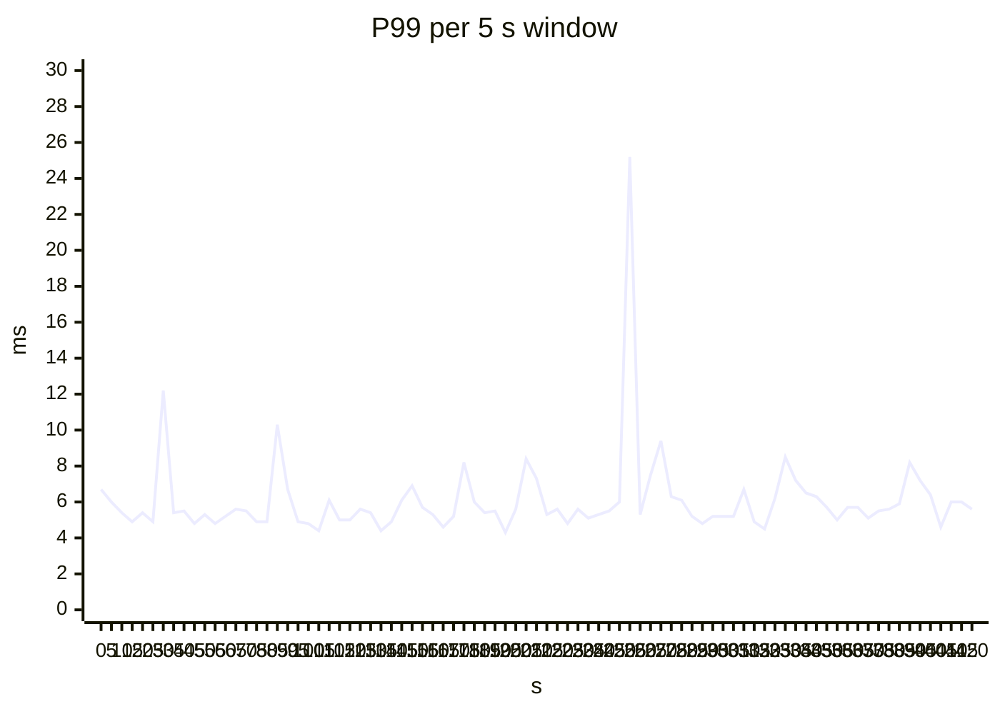
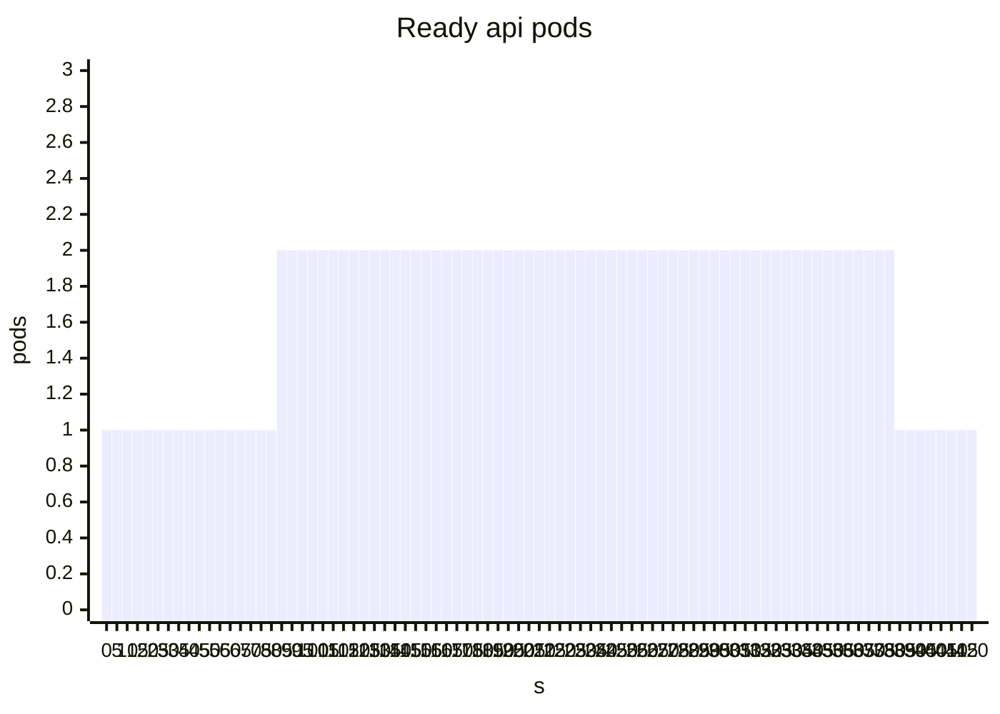

# Local Kubernetes deployment

Generated by `make deploy-report` (`kube/report.py` over `artifacts/deploy/`); do not edit by hand. Design §23.2 and the M5 acceptance of §16: the model server's rolling update does not interrupt the service, the api scales out under load, and with billing's pods deleted mid-run the ledger still equals the truth charge by charge.

## Summary

- **The model server's rolling update failed 1 of 67,482 requests (0.0015 %).** In 3 rolling updates of both model-server pods under 150 page views/s (open loop), 1 of 67,482 requests failed and 22 of the 56,251 answered from the trigger on were degraded (0.04 %). A new pod got traffic only once its bundle had loaded and passed its checks: Ready 2.0 s [1.0 s–2.0 s] after its container started; never fewer than 2 ready pods. Failed: 1 request in the 5 s window of a trigger, with 2 model-server pods ready.
  A bundle that fails its checks (item-id mapping shuffled: checksums fine, golden queries wrong) never became ready; the rollout was reported failed after 123 s and undone, with 0 failed and 0 degraded requests meanwhile.
  The same rollout without the readiness probe (pods get traffic as soon as they start): 0.00 % of the requests from the trigger on degraded, 0 failed; degradation reasons that point at the model server (`sasrec_*`, `rank_*`): 0 without the probe, 4 with it. The probe made no measurable difference here: `minReadySeconds` keeps each old pod until its replacement has run for 5 s, and a new pod serves 2.0 s [1.0 s–2.0 s] after its container starts (the gated runs); what the probe keeps out is a bundle that fails its checks (above).
- **The api scales out under load.** At a step from 100 to 500 page views/s (3 runs), the HorizontalPodAutoscaler (CPU, target 50 % of the 0.5-core request) asked for more pods 44 s [25 s–49 s] after the step and the first new pod was ready 46 s [26 s–52 s] after it; the api reached 2 [2–2] pods. P99 per 5 s window (median of the windows): 5.5 ms [5.3 ms–8.6 ms] on one pod, 6.2 ms [5.5 ms–6.4 ms] once scaled out; 3 failed requests.
- **KEDA scales the consumers on their lag.** Billing behind a database 200 ms slower per reply: lag up to 110,839 [70,203–123,370] records, scaled to 3 [3–3] pods 24 s [23 s–27 s] after the slowdown began; the lag kept growing with them (peak 115 s [108 s–119 s] into the 120 s slowdown: 3 [3–3] pods did not keep up with it); lag below 1,000 4 s [4 s–5 s] after it ended.
  The aggregator after a 90 s outage (backlog 224,888 [224,880–225,941] records): drained in 13 s [8 s–13 s] by its one pod, before KEDA added any.
- **Deleting billing's pods mid-run leaves the ledger right.** Billing drill on the cluster (30 min, 8 billing pods deleted, Redpanda's pod deleted 3 times, PostgreSQL 200 ms slower for billing 2 times): **the ledger equals the simulator's truth charge by charge** (686 charges, 686 expected; 14/14 ledger checks and 11/11 event-pipeline checks pass).

## Setup

- Machine: Apple M4 Pro, 24.0 GiB, macOS-26.6.2-arm64-arm-64bit. One kind node (v0.33.0, `kindest/node:v1.36.4`, Kubernetes v1.36.4) in Docker Desktop's VM: 8 CPUs, 12233044Ki allocatable.
- Infrastructure from official charts: cloudnative-pg 0.29.1, redpanda 26.2.5, keda 2.21.0, metrics-server 3.14.0, kube-prometheus-stack 92.10.1. Prometheus scrapes RecLoop's services every 5 s.
- Bundle `2026-11-08-sasrec64-ce60bf5d` (the api's `current`): the model server's Rank (features, LightGBM scores) on every home request, `rrf` order (no rank-layer experiment); the model's pCTR for ads.
- RecLoop's images (`deploy/kind/cluster.sh images`, loaded with `kind load`, not pushed anywhere): GO_TAG a7a996f4797c, MODEL_SERVER_TAG 547bb63c4620, WEB_TAG 75a60191fdea.
- Load: k6 v2.3.0 (go1.27.3, darwin/arm64) on the host, open loop, to the api's NodePort through kind's port mapping.
- Machine load during the runs: median 3.59, max 7.36 (start and end of each run); it includes the cluster's own load and k6's.
- No other project's container ran in the VM at any run's start or end.

Requests and limits of every container of RecLoop's two charts (CPU in cores):

| workload | container | CPU request | memory request | CPU limit | memory limit |
| --- | --- | ---: | ---: | ---: | ---: |
| aggregator | aggregator | 100m | 128Mi | 250m | 256Mi |
| api | api | 500m | 256Mi | 500m | 512Mi |
| billing | billing | 100m | 128Mi | 1 | 256Mi |
| log-sink | log-sink | 100m | 256Mi | 1 | 512Mi |
| model-server | model-server | 250m | 768Mi | 2 | 1Gi |
| pg-proxy | toxiproxy | 50m | 32Mi | 500m | 64Mi |
| recloop-pg | postgres | 250m | 1Gi | 2 | 1Gi |
| redis | exporter | 10m | 16Mi | 100m | 64Mi |
| redis | redis | 100m | 256Mi | 1 | 1536Mi |
| redis-cache | exporter | 10m | 16Mi | 100m | 64Mi |
| redis-cache | redis | 50m | 128Mi | 1 | 512Mi |
| web | web | 100m | 192Mi | 1 | 512Mi |

## 1. Rolling update of the model server

k6 at 150 page views/s (open loop, `loadtest/recs.js`) for 150 s; 30 s in, a rolling update of the model server's two pods (`maxSurge 1`, `maxUnavailable 0`, `minReadySeconds 5`). The api calls the model server over one gRPC connection per api pod; an old pod first leaves the Service (preStop sleep 5 s), then stops with `grpc.server.stop(grace=5)`, which tells the clients to reconnect (GOAWAY) and lets running calls finish. *After the trigger* = from the trigger (− one 5 s window) to the end of the load: without a probe the Deployment calls the rollout complete before its new pods serve, and what that costs comes after that.

- **gated**: the chart. Readiness = the gRPC health service says SERVING, which the server does only after `model_server/bundle.py` accepted the bundle (checksums, item count, dimension, golden queries).
- **no-probe**: the same rollout after removing the readiness and startup probes: a pod counts as ready once its container runs, before the bundle is loaded.
- **broken**: the new pods get a copy of the bundle with `item_ids.json` shuffled and its checksum updated: everything matches except the golden queries.

| variant | runs | requests | failed | degraded after the trigger | P99 before (median window) | P99 after the trigger (worst window) | rollout | fewest ready pods | Ready after start |
| --- | ---: | ---: | ---: | ---: | ---: | ---: | ---: | ---: | ---: |
| gated | 3 | 67,482 | 1 | 0.04 % | 5.4 ms [5.3 ms–5.5 ms] | 43.4 ms [6.3 ms–51.1 ms] | 14 s [12 s–14 s] | 2 | 2.0 s [1.0 s–2.0 s] |
| no-probe | 3 | 67,498 | 0 | 0.00 % | 5.6 ms [5.3 ms–5.8 ms] | 10.8 ms [10.3 ms–17.8 ms] | 10 s [10 s–10 s] | 2 | 0.0 s [0.0 s–0.0 s] |
| broken | 1 | 40,499 | 0 | 0.00 % | 5.1 ms | 9.4 ms | 123 s | 2 | – |

Degradation reasons over each variant's runs (the api's `recloop_degraded_total`):

- gated: `user_state_timeout` 11, `rank_timeout` 4, `pages_timeout` 4
- no-probe: none
- broken: none

Pods of the first gated run (s from the trigger, 2026-11-08 20:53 UTC):

| pod | created | started | ready | deletion asked | gone |
| --- | ---: | ---: | ---: | ---: | ---: |
| model-server-656d647b-8kxzv | -100 | -99 | -99 | +14 | +21 |
| model-server-656d647b-zlnfz | -100 | -100 | -99 | +7 | +14 |
| model-server-7546b89c99-gjfzw | -0 | -0 | +2 | – | – |
| model-server-7546b89c99-s5qhq | +7 | +7 | +9 | – | – |

Bundle load and checks in the new pods (their log): 0.1 s [0.1 s–0.1 s] over 6 pods.

The broken bundle: the new pod restarted 4 times (ContainerCreating, CrashLoopBackOff), never ready; the Deployment reported `ProgressDeadlineExceeded` 123 s after the change (`progressDeadlineSeconds: 120`), then `kubectl rollout undo`. Its last log line:

```
model_server.bundle.BundleError: /bundles/m5-broken-item-ids: golden queries failed: {'queries': 256, 'recall': 0.005078125, 'max_score_diff': 4.198944091982071e-06}
```

## 2. The api's HorizontalPodAutoscaler

k6 open loop: 100 page views/s for 60 s, 500/s for 240 s, then 100/s for 120 s. The api pod has exactly 0.5 core (request = limit = 500m, so utilisation means the share of it); HPA between 1 and 4 pods at 50 % CPU, metrics-server every 15 s, scale-up without stabilisation. kube-proxy places connections, not requests: k6 closes 2 % of its requests' connections (`Connection: close`), so new connections, and with them requests, reach the new pods. *One pod* = from the step until the first new pod is ready; *scaled out* = from 30 s after the last new pod is ready to the end of the step.

| run | scale-up asked | first new pod ready | pods | P99 base | P99 one pod | worst window | P99 scaled out | worst window | degraded one pod | degraded scaled out | api CPU one pod (cores) | throttled periods | HPA's CPU one pod | failed | dropped iterations |
| --- | ---: | ---: | ---: | ---: | ---: | ---: | ---: | ---: | ---: | ---: | ---: | ---: | ---: | ---: | ---: |
| 1 | 25 s | 26 s | 2 | 5.3 ms | 5.5 ms | 10.3 ms | 5.5 ms | 25.2 ms | 0.03 % | 0.03 % | 0.31 | 1 % | 19 % | 0 | 0 |
| 2 | 49 s | 52 s | 2 | 5.8 ms | 5.3 ms | 58.5 ms | 6.2 ms | 26.2 ms | 5.37 % | 1.33 % | 0.36 | 0 % | 21 % | 3 | 343 |
| 3 | 44 s | 46 s | 2 | 6.9 ms | 8.6 ms | 43.7 ms | 6.4 ms | 269.1 ms | 0.30 % | 3.13 % | 0.39 | 8 % | 22 % | 0 | 303 |

Degradation reasons over the runs (the api's `recloop_degraded_total`): `rank_circuit_open` 3,514, `user_state_timeout` 672, `rank_timeout` 193, `pages_timeout` 174, `static_popular` 76, `sasrec_timeout` 31. A `*_circuit_open` answer comes from a breaker open for 10 s after failed calls (half of 20 or more in 10 s, or 10 in a row: `BREAKER_WINDOW`); it is fast, in the RRF order of the sources that answered, without ads (§5.1).

P99 per 5 s window of the first run (ms) and its ready api pods:





## 3. KEDA: aggregator and billing scaled on their consumer lag

Both consumers are StatefulSets (pods `billing-0`, `billing-1`, ...: unique and stable static group member ids) with a KEDA ScaledObject: Kafka scaler on the group's lag over `events`' 6 partitions, a pod per 20,000 records of lag, between 1 and 3 pods, polled every 5 s; down after 60 s below target, one pod per 30 s. The lag below is the broker's (`rpk group describe`) every 5 s, k6 at 300 page views/s throughout.

- **billing**: six live campaigns (large budgets) put sponsored slots on every home page, so billing has clicks to charge; 60 s in, every reply PostgreSQL sends billing is 200 ms late for 120 s (pg-proxy). A batch of 1,000 records that holds a click then takes over a second, and the topic receives more than that per second.
- **aggregator**: 30 s in the aggregator is paused at 0 pods (KEDA's paused-replicas) for 90 s, then resumed.

Scaling in has a cost here: a removed pod is a static member, which does not leave the group (by design: a restarted pod takes its partitions back at once), so its partitions wait for its 15 s session to time out before the others get them. The lag threshold sits above what that stall builds up at this rate, so it does not trigger a scale-up.

| run | # | peak lag | lag when the fault ended | more pods after | pods | lag < 1,000 after the fault ended | back to 1 pod after the drain | failed |
| --- | ---: | ---: | ---: | ---: | ---: | ---: | ---: | ---: |
| billing | 1 | 70,203 | 36,701 | 27 s | 3 | 5 s | 79 s | 7 |
| aggregator | 1 | 224,880 | 212,364 | – | 1 | 13 s | – | 1 |
| billing | 2 | 123,370 | 123,370 | 23 s | 3 | 4 s | 76 s | 0 |
| aggregator | 2 | 224,888 | 212,612 | – | 1 | 8 s | – | 0 |
| billing | 3 | 110,839 | 109,789 | 24 s | 3 | 4 s | 79 s | 29 |
| aggregator | 3 | 225,941 | 213,461 | – | 1 | 13 s | – | 12 |

## 4. The billing drill on the cluster

Run 2026-11-08 22:09 UTC: `make deploy-drill` (`kube/drill.py`: `sim/billing_drill.py` with its chaos on pods), seed 20261107, the same traffic and checks as `make billing-drill` (billing.md). The simulator (8 sessions at a time) sent 545,336 events (624,801 deliveries with its faults `duplicate=0.1,resend=0.05,reorder=0.1,late=0.05,double_click=0.05,forge=0.02`) over 76,768 page views; 121,809 sponsored slots were served, 738 sponsored click events sent (12 forged). Redis evicted 0 keys.

Chaos (s from the start of the traffic): a billing pod deleted, alternately graceful (SIGTERM) and forced (`--grace-period=0 --force`); its StatefulSet recreates it at once under the same name, the same static member of the `billing` group. Redpanda's pod deleted (graceful) and recreated on its volume. PostgreSQL slowed for billing through pg-proxy.

| t (s) | action |
| ---: | --- |
| 98.5 | deleted pod billing-0 (graceful, SIGTERM) |
| 200.6 | postgres +200 ms for billing |
| 256.9 | deleted pod redpanda-0 |
| 278.7 | redpanda-0 ready again |
| 314.1 | deleted pod billing-0 (forced, grace 0) |
| 380.6 | postgres back to normal (180 s) |
| 572.6 | deleted pod redpanda-0 |
| 583.7 | redpanda-0 ready again |
| 688.4 | deleted pod billing-0 (graceful, SIGTERM) |
| 878.4 | postgres +200 ms for billing |
| 900.2 | deleted pod billing-0 (forced, grace 0) |
| 1046.8 | deleted pod billing-0 (graceful, SIGTERM) |
| 1058.4 | postgres back to normal (180 s) |
| 1270.1 | deleted pod billing-0 (forced, grace 0) |
| 1382.4 | deleted pod billing-0 (graceful, SIGTERM) |
| 1572.3 | deleted pod billing-0 (forced, grace 0) |
| 1603.7 | deleted pod redpanda-0 |
| 1624.8 | redpanda-0 ready again |

Billing pods during the run: 9 incarnations (billing-0); at most 1 ready at once (KEDA did not add pods at this rate).

The ledger against the truth (`sim/billing_verify.py`):

| check | expected | actual |  |
| --- | ---: | ---: | --- |
| ad_clicks: one row per sponsored click event | 738 | 738 | ok |
| ad_clicks: rows for clicks the simulator did not send | 0 | 0 | ok |
| forged tokens refused (invalid) | 12 | 12 | ok |
| genuine tokens verified (valid, or expired after exp) | 726 | 726 | ok |
| charges: clicked impressions with no charge | 0 | 0 | ok |
| charges: charges with no clicked impression | 0 | 0 | ok |
| charges: campaign, day and price of the token | 0 | 0 | ok |
| charges: billed click is a genuine click of the impression | 0 | 0 | ok |
| amounts: billed = min(budget, sum of prices) per campaign-day | 0 | 0 | ok |
| amounts: charges above budget | 0 | 0 | ok |
| amounts: one partial charge at most, zero only once the budget is spent | 0 | 0 | ok |
| budget rows = ledger | 0 | 0 | ok |
| budget rows: the campaign's daily budget | 0 | 0 | ok |
| Redis spend = ledger | 0 | 0 | ok |

4 of 6 campaign-days spent their whole budget; $135.68 billed, $1.07 not billed. Reconciliation after the drill: 20 campaign-days in agreement, 0 Redis counters behind (repaired +0 ¢), 0 ahead, 0 budget rows different from the ledger.

The same run, checked as `make drill` checks the event pipeline:

| check | expected | actual |  |
| --- | ---: | ---: | --- |
| events_raw: ledger events stored | 545336 | 545336 | ok |
| events_raw: events stored twice | 0 | 0 | ok |
| events_raw: rows the simulator did not send | 0 | 0 | ok |
| served: pages with their served row | 76767 | 76767 | ok |
| served: extra served rows | 0 | 0 | ok |
| orders: one per purchase event | [519, 519] | [519, 519] | ok |
| stock: one unit per purchase | 0 | 0 | ok |
| redis: hv = before + history events (users) | 0 | 0 | ok |
| redis: purchases in bought (users) | 0 | 0 | ok |
| redis: last clicked item in history (users) | 0 | 0 | ok |
| redis: dedup marker per event | 545336 | 545336 | ok |

## How it is deployed

- `deploy/kind/cluster.yaml`: one node; the host reaches NodePort Services through kind's port mappings on 127.0.0.1 (no Ingress). The bundles directory (`artifacts/bundles`) is mounted read-only into the node and from there into the api and model-server pods, so both see every version and the `current` link as in compose; images stay code-only and a new bundle needs no image build.
- `deploy/helm/recloop-infra`: PostgreSQL as a CloudNativePG `Cluster` (its standard image has pgvector), Redis as StatefulSets (state: noeviction; cache: allkeys-lru), the `events` topic. `deploy/helm/recloop`: the services, an HPA for the api, KEDA ScaledObjects for the consumers, ServiceMonitors, compose's Grafana dashboard.
- Readiness: the api's `/healthz` (the listener starts after the bundle, the catalog and the experiments loaded), not `/readyz`, whose dependency report would take every api pod out of the Service when one dependency fails, instead of degrading (§5.1). The model server's readiness is its gRPC health service (SERVING after the bundle checks).
