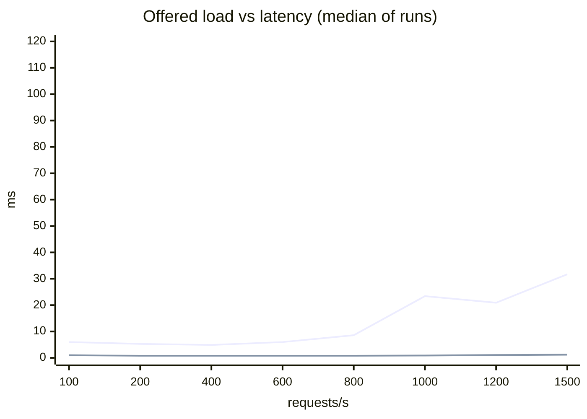

# Latency budget and degradation

> Generated by `make load` (`loadtest/run.py`, rendered by `loadtest/report.py` from `artifacts/latency/results.json`). Do not edit by hand.

## Summary

- **600 requests/s** is the largest offered load at which every run met the SLO (P99 ≤ 100 ms, ≤ 1% degraded responses, ≤ 0.1% errors, k6 kept the rate), with this design and the candidate cache on. At 800/s 0 of 3 runs met it; repeat 3 had P99 8.6 ms and 30.9 % degraded: no fault was injected; a burst of timeouts opened the breaker in front of the model server's Rank (10 failures in a row, or at least half of the last 10 s's calls), which then stayed open for at least its 10 s.
- From 1000/s on, the ladder's runs never filled the candidate cache (home hit rate 4.1 % there, 87.2 % at 400/s): every run starts with it empty, a miss costs the model server a Retrieve and a Rank call, and a degraded list is not cached (§1). With the cache filled first (30 s at 400/s): 1000/s 2/3 runs within the SLO, P99 7.1 ms, 0.1 % degraded, 92.9 % home hits; 1500/s 0/3 runs within the SLO, P99 14.9 ms, 20.0 % degraded, 75.4 % home hits.
- Candidate cache at 400/s: P50 3.0 → 0.8 ms, model server calls 227 → 48 per second, hit rate 82.9 % (home). P99 12.8 ms off, 5.3 ms on (median). The three runs opened every repeat in a shuffled order (repeat 1: on through Toxiproxy, off, on; repeat 2: on, on through Toxiproxy, off; repeat 3: off, on, on through Toxiproxy), never right after the ladder's highest rate.
- Model server: 30 % of calls +200 ms: naive P99 206.6 ms with 0.0 % errors; this design P99 39.3 ms, 0.0 % errors, 23.8 % degraded.
- Model server: every call +50 ms: naive P99 4437.5 ms with 0.0 % errors; this design P99 4.6 ms, 0.0 % errors, 96.3 % degraded.
- Model server disconnected: naive P99 2.4 ms with 100.0 % errors; this design P99 3.4 ms, 0.0 % errors, 96.4 % degraded.
- Redis disconnected: naive P99 160.1 ms with 100.0 % errors; this design P99 8.4 ms, 0.0 % errors, 100.0 % degraded.
- Breaker rule, 10 in a row, 5 probes (in force) vs 25 in a row, 2 probes: without a fault at 1500/s it opened in 3 vs 3 of 3 runs, 96.1 % vs 96.0 % degraded (worst run 96.6 % vs 96.4 %), P99 30.4 vs 36.9 ms (the candidate cache never filled under either rule); with 30 % of the calls slow 23.8 % vs 23.5 % degraded (opened in 0 vs 0 of 3), P99 39.3 vs 39.4 ms (§5).

## Setup

- Machine: Apple M4 Pro, 12 cores, 24 GB, macOS 26.6.2, on mains power. Docker 29.7.2, VM with 8 CPUs and 11.67 GB.
- Served: bundle `2026-11-08-sasrec64-ce60bf5d` with a LightGBM ranker and a logistic-regression pCTR model: a home request that misses the candidate cache calls the model server twice, Retrieve (SASRec recall) and Rank (every candidate's features and the ranker's score), each behind a breaker of its own; a hit reuses the ranked list. The list keeps RRF's order (the api's default ranker; no rank-layer experiment ran). Redis: two instances, state (`noeviction`, 1024 MB: user context, frequency caps, spend) and cache (`allkeys-lru`, 384 MB: candidate cache, result pages); no campaign was active, so the ads stage had nothing to serve.
- Containers (compose `deploy/docker-compose.yml`, bench profile): api 2 CPU / 512 MB, model-server 2 CPU / 1024 MB, redis 1 CPU / 1536 MB, redis-cache 1 CPU / 512 MB, postgres 2 CPU / 1024 MB, redpanda 1 CPU / 1024 MB, aggregator 1 CPU / 256 MB, log-sink 1 CPU / 512 MB, toxiproxy 1 CPU / 128 MB. The api connects to the model server and Redis directly, except in the fault experiment, where every row (the no-fault one included) goes through Toxiproxy.
- Load: k6 v2.3.0 (go1.27.3, darwin/arm64) on the host, open loop (`constant-arrival-rate`: requests start on schedule however slow the answers are, so a slow server cannot hide its tail). One iteration is one page view of a simulated session (`sim/world.py`: the 2,024 test-period users, click model on text similarity to each user's next items), followed by the page's impression / click / cart / purchase events on `POST /v1/events`; rates below count page views, i.e. recommendation requests.
- Each configuration ran 3 times: 10 s of warm-up, then 60 s measured. Before every run the consumers caught up, Redis was reseeded (so the candidate cache starts empty) and every fault was off. Tables show the median over the runs; P99 in brackets is the range over the runs. Latency is measured by k6 (client side, all recommendation requests: home, item page and next page); "server P99" is the api's own histogram.
- Started 2026-11-08 22:54 UTC (after waiting 430 s for the 1-minute load average to drop below 2); 1-minute load average 1.98 at the start and 8.55 at the end; over the runs median 4.96, max 11.84 (start and end of each run); 0 containers of other projects running.
- Resumed 00:43 UTC (after waiting 100 s; 1-minute load average 1.87; 0 containers of other projects running): the warm runs (section 1: 1000 and 1500/s after 30 s at 400/s) were added to the plan during the first start, once the ladder runs from 1000/s on never filled the candidate cache; every finished run was kept, none re-ran. 81 runs kept, 0 discarded.
- SLO (design §5.1): P99 ≤ 100 ms and at most 1% of responses degraded (`degraded` not empty), under normal load. A rate of the ladder also needs at most 0.1% errors (answers other than 200, next pages included) and no requests k6 had to drop, in every one of its runs.

## 1. Offered load vs P99

This design, candidate cache on, no fault.

| offered /s | runs within the SLO | achieved /s | P50 ms | P95 ms | P99 ms | server P99 ms | degraded | errors | dropped | cache hits (home) | top degradation reasons (count per run) |
|---:|---:|---:|---:|---:|---:|---:|---:|---:|---:|---:|---|
| 100 | 3/3 | 100 | 1.0 | 4.4 | 6.0 [5.3–6.2] | 5.2 | 0.0 % | 0.00 % | 0 | 73.6 % | – |
| 200 | 3/3 | 200 | 0.8 | 3.9 | 5.3 [4.9–5.4] | 4.9 | 0.0 % | 0.00 % | 0 | 80.9 % | – |
| 400 | 3/3 | 400 | 0.8 | 3.6 | 4.9 [4.9–5.0] | 4.8 | 0.0 % | 0.00 % | 0 | 87.2 % | – |
| 600 | 3/3 | 600 | 0.8 | 3.9 | 6.0 [6.0–6.2] | 5.0 | 0.0 % | 0.00 % | 0 | 86.0 % | – |
| 800 ✗ | 0/3 | 800 | 0.8 | 4.0 | 8.6 [6.9–8.9] | 7.2 | 15.9 % [15.7–30.9] | 0.00 % | 0 | 72.5 % | rank_circuit_open 5426, sasrec_circuit_open 4747, rank_timeout 20 |
| 1000 ✗ | 0/3 | 1000 | 0.9 | 4.2 | 23.4 [21.9–25.8] | 26.0 | 92.1 % [89.6–93.6] | 0.00 % | 0 | 4.1 % | rank_circuit_open 45890, sasrec_circuit_open 34866, static_popular 3676 |
| 1200 ✗ | 0/3 | 1200 | 1.1 | 6.9 | 20.9 [16.6–26.7] | 22.5 | 94.9 % [94.2–95.6] | 0.00 % | 0 | 1.7 % | rank_circuit_open 56629, sasrec_circuit_open 38609, static_popular 6223 |
| 1500 ✗ | 0/3 | 1500 | 1.2 | 13.0 | 31.7 [29.2–39.2] | 32.2 | 96.6 % [96.5–96.7] | 0.00 % | 0 | 0.1 % | rank_circuit_open 72201, sasrec_circuit_open 58750, static_popular 16391 |

✗: at least one run missed the SLO (a rate counts its worst run, not the median). Degraded: median of the runs [range].

Without any fault, the breakers in front of the model server's Rank and the model server's Retrieve were open in 3 of 3 runs at 800/s (the worst run 30.9 % degraded; in 2 of them they had opened in the warm-up). When one opened during the measurement, a burst of timeouts had tripped it (10 failures in a row, or at least half of the last 10 s's calls), and it then stayed open for at least its 10 s. The warm-up (10 s at the run's rate) starts with the candidate cache empty, so at first every home request misses and calls the model server; a breaker that opened then was still open when the measurement began.

From 1000/s on, the candidate cache never filled: the home hit rate was 4.1 % at 1000/s, 1.7 % at 1200/s, 0.1 % at 1500/s, against 87.2 % at 400/s. Every run starts with Redis reseeded, so the cache is empty, and a home request that misses calls the model server twice (Retrieve, then Rank). At 1000/s the model server received 6388 calls in the measured 60 s, 277 of which ran past their deadline (207 were already past it on arrival, i.e. had queued), and the breakers (Retrieve and Rank each have one) opened 11 times per run in all. The counts read as a cycle: when a breaker closes, every request still misses and calls the model server at once, its calls queue past their deadlines, the breaker trips again and stays open for another 10 s. A degraded list is never cached, so the cache can fill only in those short spells, and in between the model server is barely called (its container's CPU mid-run: 58 % at 1000/s, 26 % at 1200/s, 13 % at 1500/s). The warm runs below fill the cache first.

Lines: P99 (upper) and P50 (lower), median of the runs.

Per stage (server P99, ms) and where the CPU went (container CPU % mid-run, 100 % = one core):

| offered /s | user context | cache get | recall | rank | filter | page store | render | api CPU | model server CPU | state Redis CPU | cache Redis CPU | PostgreSQL CPU | Redpanda CPU | log-sink lag (max) |
|---:|---:|---:|---:|---:|---:|---:|---:|---:|---:|---:|---:|---:|---:|---:|
| 100 | 0.5 | 0.5 | 3.4 | 3.3 | 0.5 | 0.5 | 0.5 | 10 | 20 | 2 | 1 | 4 | 8 | 456 |
| 200 | 0.5 | 0.5 | 3.0 | 3.0 | 0.5 | 0.5 | 0.5 | 17 | 9 | 4 | 2 | 7 | 11 | 943 |
| 400 | 0.5 | 0.5 | 2.9 | 3.8 | 0.5 | 0.5 | 0.5 | 27 | 11 | 7 | 3 | 8 | 21 | 1792 |
| 600 | 0.6 | 0.5 | 4.2 | 4.8 | 0.5 | 0.5 | 0.5 | 40 | 26 | 10 | 4 | 13 | 30 | 2690 |
| 800 | 0.8 | 0.5 | 5.5 | 7.3 | 0.5 | 0.6 | 0.5 | 56 | 30 | 13 | 6 | 17 | 33 | 3621 |
| 1000 | 1.3 | 0.9 | 9.6 | 14.1 | 0.5 | 0.9 | 0.5 | 78 | 58 | 17 | 7 | 24 | 37 | 4585 |
| 1200 | 1.8 | 1.1 | 17.5 | 0.8 | 0.5 | 1.4 | 0.5 | 86 | 26 | 21 | 8 | 27 | 44 | 5380 |
| 1500 | 3.8 | 2.7 | 27.8 | 0.8 | 0.5 | 2.9 | 0.5 | 105 | 13 | 23 | 9 | 31 | 50 | 6331 |

The same rates with the candidate cache filled first: 30 s at 400/s (a rate whose cold start fills it), then the usual 10 s at the rate and the measured 60 s; added to the plan by a restart (Setup), they ran after every other run, each after a reseed like any run. Next to each, the ladder's run at that rate, which starts with the cache empty.

| offered /s | start | runs within the SLO | P99 ms | degraded | errors | cache hits (home) | model server calls/s | breaker opened: times per run (runs) | top degradation reasons (count per run) |
|---:|---|---:|---:|---:|---:|---:|---:|---:|---|
| 1000 ✗ | empty cache (ladder) | 0/3 | 23.4 [21.9–25.8] | 92.1 % [89.6–93.6] | 0.00 % | 4.1 % | 106 | 11 (3/3) | rank_circuit_open 45890, sasrec_circuit_open 34866, static_popular 3676 |
| 1000 ✗ | cache filled | 2/3 | 7.1 [6.5–7.1] | 0.1 % [0.0–4.0] | 0.00 % | 92.9 % | 57 | 0 (1/3) | user_state_timeout 21, rank_timeout 4 |
| 1500 ✗ | empty cache (ladder) | 0/3 | 31.7 [29.2–39.2] | 96.6 % [96.5–96.7] | 0.00 % | 0.1 % | 169 | 11 (3/3) | rank_circuit_open 72201, sasrec_circuit_open 58750, static_popular 16391 |
| 1500 ✗ | cache filled | 0/3 | 14.9 [13.4–21.5] | 20.0 % [19.3–72.2] | 0.00 % | 75.4 % | 191 | 4 (3/3) | rank_circuit_open 14598, sasrec_circuit_open 6219, static_popular 2061 |

## 2. Candidate cache on / off (400 requests/s)

| candidate cache | P50 ms | P95 ms | P99 ms | home P99 ms | hit rate home | hit rate item | model server calls/s | degraded | errors |
|---|---:|---:|---:|---:|---:|---:|---:|---:|---:|
| off | 3.0 | 5.7 | 12.8 [11.3–15.0] | 14.4 | 0.0 % | 0.0 % | 227 | 16.21 % | 0.00 % |
| on | 0.8 | 3.8 | 5.3 [5.2–6.0] | 5.4 | 82.9 % | 27.6 % | 48 | 0.00 % | 0.00 % |
| on, through Toxiproxy | 1.0 | 4.2 | 6.0 [5.1–6.4] | 6.3 | 82.8 % | 27.0 % | 46 | 0.00 % | 0.00 % |

The cache keeps recall + ranking output per user and history version (`cand:{uid}:home:{variant}:{model_ver}:{hv}`) and per item for the item page; filters run on every request. A click, add-to-cart or purchase bumps hv, so the next request recomputes. The last row is the same configuration with Toxiproxy between the api and the model server / Redis, as in every row of the fault table below: the proxy's own cost.

With the cache off every home request calls the model server (Retrieve, and Rank when the bundle has a ranker): at 400/s a breaker was open in 3 of 3 runs (16.2 % [16.2–16.9] degraded; rank_circuit_open 3518, sasrec_circuit_open 2228, rank_timeout 17 per run).

Order: the cache block opens every repeat, its three runs shuffled with a fixed seed (`loadtest/run.py`, `SHUFFLE_SEED`), so no configuration always follows the same run: repeat 1: on through Toxiproxy, off, on (after the start of the measurement); repeat 2: on, on through Toxiproxy, off (after the onset run at 200/s); repeat 3: off, on, on through Toxiproxy (after the onset run at 200/s).

## 3. Faults: naive vs this design (200 requests/s, candidate cache off, through Toxiproxy)

| fault | implementation | P50 ms | P99 ms | errors | degraded | top degradation reasons (count per run) | breaker opened: times per run (runs) |
|---|---|---:|---:|---:|---:|---|---:|
| no fault | naive | 3.3 | 11.3 [8.2–18.4] | 0.00 % | 0.0 % | – | 0 (0/3) |
| no fault | this design | 3.2 | 7.9 [7.0–11.2] | 0.00 % | 0.0 % | user_state_timeout 2 | 0 (0/3) |
| model server: 30 % of calls +200 ms | naive | 3.4 | 206.6 [205.9–206.8] | 0.00 % | 0.0 % | – | 0 (0/3) |
| model server: 30 % of calls +200 ms | this design | 3.4 | 39.3 [39.3–39.6] | 0.00 % | 23.8 % [23.1–24.2] | sasrec_timeout 2367, user_state_timeout 1 | 0 (0/3) |
| model server: 30 % of calls +200 ms | this design, count window | 2.2 | 8.4 [5.8–37.2] | 0.00 % | 77.0 % [76.5–79.1] | sasrec_circuit_open 7672, sasrec_timeout 41 | 5 (3/3) |
| model server: 30 % of calls +200 ms | this design, 25 in a row, 2 probes | 3.4 | 39.4 [39.0–40.0] | 0.00 % | 23.5 % [22.7–23.9] | sasrec_timeout 2317 | 0 (0/3) |
| model server: every call +50 ms | naive | 2204.1 | 4437.5 [2192.8–4472.0] | 0.00 % | 0.0 % | – | 0 (0/3) |
| model server: every call +50 ms | this design | 0.9 | 4.6 [3.9–5.3] | 0.00 % | 96.3 % [95.9–96.6] | rank_circuit_open 9636, sasrec_circuit_open 7884, sasrec_timeout 26 | 11 (3/3) |
| model server disconnected | naive | 0.7 | 2.4 [2.0–2.5] | 100.00 % | – | – | 0 (0/3) |
| model server disconnected | this design | 0.9 | 3.4 [3.1–4.1] | 0.00 % | 96.4 % [95.9–96.7] | rank_circuit_open 9656, sasrec_circuit_open 7895, static_popular 25 | 11 (3/3) |
| Redis disconnected | naive | 102.6 | 160.1 [160.1–160.4] | 100.00 % | – | – | 0 (0/3) |
| Redis disconnected | this design | 1.5 | 8.4 [6.1–12.4] | 0.00 % | 100.0 % | pages_error 11928, user_state_error 11928 | 0 (0/3) |

- Naive: no request deadline, no stage budgets, no circuit breaker, and any failed dependency fails the request (503). Same binary, `RECLOOP_RESILIENCE=naive`; Redis client defaults (3 s timeouts, 3 retries).
- This design (§5.1): 100 ms per request, every stage takes its budget from what is left (user context 5 ms, recall 35 ms, 25 ms kept for ranking); each call to the model server (Retrieve, Rank) is behind a circuit breaker of its own that opens for 10 s when at least half of the calls of the last 10 s failed (at least 20 calls) or after 10 failures in a row; every missing piece is written into `degraded` and the request goes on without it, down to the in-process popular list.
- "25 in a row, 2 probes": the same design with the candidate breaker rule `time:10s:20:25:2` of §5 (a comparison, not the rule in force).
- "count window": the same design with §5.1's first breaker rule, at least half of the last 20 calls. At hundreds of calls per second those 20 calls span a few tens of milliseconds; with 30 % of the calls slow, some of these short windows reach 10 failures, the breaker opens, and its half-open probes often fail again.
- The 30 % fault is the model server's own switch (per call, which a proxy on one long-lived gRPC connection cannot do); the deadline the api sends ends the delay early. It delays Retrieve calls only, so the slow calls show up as `sasrec_timeout`; Rank is not delayed, while the Toxiproxy faults hit Retrieve and Rank alike. +50 ms on every call is a Toxiproxy latency toxic; disconnects are Toxiproxy proxies switched off.

## 4. Breaker onset and recovery (200 requests/s, this design)

The fault starts in the middle of steady traffic and ends 15 s later. Open after: from the fault to the breaker opening (the api's breaker state, read every 10 ms); failed calls: SASRec calls that failed or timed out (each waiting up to its budget) before it opened; closed after: from the model server's recovery to the breaker closing again (it stays open 10 s, then 5 probes must succeed).

| fault | open after ms | failed calls before | closed after recovery s |
|---|---:|---:|---:|
| model server disconnected | 68.7 [61.0–87.8] | 10 | 5.1 |
| model server: every call +50 ms | 103.1 [93.2–123.6] | 7 | 5.2 |

## 5. Breaker rule: in force vs 25 in a row, 2 probes

The rule in force (`BREAKER_WINDOW=time:10s:20:10`: open after 10 failures in a row or when at least half of the last 10 s's calls failed, at least 20 of them; open 10 s; 5 half-open probes must succeed in a row) against the candidate `BREAKER_WINDOW=time:10s:20:25:2` (25 in a row, 2 probes). Same api, the same rule for every breaker (model server Retrieve, Rank, PostgreSQL text recall). A comparison only: the api keeps the rule in force.

| scenario | rule | P99 ms | degraded | errors | breaker opened: times per run (runs) | top degradation reasons (count per run) |
|---|---|---:|---:|---:|---:|---|
| 1500/s, no fault | 10 in a row, 5 probes | 30.4 [29.1–31.3] | 96.1 % [96.1–96.6] | 0.00 % | 10 (3/3) | rank_circuit_open 71892, sasrec_circuit_open 58549, static_popular 16156 |
| 1500/s, no fault | 25 in a row, 2 probes | 36.9 [36.6–38.4] | 96.0 % [95.8–96.4] | 0.00 % | 10 (3/3) | rank_circuit_open 71715, sasrec_circuit_open 55623, static_popular 12944 |
| 200/s, 30 % of the calls +200 ms | 10 in a row, 5 probes | 39.3 [39.3–39.6] | 23.8 % [23.1–24.2] | 0.00 % | 0 (0/3) | sasrec_timeout 2367, user_state_timeout 1 |
| 200/s, 30 % of the calls +200 ms | 25 in a row, 2 probes | 39.4 [39.0–40.0] | 23.5 % [22.7–23.9] | 0.00 % | 0 (0/3) | sasrec_timeout 2317 |

- No fault: both rules at the ladder's top rate, candidate cache on, direct; their own block right after the ladder, in a shuffled order per repeat (repeat 1: in force first, then candidate; repeat 2: candidate first, then in force; repeat 3: candidate first, then in force). 30 % of the calls +200 ms: the fault table's rows (§3), whose design variants also run in a shuffled order.
- At 1500/s without a fault the candidate cache never filled under either rule (home hit rate 0.6 % vs 0.7 %), as at the ladder's top rates (§1): the breakers reopened all through the runs, so this row compares the rules in that overload, not after a burst of timeouts.
- What the two fields change: a breaker that opens without a fault meets a burst of timeouts, and 25 failures in a row need a burst 2.5 times as long as 10 (independent failures at 30 % start a run of 10 at a given call with probability 0.3^10 ≈ 6·10⁻⁶, a run of 25 with 0.3^25 ≈ 10⁻¹³; at a steady 30 % the 50 % rule does not trip). Half-open, a breaker closes once all its probes succeed in a row, at 70 % success 0.7² = 49 % of the attempts with 2 probes against 0.7⁵ = 17 % with 5; a failed probe opens it for another 10 s.
- §4's onset runs use the rule in force only.

## Appendix: every run

In the order they ran (UTC), with the host's 1-minute load average when each run's measurement started and ended; the test's own load is part of it. P99: k6, all recommendation requests (onset: the whole run, fault included).

| started | experiment | rate /s | api | fault | repeat | load start → end | P99 ms |
|---|---|---:|---|---|---:|---|---:|
| 22:54:52 | cache | 400 | design, cache on, via Toxiproxy | no fault | 1 | 2.86 → 4.14 | 6.4 |
| 22:56:13 | cache | 400 | design, cache off, direct | no fault | 1 | 5.12 → 6.34 | 12.8 |
| 22:57:33 | cache | 400 | design, cache on, direct | no fault | 1 | 5.68 → 5.00 | 6.0 |
| 22:58:52 | ladder | 100 | design, cache on, direct | no fault | 1 | 4.62 → 3.56 | 6.2 |
| 23:00:11 | ladder | 200 | design, cache on, direct | no fault | 1 | 3.39 → 6.06 | 5.4 |
| 23:01:30 | ladder | 400 | design, cache on, direct | no fault | 1 | 5.04 → 4.30 | 5.0 |
| 23:02:49 | ladder | 600 | design, cache on, direct | no fault | 1 | 4.14 → 4.85 | 6.0 |
| 23:04:08 | ladder | 800 | design, cache on, direct | no fault | 1 | 5.13 → 8.37 | 8.9 |
| 23:05:27 | ladder | 1000 | design, cache on, direct | no fault | 1 | 7.70 → 8.04 | 21.9 |
| 23:06:47 | ladder | 1200 | design, cache on, direct | no fault | 1 | 7.86 → 9.35 | 16.6 |
| 23:08:06 | ladder | 1500 | design, cache on, direct | no fault | 1 | 10.00 → 11.84 | 39.2 |
| 23:09:25 | breaker | 1500 | design, cache on, direct | no fault | 1 | 9.73 → 9.69 | 30.4 |
| 23:10:46 | breaker | 1500 | design, cache on, direct, time:10s:20:25:2 | no fault | 1 | 9.03 → 10.44 | 38.4 |
| 23:12:08 | faults | 200 | naive, cache off, via Toxiproxy | no fault | 1 | 9.22 → 6.19 | 11.3 |
| 23:13:28 | faults | 200 | design, cache off, via Toxiproxy | no fault | 1 | 5.91 → 6.83 | 11.2 |
| 23:14:50 | faults | 200 | naive, cache off, via Toxiproxy | model server: 30 % of calls +200 ms | 1 | 6.95 → 6.41 | 206.8 |
| 23:16:13 | faults | 200 | design, cache off, via Toxiproxy | model server: 30 % of calls +200 ms | 1 | 5.86 → 5.58 | 39.6 |
| 23:17:35 | faults | 200 | design, cache off, via Toxiproxy, calls:20 | model server: 30 % of calls +200 ms | 1 | 5.86 → 5.47 | 37.2 |
| 23:18:57 | faults | 200 | design, cache off, via Toxiproxy, time:10s:20:25:2 | model server: 30 % of calls +200 ms | 1 | 5.10 → 5.42 | 40.0 |
| 23:20:19 | faults | 200 | naive, cache off, via Toxiproxy | model server: every call +50 ms | 1 | 4.72 → 3.06 | 4437.5 |
| 23:21:44 | faults | 200 | design, cache off, via Toxiproxy | model server: every call +50 ms | 1 | 4.17 → 4.28 | 4.6 |
| 23:23:06 | faults | 200 | naive, cache off, via Toxiproxy | model server disconnected | 1 | 4.21 → 3.39 | 2.4 |
| 23:24:28 | faults | 200 | design, cache off, via Toxiproxy | model server disconnected | 1 | 4.18 → 4.81 | 4.1 |
| 23:25:50 | faults | 200 | naive, cache off, via Toxiproxy | Redis disconnected | 1 | 4.51 → 3.35 | 160.1 |
| 23:27:12 | faults | 200 | design, cache off, via Toxiproxy | Redis disconnected | 1 | 3.94 → 4.36 | 8.4 |
| 23:28:30 | onset | 200 | design, cache off, via Toxiproxy | model server disconnected | 1 | 3.66 → 3.91 | 6.6 |
| 23:29:18 | onset | 200 | design, cache off, via Toxiproxy | model server: every call +50 ms | 1 | 4.02 → 4.15 | 8.0 |
| 23:30:07 | cache | 400 | design, cache on, direct | no fault | 2 | 4.25 → 5.53 | 5.3 |
| 23:31:28 | cache | 400 | design, cache on, via Toxiproxy | no fault | 2 | 4.97 → 5.18 | 5.1 |
| 23:32:49 | cache | 400 | design, cache off, direct | no fault | 2 | 5.19 → 5.34 | 15.0 |
| 23:34:10 | ladder | 100 | design, cache on, direct | no fault | 2 | 5.75 → 3.95 | 6.0 |
| 23:35:28 | ladder | 200 | design, cache on, direct | no fault | 2 | 3.89 → 3.10 | 5.3 |
| 23:36:47 | ladder | 400 | design, cache on, direct | no fault | 2 | 2.89 → 4.10 | 4.9 |
| 23:38:06 | ladder | 600 | design, cache on, direct | no fault | 2 | 3.87 → 5.53 | 6.2 |
| 23:39:26 | ladder | 800 | design, cache on, direct | no fault | 2 | 5.44 → 5.33 | 6.9 |
| 23:40:45 | ladder | 1000 | design, cache on, direct | no fault | 2 | 5.59 → 6.42 | 23.4 |
| 23:42:04 | ladder | 1200 | design, cache on, direct | no fault | 2 | 5.92 → 7.91 | 20.9 |
| 23:43:23 | ladder | 1500 | design, cache on, direct | no fault | 2 | 8.21 → 8.77 | 31.7 |
| 23:44:44 | breaker | 1500 | design, cache on, direct, time:10s:20:25:2 | no fault | 2 | 8.06 → 7.96 | 36.6 |
| 23:46:06 | breaker | 1500 | design, cache on, direct | no fault | 2 | 8.44 → 7.84 | 31.3 |
| 23:47:27 | faults | 200 | naive, cache off, via Toxiproxy | no fault | 2 | 6.96 → 9.08 | 18.4 |
| 23:48:48 | faults | 200 | design, cache off, via Toxiproxy | no fault | 2 | 7.74 → 4.58 | 7.0 |
| 23:50:09 | faults | 200 | naive, cache off, via Toxiproxy | model server: 30 % of calls +200 ms | 2 | 5.25 → 3.81 | 205.9 |
| 23:51:31 | faults | 200 | design, cache off, via Toxiproxy | model server: 30 % of calls +200 ms | 2 | 4.20 → 5.28 | 39.3 |
| 23:52:53 | faults | 200 | design, cache off, via Toxiproxy, calls:20 | model server: 30 % of calls +200 ms | 2 | 6.06 → 4.75 | 5.8 |
| 23:54:15 | faults | 200 | design, cache off, via Toxiproxy, time:10s:20:25:2 | model server: 30 % of calls +200 ms | 2 | 5.34 → 4.97 | 39.0 |
| 23:55:37 | faults | 200 | naive, cache off, via Toxiproxy | model server: every call +50 ms | 2 | 5.62 → 3.88 | 2192.8 |
| 23:57:00 | faults | 200 | design, cache off, via Toxiproxy | model server: every call +50 ms | 2 | 3.37 → 3.38 | 3.9 |
| 23:58:22 | faults | 200 | naive, cache off, via Toxiproxy | model server disconnected | 2 | 3.66 → 3.30 | 2.0 |
| 23:59:44 | faults | 200 | design, cache off, via Toxiproxy | model server disconnected | 2 | 3.61 → 3.80 | 3.1 |
| 00:01:06 | faults | 200 | naive, cache off, via Toxiproxy | Redis disconnected | 2 | 3.13 → 2.09 | 160.4 |
| 00:02:28 | faults | 200 | design, cache off, via Toxiproxy | Redis disconnected | 2 | 2.64 → 3.60 | 6.1 |
| 00:03:46 | onset | 200 | design, cache off, via Toxiproxy | model server disconnected | 2 | 3.16 → 3.53 | 5.5 |
| 00:04:35 | onset | 200 | design, cache off, via Toxiproxy | model server: every call +50 ms | 2 | 3.21 → 3.82 | 5.9 |
| 00:05:24 | cache | 400 | design, cache off, direct | no fault | 3 | 3.35 → 5.13 | 11.3 |
| 00:06:45 | cache | 400 | design, cache on, direct | no fault | 3 | 4.70 → 4.46 | 5.2 |
| 00:08:05 | cache | 400 | design, cache on, via Toxiproxy | no fault | 3 | 4.27 → 5.13 | 6.0 |
| 00:09:26 | ladder | 100 | design, cache on, direct | no fault | 3 | 4.90 → 4.20 | 5.3 |
| 00:10:45 | ladder | 200 | design, cache on, direct | no fault | 3 | 4.18 → 3.83 | 4.9 |
| 00:12:03 | ladder | 400 | design, cache on, direct | no fault | 3 | 3.28 → 4.08 | 4.9 |
| 00:13:22 | ladder | 600 | design, cache on, direct | no fault | 3 | 4.06 → 5.18 | 6.0 |
| 00:14:41 | ladder | 800 | design, cache on, direct | no fault | 3 | 4.93 → 5.99 | 8.6 |
| 00:16:00 | ladder | 1000 | design, cache on, direct | no fault | 3 | 5.49 → 7.32 | 25.8 |
| 00:17:20 | ladder | 1200 | design, cache on, direct | no fault | 3 | 7.16 → 7.42 | 26.7 |
| 00:18:39 | ladder | 1500 | design, cache on, direct | no fault | 3 | 6.75 → 8.75 | 29.2 |
| 00:20:00 | breaker | 1500 | design, cache on, direct, time:10s:20:25:2 | no fault | 3 | 7.50 → 9.28 | 36.9 |
| 00:21:21 | breaker | 1500 | design, cache on, direct | no fault | 3 | 7.23 → 9.21 | 29.1 |
| 00:22:42 | faults | 200 | naive, cache off, via Toxiproxy | no fault | 3 | 8.11 → 6.27 | 8.2 |
| 00:24:02 | faults | 200 | design, cache off, via Toxiproxy | no fault | 3 | 6.28 → 4.75 | 7.9 |
| 00:25:24 | faults | 200 | naive, cache off, via Toxiproxy | model server: 30 % of calls +200 ms | 3 | 4.58 → 3.78 | 206.6 |
| 00:26:47 | faults | 200 | design, cache off, via Toxiproxy, time:10s:20:25:2 | model server: 30 % of calls +200 ms | 3 | 3.85 → 3.63 | 39.4 |
| 00:28:09 | faults | 200 | design, cache off, via Toxiproxy | model server: 30 % of calls +200 ms | 3 | 4.32 → 4.09 | 39.3 |
| 00:29:31 | faults | 200 | design, cache off, via Toxiproxy, calls:20 | model server: 30 % of calls +200 ms | 3 | 4.33 → 3.94 | 8.4 |
| 00:30:53 | faults | 200 | naive, cache off, via Toxiproxy | model server: every call +50 ms | 3 | 4.03 → 3.19 | 4472.0 |
| 00:32:17 | faults | 200 | design, cache off, via Toxiproxy | model server: every call +50 ms | 3 | 3.00 → 3.45 | 5.3 |
| 00:33:39 | faults | 200 | naive, cache off, via Toxiproxy | model server disconnected | 3 | 4.37 → 3.77 | 2.5 |
| 00:35:01 | faults | 200 | design, cache off, via Toxiproxy | model server disconnected | 3 | 5.31 → 4.15 | 3.4 |
| 00:36:23 | faults | 200 | naive, cache off, via Toxiproxy | Redis disconnected | 3 | 4.06 → 2.41 | 160.1 |
| 00:37:45 | faults | 200 | design, cache off, via Toxiproxy | Redis disconnected | 3 | 3.58 → 5.25 | 12.4 |
| 00:39:03 | onset | 200 | design, cache off, via Toxiproxy | model server disconnected | 3 | 3.98 → 3.81 | 6.5 |
| 00:39:51 | onset | 200 | design, cache off, via Toxiproxy | model server: every call +50 ms | 3 | 4.15 → 3.78 | 8.5 |
| 00:44:21 | warm | 1000 | design, cache on, direct | no fault | 1 | 4.70 → 5.33 | 7.1 |
| 00:46:10 | warm | 1500 | design, cache on, direct | no fault | 1 | 4.94 → 8.90 | 14.9 |
| 00:48:00 | warm | 1000 | design, cache on, direct | no fault | 2 | 6.28 → 6.42 | 7.1 |
| 00:49:49 | warm | 1500 | design, cache on, direct | no fault | 2 | 6.22 → 8.44 | 13.4 |
| 00:51:39 | warm | 1000 | design, cache on, direct | no fault | 3 | 7.37 → 8.34 | 6.5 |
| 00:53:29 | warm | 1500 | design, cache on, direct | no fault | 3 | 7.59 → 9.21 | 21.5 |
