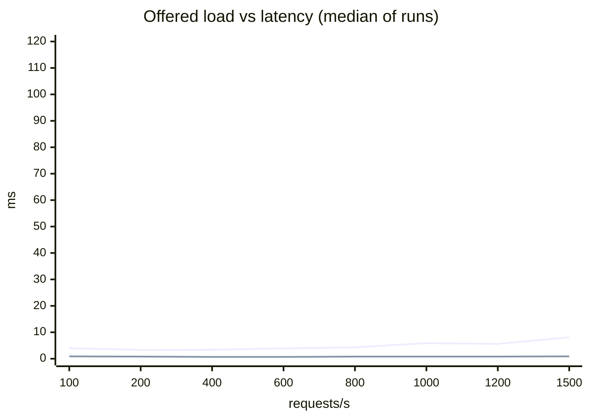

# Latency budget and degradation

> Generated by `make load` (`loadtest/run.py`, rendered by `loadtest/report.py` from `artifacts/latency/results.json`). Do not edit by hand.

## Summary

- **1200 requests/s** is the largest offered load at which every run met the SLO (P99 ≤ 100 ms, ≤ 1% degraded responses, ≤ 0.1% errors, k6 kept the rate), with this design and the candidate cache on. At 1500/s 2 of 3 runs met it; repeat 1 had P99 8.1 ms and 15.6 % degraded: no fault was injected; a burst of timeouts reached the 10-failures-in-a-row rule of the breaker in front of the model server, which then stayed open for at least its 10 s.
- Candidate cache at 400/s: P50 1.4 → 0.7 ms, model server calls 272 → 37 per second, hit rate 87.2 % (home). P99 4.4 ms off, 3.6 ms on (median); in repeat 3 the cache-on run was the slower one (6.1 vs 5.3 ms). The cache-on run always runs right after the ladder's 1500/s run, before the cache-off run, so the P99 comparison carries that order, the likely reason for the slower repeat.
- Model server: 30 % of calls +200 ms: naive P99 203.0 ms with 0.0 % errors; this design P99 36.6 ms, 0.0 % errors, 24.1 % degraded (69.2 % in the run where the breaker opened).
- Model server: every call +50 ms: naive P99 54.9 ms with 0.0 % errors; this design P99 3.8 ms, 0.0 % errors, 79.1 % degraded.
- Model server disconnected: naive P99 3.0 ms with 83.0 % errors; this design P99 3.6 ms, 0.0 % errors, 79.0 % degraded.
- Redis disconnected: naive P99 159.8 ms with 100.0 % errors; this design P99 4.1 ms, 0.0 % errors, 100.0 % degraded.

## Setup

- Machine: Apple M4 Pro, 12 cores, 24 GB, macOS 26.6.2, on mains power. Docker 29.7.2, VM with 8 CPUs and 11.67 GB.
- Containers (compose `deploy/docker-compose.yml`, bench profile): api 2 CPU / 512 MB, model-server 2 CPU / 1024 MB, redis 1 CPU / 512 MB, postgres 2 CPU / 1024 MB, redpanda 1 CPU / 1024 MB, aggregator 1 CPU / 256 MB, log-sink 1 CPU / 512 MB, toxiproxy 1 CPU / 128 MB. The api connects to the model server and Redis directly, except in the fault experiment, where every row (the no-fault one included) goes through Toxiproxy.
- Load: k6 v2.3.0 (go1.27.3, darwin/arm64) on the host, open loop (`constant-arrival-rate`: requests start on schedule however slow the answers are, so a slow server cannot hide its tail). One iteration is one page view of a simulated session (`sim/world.py`: the 2,024 test-period users, click model on text similarity to each user's next items), followed by the page's impression / click / cart / purchase events on `POST /v1/events`; rates below count page views, i.e. recommendation requests.
- Each configuration ran 3 times: 10 s of warm-up, then 60 s measured. Before every run the consumers caught up, Redis was reseeded and every fault was off. Tables show the median over the runs; P99 in brackets is the range over the runs. Latency is measured by k6 (client side, all recommendation requests: home, item page and next page); "server P99" is the api's own histogram.
- Started 2026-11-07 07:13 UTC (after waiting 210 s for the 1-minute load average to drop below 2); 1-minute load average 1.86 at the start and 5.74 at the end; over the runs median 4.11, max 9.23 (start and end of each run); 0 containers of other projects running.
- An earlier start (runs from 06:36 UTC) was stopped after 8 runs: other sessions ran work during it, and the log-sink fell behind at the higher rates. The plan then started again from scratch at 07:13 UTC; none of its runs are used (they are in `artifacts/latency/results-aborted-2226.json`).
- Another project's session built Docker images on the same machine at about 07:44 and 08:46 UTC and ran a validation stack from 09:22 to 09:27 UTC. Runs near those times: onset repeat 1 (both faults), the count-window row of the 30 % slow fault in repeat 3 and the naive row of the +50 ms fault in repeat 3; none of them gives a reported median (each comes from another repeat), so they were kept.
- The cache run of repeat 2 through Toxiproxy was disturbed twice: another project's test containers started in the same Docker VM during its first run (09:33:27 UTC, discarded) and again during its re-run (09:38 UTC). The re-run is kept, with no third attempt: P99 48.7 ms, 8.9 % degraded. It is the extreme of its row in P95, P99, degraded share and hit rate, so those medians come from the other two repeats; its P50 (0.97 ms) is the row's median, within 0.01 ms of repeat 1's.
- Resumed 08:15 UTC (after waiting 50 s; 1-minute load average 1.98; 0 containers of other projects running): repeat 2 of the ladder had run with the fault experiment's API configuration (cache off, through Toxiproxy), a bug in the runner's plan, now fixed. 40 runs kept, 8 discarded (listed in `artifacts/latency/results-discarded.json`, not used here).
- Resumed 09:28 UTC (after waiting 0 s; 1-minute load average 1.59; 0 containers of other projects running): repeat 2 of the cache experiment had followed one of the discarded runs (1500/s with the cache off, through Toxiproxy) instead of the planned ladder run at 1500/s; its three runs and that ladder run ran again, after the stack had been restarted for another measurement. 68 runs kept, 4 discarded (listed in `artifacts/latency/results-discarded.json`, not used here).
- Resumed 09:38 UTC (after waiting 0 s; 1-minute load average 1.49; 0 containers of other projects running): the cache run of repeat 2 through Toxiproxy had another project's containers start in the same Docker VM during its measurement (09:33:27 UTC); it ran again on its own, after an idle stack instead of right after the cache-off run. 71 runs kept, 1 discarded (listed in `artifacts/latency/results-discarded.json`, not used here).
- SLO (design §5.1): P99 ≤ 100 ms and at most 1% of responses degraded (`degraded` not empty), under normal load. A rate of the ladder also needs at most 0.1% errors (answers other than 200, next pages included) and no requests k6 had to drop, in every one of its runs.

## 1. Offered load vs P99

This design, candidate cache on, no fault.

| offered /s | runs within the SLO | achieved /s | P50 ms | P95 ms | P99 ms | server P99 ms | degraded | errors | dropped | cache hits (home) | top degradation reasons (count per run) |
|---:|---:|---:|---:|---:|---:|---:|---:|---:|---:|---:|---|
| 100 | 3/3 | 100 | 0.9 | 2.9 | 4.0 [4.0–4.2] | 4.0 | 0.0 % | 0.00 % | 0 | 74.2 % | – |
| 200 | 3/3 | 200 | 0.8 | 2.3 | 3.3 [3.3–3.4] | 2.9 | 0.0 % [0.0–0.1] | 0.00 % | 0 | 81.1 % | pages_timeout 2, user_state_timeout 2 |
| 400 | 3/3 | 400 | 0.7 | 2.1 | 3.4 [3.2–3.6] | 2.8 | 0.0 % [0.0–0.1] | 0.00 % | 0 | 87.0 % | user_state_timeout 11 |
| 600 | 3/3 | 600 | 0.7 | 2.3 | 3.9 [3.7–5.0] | 2.9 | 0.1 % [0.0–0.1] | 0.00 % | 0 | 89.8 % | user_state_timeout 15, pages_timeout 3 |
| 800 | 3/3 | 800 | 0.8 | 2.5 | 4.3 [4.3–4.4] | 3.0 | 0.1 % | 0.00 % | 0 | 91.1 % | user_state_timeout 20, pages_timeout 10 |
| 1000 | 3/3 | 1000 | 0.8 | 2.9 | 5.9 [4.5–10.6] | 4.3 | 0.1 % [0.1–0.7] | 0.01 % | 0 | 91.6 % | user_state_timeout 60, pages_timeout 35 |
| 1200 | 3/3 | 1200 | 0.8 | 2.9 | 5.6 [5.3–20.6] | 4.4 | 0.3 % [0.2–0.9] | 0.02 % | 0 | 91.1 % | user_state_timeout 185, pages_timeout 148, itemcf_timeout 13 |
| 1500 ✗ | 2/3 | 1500 | 0.9 | 3.7 | 8.1 [7.1–11.1] | 6.5 | 0.5 % [0.1–15.6] | 0.03 % | 0 | 89.4 % | user_state_timeout 280, pages_timeout 253, itemcf_timeout 4 |

✗: at least one run missed the SLO (a rate counts its worst run, not the median). Degraded: median of the runs [range].

Without any fault, the model server's breaker opened in 1 of 3 runs at 1500/s (the worst run 15.6 % degraded): a burst of timeouts reached the 10-failures-in-a-row rule, and the breaker then stayed open for at least its 10 s.

Errors by status: 1500/s 410 ×22 (recorded in 1 of its 3 runs). 410: a next page whose result list had expired or been evicted (Redis `maxmemory` with `volatile-ttl` drops the entries closest to expiry first); 503: the page read missed its budget. Runs without a status record ran before the runner kept one.

Lines: P99 (upper) and P50 (lower), median of the runs.

Per stage (server P99, ms) and where the CPU went (container CPU % mid-run, 100 % = one core):

| offered /s | user context | cache get | recall | rank | filter | page store | render | api CPU | model server CPU | Redis CPU | PostgreSQL CPU | Redpanda CPU | log-sink lag (max) |
|---:|---:|---:|---:|---:|---:|---:|---:|---:|---:|---:|---:|---:|---:|
| 100 | 0.5 | 0.5 | 4.3 | 0.5 | 0.5 | 0.5 | 0.5 | 8 | 3 | 2 | 5 | 8 | 641 |
| 200 | 0.5 | 0.5 | 3.0 | 0.5 | 0.5 | 0.5 | 0.5 | 14 | 14 | 4 | 4 | 8 | 1292 |
| 400 | 0.5 | 0.5 | 3.2 | 0.5 | 0.5 | 0.5 | 0.5 | 24 | 15 | 7 | 10 | 12 | 2549 |
| 600 | 0.5 | 0.5 | 5.0 | 0.5 | 0.5 | 0.5 | 0.5 | 40 | 19 | 12 | 15 | 22 | 3849 |
| 800 | 0.6 | 0.5 | 4.9 | 0.5 | 0.5 | 0.5 | 0.5 | 51 | 19 | 18 | 20 | 23 | 5198 |
| 1000 | 1.3 | 0.8 | 6.5 | 0.5 | 0.5 | 0.9 | 0.5 | 56 | 7 | 18 | 19 | 26 | 6501 |
| 1200 | 1.3 | 0.8 | 6.9 | 0.5 | 0.5 | 0.9 | 0.5 | 76 | 9 | 25 | 25 | 32 | 7797 |
| 1500 | 2.2 | 1.6 | 7.2 | 0.5 | 0.5 | 1.9 | 0.5 | 87 | 23 | 29 | 33 | 34 | 8963 |

## 2. Candidate cache on / off (400 requests/s)

| candidate cache | P50 ms | P95 ms | P99 ms | home P99 ms | hit rate home | hit rate item | model server calls/s | degraded | errors |
|---|---:|---:|---:|---:|---:|---:|---:|---:|---:|
| off | 1.4 | 2.8 | 4.4 [4.2–5.3] | 4.6 | 0.0 % | 0.0 % | 272 | 0.02 % | 0.00 % |
| on | 0.7 | 2.2 | 3.6 [3.1–6.1] | 3.2 | 87.2 % | 23.1 % | 37 | 0.07 % | 0.00 % |
| on, through Toxiproxy | 1.0 | 3.0 | 4.7 [3.9–48.7] | 4.5 | 86.7 % | 23.4 % | 37 | 0.12 % | 0.00 % |

The cache keeps recall + ranking output per user and history version (`cand:{uid}:home:{variant}:{model_ver}:{hv}`) and per item for the item page; filters run on every request. A click, add-to-cart or purchase bumps hv, so the next request recomputes. The last row is the same configuration with Toxiproxy between the api and the model server / Redis, as in every row of the fault table below: the proxy's own cost.

Within a repeat the order is fixed: the ladder up to 1500/s, then the cache rows top to bottom, so the "on" run always starts right after the ladder's highest rate.

## 3. Faults: naive vs this design (200 requests/s, candidate cache off, through Toxiproxy)

| fault | implementation | P50 ms | P99 ms | errors | degraded | top degradation reasons (count per run) | breaker opened: times per run (runs) |
|---|---|---:|---:|---:|---:|---|---:|
| no fault | naive | 1.6 | 4.8 [4.3–6.1] | 0.00 % | 0.0 % | – | 0 (0/3) |
| no fault | this design | 1.6 | 4.8 [4.0–4.9] | 0.00 % | 0.1 % [0.0–0.1] | – | 0 (0/3) |
| model server: 30 % of calls +200 ms | naive | 1.7 | 203.0 [202.9–203.2] | 0.00 % | 0.0 % | – | 0 (0/3) |
| model server: 30 % of calls +200 ms | this design | 1.7 | 36.6 [36.1–36.7] | 0.00 % | 24.1 % [22.7–69.2] | sasrec_timeout 2261 | 0 (1/3) |
| model server: 30 % of calls +200 ms | this design, count window | 0.9 | 35.6 [4.9–35.8] | 0.00 % | 76.3 % [75.7–77.9] | sasrec_circuit_open 7504, sasrec_timeout 39 | 5 (3/3) |
| model server: every call +50 ms | naive | 52.2 | 54.9 [54.5–57.8] | 0.00 % | 0.0 % | – | 0 (0/3) |
| model server: every call +50 ms | this design | 0.9 | 3.8 [3.7–4.2] | 0.00 % | 79.1 % [78.8–80.0] | sasrec_circuit_open 7966, sasrec_timeout 27, static_popular 1 | 5 (3/3) |
| model server disconnected | naive | 0.7 | 3.0 [2.7–3.2] | 82.98 % | 0.0 % | – | 0 (0/3) |
| model server disconnected | this design | 0.9 | 3.6 [3.4–3.8] | 0.00 % | 79.0 % [78.6–79.2] | sasrec_circuit_open 7911, user_state_timeout 8, sasrec_error 5 | 5 (3/3) |
| Redis disconnected | naive | 102.6 | 159.8 [159.7–160.4] | 100.00 % | – | – | 0 (0/3) |
| Redis disconnected | this design | 0.6 | 4.1 [3.9–6.1] | 0.00 % | 100.0 % | pages_error 11937, user_state_error 11935 | 0 (0/3) |

- Naive: no request deadline, no stage budgets, no circuit breaker, and any failed dependency fails the request (503). Same binary, `RECLOOP_RESILIENCE=naive`; Redis client defaults (3 s timeouts, 3 retries).
- This design (§5.1): 100 ms per request, every stage takes its budget from what is left (user context 5 ms, recall 35 ms, 25 ms kept for ranking); the model server is behind a circuit breaker that opens for 10 s when at least half of the calls of the last 10 s failed (at least 20 calls) or after 10 failures in a row; every missing piece is written into `degraded` and the request goes on without it, down to the in-process popular list.
- 30 % of the calls slow: the 50 % rule of the 10-s window does not trip, yet the breaker opened in 1 of 3 runs. The 10-failures-in-a-row rule did it: independent 30 % failures make such a streak unlikely, so these were bursts of timeouts. A half-open breaker needs 5 successes in a row (at 70 % success, 17 % per attempt), so it then stayed open for most of the run. Hence the spread of the degraded share between the runs.
- "count window": the same design with §5.1's first breaker rule, at least half of the last 20 calls. At hundreds of calls per second those 20 calls span a few tens of milliseconds; with 30 % of the calls slow, some of these short windows reach 10 failures, the breaker opens, and its half-open probes often fail again.
- The 30 % fault is the model server's own switch (per call, which a proxy on one long-lived gRPC connection cannot do); the deadline the api sends ends the delay early. +50 ms on every call is a Toxiproxy latency toxic; disconnects are Toxiproxy proxies switched off.

## 4. Breaker onset and recovery (200 requests/s, this design)

The fault starts in the middle of steady traffic and ends 15 s later. Open after: from the fault to the breaker opening (the api's breaker state, read every 10 ms); failed calls: SASRec calls that failed or timed out (each waiting up to its budget) before it opened; closed after: from the model server's recovery to the breaker closing again (it stays open 10 s, then 5 probes must succeed).

| fault | open after ms | failed calls before | closed after recovery s |
|---|---:|---:|---:|
| model server disconnected | 84.1 [67.3–91.7] | 10 | 5.1 |
| model server: every call +50 ms | 111.7 [106.0–113.5] | 10 | 5.2 |

## Appendix: every run

In the order they ran (UTC), with the host's 1-minute load average when each run's measurement started and ended; the test's own load is part of it. Runs without one (onset) ran before the runner recorded it for them; the rows around them bracket them. P99: k6, all recommendation requests (onset: the whole run, fault included).

| started | experiment | rate /s | api | fault | repeat | load start → end | P99 ms |
|---|---|---:|---|---|---:|---|---:|
| 07:13:30 | ladder | 100 | design, cache on, direct | no fault | 1 | 2.12 → 2.18 | 4.2 |
| 07:14:48 | ladder | 200 | design, cache on, direct | no fault | 1 | 2.55 → 3.46 | 3.3 |
| 07:16:07 | ladder | 400 | design, cache on, direct | no fault | 1 | 3.04 → 3.30 | 3.2 |
| 07:17:25 | ladder | 600 | design, cache on, direct | no fault | 1 | 2.87 → 3.87 | 3.7 |
| 07:18:44 | ladder | 800 | design, cache on, direct | no fault | 1 | 4.81 → 4.78 | 4.4 |
| 07:20:02 | ladder | 1000 | design, cache on, direct | no fault | 1 | 5.27 → 5.96 | 4.5 |
| 07:21:21 | ladder | 1200 | design, cache on, direct | no fault | 1 | 6.86 → 7.11 | 5.6 |
| 07:22:40 | ladder | 1500 | design, cache on, direct | no fault | 1 | 6.02 → 6.73 | 8.1 |
| 07:23:58 | cache | 400 | design, cache on, direct | no fault | 1 | 5.15 → 4.53 | 3.6 |
| 07:25:18 | cache | 400 | design, cache off, direct | no fault | 1 | 4.22 → 5.78 | 4.2 |
| 07:26:38 | cache | 400 | design, cache on, via Toxiproxy | no fault | 1 | 5.24 → 4.11 | 4.7 |
| 07:27:57 | faults | 200 | naive, cache off, via Toxiproxy | no fault | 1 | 3.74 → 5.30 | 6.1 |
| 07:29:17 | faults | 200 | design, cache off, via Toxiproxy | no fault | 1 | 4.40 → 4.58 | 4.8 |
| 07:30:38 | faults | 200 | naive, cache off, via Toxiproxy | model server: 30 % of calls +200 ms | 1 | 3.84 → 3.51 | 203.2 |
| 07:31:59 | faults | 200 | design, cache off, via Toxiproxy | model server: 30 % of calls +200 ms | 1 | 3.60 → 4.28 | 36.1 |
| 07:33:20 | faults | 200 | design, cache off, via Toxiproxy, calls:20 | model server: 30 % of calls +200 ms | 1 | 3.64 → 3.99 | 35.8 |
| 07:34:41 | faults | 200 | naive, cache off, via Toxiproxy | model server: every call +50 ms | 1 | 3.58 → 4.13 | 54.9 |
| 07:36:02 | faults | 200 | design, cache off, via Toxiproxy | model server: every call +50 ms | 1 | 4.78 → 4.77 | 3.8 |
| 07:37:23 | faults | 200 | naive, cache off, via Toxiproxy | model server disconnected | 1 | 4.53 → 2.67 | 2.7 |
| 07:38:43 | faults | 200 | design, cache off, via Toxiproxy | model server disconnected | 1 | 2.27 → 3.61 | 3.6 |
| 07:40:04 | faults | 200 | naive, cache off, via Toxiproxy | Redis disconnected | 1 | 3.02 → 2.95 | 159.7 |
| 07:41:25 | faults | 200 | design, cache off, via Toxiproxy | Redis disconnected | 1 | 2.70 → 2.88 | 4.1 |
| 07:42:43 | onset | 200 | design, cache off, via Toxiproxy | model server disconnected | 1 | – | 3.5 |
| 07:43:30 | onset | 200 | design, cache off, via Toxiproxy | model server: every call +50 ms | 1 | – | 3.5 |
| 07:58:46 | faults | 200 | naive, cache off, via Toxiproxy | no fault | 2 | 5.11 → 3.58 | 4.3 |
| 08:00:06 | faults | 200 | design, cache off, via Toxiproxy | no fault | 2 | 3.17 → 3.49 | 4.9 |
| 08:01:27 | faults | 200 | naive, cache off, via Toxiproxy | model server: 30 % of calls +200 ms | 2 | 3.93 → 2.91 | 203.0 |
| 08:02:48 | faults | 200 | design, cache off, via Toxiproxy | model server: 30 % of calls +200 ms | 2 | 2.99 → 2.97 | 36.6 |
| 08:04:09 | faults | 200 | design, cache off, via Toxiproxy, calls:20 | model server: 30 % of calls +200 ms | 2 | 2.74 → 3.23 | 35.6 |
| 08:05:30 | faults | 200 | naive, cache off, via Toxiproxy | model server: every call +50 ms | 2 | 3.75 → 2.97 | 54.5 |
| 08:06:51 | faults | 200 | design, cache off, via Toxiproxy | model server: every call +50 ms | 2 | 2.78 → 3.09 | 3.7 |
| 08:08:13 | faults | 200 | naive, cache off, via Toxiproxy | model server disconnected | 2 | 2.90 → 3.02 | 3.0 |
| 08:09:34 | faults | 200 | design, cache off, via Toxiproxy | model server disconnected | 2 | 2.81 → 2.74 | 3.4 |
| 08:10:55 | faults | 200 | naive, cache off, via Toxiproxy | Redis disconnected | 2 | 3.33 → 2.79 | 160.4 |
| 08:12:16 | faults | 200 | design, cache off, via Toxiproxy | Redis disconnected | 2 | 2.50 → 2.75 | 3.9 |
| 08:13:33 | onset | 200 | design, cache off, via Toxiproxy | model server disconnected | 2 | – | 3.4 |
| 08:14:21 | onset | 200 | design, cache off, via Toxiproxy | model server: every call +50 ms | 2 | – | 4.5 |
| 08:16:05 | ladder | 100 | design, cache on, direct | no fault | 2 | 1.90 → 1.92 | 4.0 |
| 08:17:24 | ladder | 200 | design, cache on, direct | no fault | 2 | 1.79 → 2.67 | 3.4 |
| 08:18:42 | ladder | 400 | design, cache on, direct | no fault | 2 | 2.98 → 4.26 | 3.6 |
| 08:20:01 | ladder | 600 | design, cache on, direct | no fault | 2 | 4.81 → 5.66 | 5.0 |
| 08:21:19 | ladder | 800 | design, cache on, direct | no fault | 2 | 4.77 → 6.82 | 4.3 |
| 08:22:38 | ladder | 1000 | design, cache on, direct | no fault | 2 | 6.72 → 6.65 | 5.9 |
| 08:23:56 | ladder | 1200 | design, cache on, direct | no fault | 2 | 6.60 → 7.81 | 5.3 |
| 08:26:34 | ladder | 100 | design, cache on, direct | no fault | 3 | 6.53 → 3.22 | 4.0 |
| 08:27:52 | ladder | 200 | design, cache on, direct | no fault | 3 | 2.81 → 3.24 | 3.3 |
| 08:29:11 | ladder | 400 | design, cache on, direct | no fault | 3 | 2.82 → 2.53 | 3.4 |
| 08:30:29 | ladder | 600 | design, cache on, direct | no fault | 3 | 4.05 → 4.70 | 3.9 |
| 08:31:48 | ladder | 800 | design, cache on, direct | no fault | 3 | 4.19 → 4.86 | 4.3 |
| 08:33:06 | ladder | 1000 | design, cache on, direct | no fault | 3 | 6.13 → 6.13 | 10.6 |
| 08:34:25 | ladder | 1200 | design, cache on, direct | no fault | 3 | 5.91 → 9.23 | 20.6 |
| 08:35:44 | ladder | 1500 | design, cache on, direct | no fault | 3 | 9.13 → 7.82 | 11.1 |
| 08:37:02 | cache | 400 | design, cache on, direct | no fault | 3 | 6.18 → 6.51 | 6.1 |
| 08:38:22 | cache | 400 | design, cache off, direct | no fault | 3 | 6.45 → 6.06 | 5.3 |
| 08:39:42 | cache | 400 | design, cache on, via Toxiproxy | no fault | 3 | 5.73 → 5.45 | 3.9 |
| 08:41:01 | faults | 200 | naive, cache off, via Toxiproxy | no fault | 3 | 4.73 → 4.96 | 4.8 |
| 08:42:20 | faults | 200 | design, cache off, via Toxiproxy | no fault | 3 | 5.13 → 4.24 | 4.0 |
| 08:43:42 | faults | 200 | naive, cache off, via Toxiproxy | model server: 30 % of calls +200 ms | 3 | 4.32 → 4.78 | 202.9 |
| 08:45:03 | faults | 200 | design, cache off, via Toxiproxy | model server: 30 % of calls +200 ms | 3 | 4.10 → 4.44 | 36.7 |
| 08:46:24 | faults | 200 | design, cache off, via Toxiproxy, calls:20 | model server: 30 % of calls +200 ms | 3 | 4.51 → 3.93 | 4.9 |
| 08:47:45 | faults | 200 | naive, cache off, via Toxiproxy | model server: every call +50 ms | 3 | 3.84 → 6.19 | 57.8 |
| 08:49:06 | faults | 200 | design, cache off, via Toxiproxy | model server: every call +50 ms | 3 | 5.26 → 3.77 | 4.2 |
| 08:50:27 | faults | 200 | naive, cache off, via Toxiproxy | model server disconnected | 3 | 3.23 → 4.01 | 3.2 |
| 08:51:48 | faults | 200 | design, cache off, via Toxiproxy | model server disconnected | 3 | 3.68 → 3.36 | 3.8 |
| 08:53:09 | faults | 200 | naive, cache off, via Toxiproxy | Redis disconnected | 3 | 2.78 → 4.08 | 159.8 |
| 08:54:30 | faults | 200 | design, cache off, via Toxiproxy | Redis disconnected | 3 | 4.24 → 4.75 | 6.1 |
| 08:55:47 | onset | 200 | design, cache off, via Toxiproxy | model server disconnected | 3 | – | 4.9 |
| 08:56:34 | onset | 200 | design, cache off, via Toxiproxy | model server: every call +50 ms | 3 | – | 5.6 |
| 09:29:01 | ladder | 1500 | design, cache on, direct | no fault | 2 | 2.37 → 5.68 | 7.1 |
| 09:30:19 | cache | 400 | design, cache on, direct | no fault | 2 | 5.32 → 6.27 | 3.1 |
| 09:31:39 | cache | 400 | design, cache off, direct | no fault | 2 | 5.88 → 4.70 | 4.4 |
| 09:38:26 | cache | 400 | design, cache on, via Toxiproxy | no fault | 2 | 1.52 → 5.98 | 48.7 |
